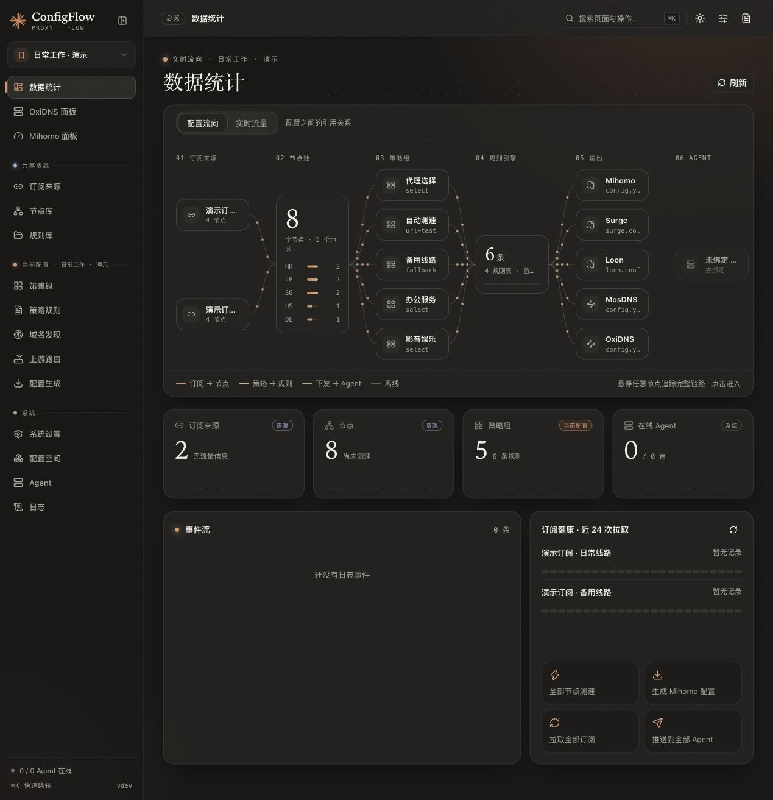
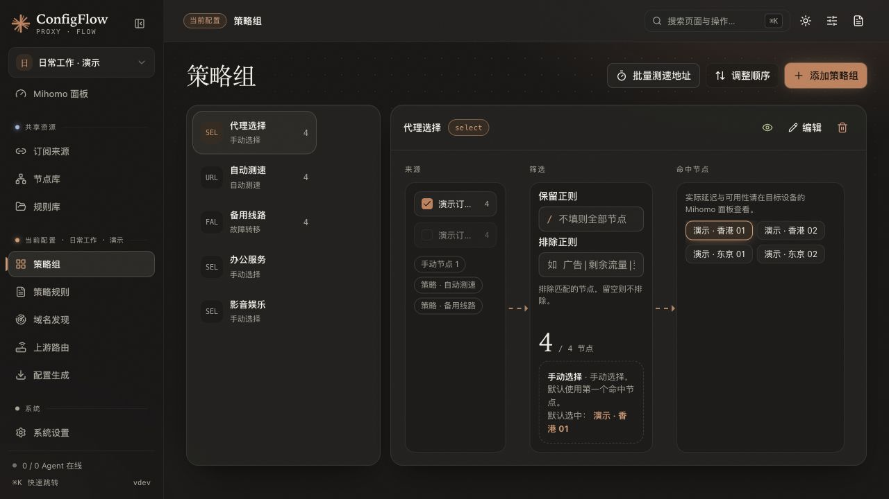

<div align="center">

# ConfigFlow

**把订阅、节点、规则和设备配置，放到一个面板里管理。**

支持生成 **Mihomo · Surge · Loon · MosDNS · OxiDNS** 配置

[](LICENSE)
[](https://hub.docker.com/r/thsrite/config-flow)
[](backend/requirements.txt)
[](frontend/package.json)

[核心功能](#核心功能) · [快速开始](#快速开始) · [第一次使用](#第一次使用) · [备份与升级](#备份与升级) · [常见问题](#常见问题) · [详细文档](#详细文档)

</div>

---

## 项目简介

ConfigFlow 是一个通过浏览器操作的代理与 DNS 配置管理平台。你可以集中维护订阅、节点和规则，为家庭、办公等不同场景分别设置配置，再下载到客户端，或通过 Agent 发布到远程设备。

日常操作可以在页面中完成；需要精细调整时，也能编辑配置原文。

> 开始使用前，请准备自己的可用订阅或节点，以及对应的代理客户端。需要远程管理时，再为目标设备安装 Agent。

## 核心功能

| 功能 | 可以做什么 |
| --- | --- |
| 🗂️ 多配置空间 | 为不同场景保存各自的策略组、规则和生成参数，共用一份订阅、节点与规则库 |
| 📦 订阅与节点 | 管理多个订阅，导入 URI、JSON、YAML 节点；内置 Sub-Store 处理订阅解析与格式转换 |
| 🔗 订阅聚合 | 将多个订阅和节点组合成新的来源，供策略组使用 |
| 🎯 策略组 | 手动选择、自动测速、故障转移、负载均衡，支持节点筛选、组间引用和跟随；Mihomo 另支持代理链 |
| 📚 规则管理 | 维护在线或本地规则集，调整匹配顺序，用「命中模拟」检查域名或 IP 会走哪条规则 |
| ⚡ 配置生成 | 在生成工作台查看结果、下载文件、复制配置链接，Loon 支持一键导入 |
| 📡 节点测速 | 从 ConfigFlow 所在机器通过节点访问测试地址，支持批量测试和独立测速 DNS 设置 |
| 🤖 Agent 管理 | 生成安装命令，查看在线状态、主机信息和日志，远程发布配置、重启服务 |
| 📊 运行面板 | 在 Mihomo 面板查看连接、切换节点和测速；在 OxiDNS 面板查看 DNS 统计、查询记录和清理缓存 |
| 🔭 域名发现 | 从 Mihomo Agent 收集域名，发现未覆盖或直连失败的请求，探测后补充规则，并支持地区检测 |
| 🌐 网关与路由 | 提供 Linux 选择性网关安装向导，以及 RouterOS 接入、路由预览、设备分流和可选的强制 DNS 管理 |
| 💾 备份与恢复 | 导出全部数据、单配置导入导出、脱敏分享，以及 WebDAV 手动和自动备份 |
| 🔌 MCP 服务 | 通过内置 `/mcp` 端点，让支持 MCP 的客户端调用资源管理、配置生成和设备管理工具 |

### 支持的生成格式

| 目标 | 下载内容 | 使用方式 |
| --- | --- | --- |
| **Mihomo / Clash Meta** | `mihomo.yaml` | 下载导入客户端，或使用配置链接 |
| **Surge** | `surge.conf` | 下载导入客户端，或使用配置链接 |
| **Loon** | `.lcf` 配置文件 | 下载、使用配置链接，或在 iOS 上一键导入 |
| **MosDNS** | `mosdns-config.zip` | 下载完整配置包，或通过 Agent 发布 |
| **OxiDNS** | `oxidns-config.zip` | 下载完整配置包，或通过 Agent 发布 |

已有的 **Mihomo、Surge、Loon、Shadowrocket 配置文件**，还可以通过「配置空间 → 导入客户端配置」转换为新的配置空间。Shadowrocket 当前属于导入来源。

> **MosDNS / OxiDNS 首次手动部署请下载完整 ZIP。** 配置链接返回的 YAML 不包含首次部署所需的全部规则和附加文件。

## 界面预览

截图更新于 **2026-10-21**，来自本地隔离演示环境。配置空间、订阅、节点与规则均为虚构数据，未接入真实订阅或设备，不含生产凭据。

### 数据统计



### 策略组管理



更多页面与新版分层选项说明见 [使用指南的界面预览](doc/README.md#界面预览)。

## 快速开始

推荐使用 **Docker Compose** 部署。镜像已经包含前端、后端、Sub-Store 和节点测速组件，无需分别安装。

### 1. 准备一个目录

先确认设备已安装 Docker 和 Docker Compose，然后在终端执行：

```bash
mkdir -p configflow
cd configflow
```

这个目录用于保存部署文件和运行数据。

### 2. 创建部署文件

在刚才的目录中新建 `compose.yaml`，复制以下内容。

**启动前，请替换密码和密钥两个占位值。** 密码用于登录面板；密钥用于保护登录凭证，建议使用至少 32 位的随机字符串。

```yaml
services:
  config-flow:
    image: thsrite/config-flow:latest
    container_name: config-flow
    ports:
      - "5010:80"
    volumes:
      - ./data:/data
    environment:
      DATA_DIR: /data
      TZ: Asia/Shanghai
      ADMIN_USERNAME: admin
      ADMIN_PASSWORD: "replace-with-a-strong-password"
      JWT_SECRET_KEY: "replace-with-at-least-32-random-characters"
    restart: unless-stopped
```

| 配置 | 含义 |
| --- | --- |
| `5010:80` | 使用设备的 `5010` 端口访问面板；端口被占用时，可改为 `5011:80` 等 |
| `./data:/data` | 将数据保存在部署文件旁的 `data` 文件夹中，重建容器后仍可保留 |
| `ADMIN_USERNAME` | 登录用户名，示例为 `admin` |
| `ADMIN_PASSWORD` | 你设置的登录密码 |
| `JWT_SECRET_KEY` | 登录凭证的签名密钥，请固定保存，不要每次重启都更换 |

NAS 用户也可以在容器管理工具的项目或 Compose 编辑器中填写同样的内容，并明确选择数据保存目录。

### 3. 启动服务

在 `compose.yaml` 所在目录执行：

```bash
docker compose pull
docker compose up -d
```

查看运行状态：

```bash
docker compose ps
```

遇到启动问题时查看日志：

```bash
docker compose logs --tail=100 config-flow
```

### 4. 打开面板

| 部署位置 | 浏览器中输入 |
| --- | --- |
| 当前电脑 | `http://localhost:5010` |
| NAS 或其他服务器 | `http://设备的IP地址:5010` |

例如，NAS 的 IP 是 `192.168.1.10`，就访问：

```text
http://192.168.1.10:5010
```

使用刚才设置的用户名和密码登录。

接着打开 **系统 → 系统设置**：

1. 将「服务域名」填为客户端和 Agent 都能访问的完整地址，例如 `http://192.168.1.10:5010`。
2. 在「访问令牌」中生成并保存令牌，用于保护配置链接。

> 有其他设备需要访问时，服务域名请填写 NAS 或服务器的实际地址。`localhost` 只表示发起访问的设备自己。
>
> **访问令牌同时授予 MCP 管理权限。含令牌的配置链接请像密码一样保管，不要公开分享。**

## 第一次使用

下面以生成 **Mihomo 配置**为例。

### 第一步：新建配置空间

打开 **系统 → 配置空间 → 新建配置空间**，填写：

| 项目 | 示例 |
| --- | --- |
| 标识 ID | `home` |
| 名称 | `家庭网络` |
| 说明 | 可选，可以留空 |

保存后，从配置选择器切换到「家庭网络」。

配置空间可以理解为一套独立方案。以后需要办公、备用等方案时，可以再创建或复制。

### 第二步：添加订阅

打开 **共享资源 → 订阅来源 → 添加订阅**：

1. 起一个方便辨认的名字。
2. 粘贴自己的订阅链接。
3. 按提供方说明选择格式；Clash / Mihomo 格式选择 Mihomo。
4. 第一次使用可保留默认更新间隔，保存后手动更新一次，确认能看到节点。

没有订阅、只有单个节点链接时，可以到 **共享资源 → 节点库** 添加。

### 第三步：创建策略组

策略组就是“一组可供选择的出口”。

打开 **当前配置 → 策略组 → 添加策略组**：

1. 名称填写 `代理选择`。
2. 类型选择「手动选择」。
3. 在「订阅筛选」中选择刚才添加的订阅；使用手动节点时，勾选「节点」来源，在「包含节点」中选择它们。
4. 第一次使用时，节点筛选条件可以留空。
5. 保存。

这样，这个组就能使用所选订阅或手动节点。

### 第四步：添加分流规则

打开 **当前配置 → 策略规则 → 添加规则**，可以先用下面两条熟悉操作：

| 顺序 | 类型 | 值 | 策略 | 效果 |
| --- | --- | --- | --- | --- |
| 1 | `DOMAIN-SUFFIX` | `example.com` | `DIRECT` | `example.com` 及其子域名直接连接 |
| 2 | `MATCH` | 留空 | `代理选择` | 其他请求交给刚才创建的策略组 |

**规则从上往下匹配，先匹配到的生效；`MATCH` 是兜底规则，应放在最后。**

添加完成后，打开「更多 → 调整顺序」，把 `DOMAIN-SUFFIX` 放在前面、`MATCH` 放在最后，再保存顺序。新添加的规则会出现在列表顶部，需要手动确认位置。

这是一份最小操作示例。日常使用时，可以在「规则库」添加所需规则集，再通过「策略规则 → 更多 → 添加规则集」指定它们使用的策略，并放在兜底规则之前。

页面中的「命中模拟」可以帮助检查某个域名或 IP 会匹配到哪里。

### 第五步：生成并导入客户端

打开 **当前配置 → 配置生成**：

1. 选择 **Mihomo**。
2. 点击「生成」，检查生成结果；出现错误时，按提示修改。
3. 点击「下载」，将文件导入自己的 Mihomo 客户端。
4. 也可以复制页面中的配置 URL，在客户端添加远程配置。
5. 在客户端启用这份配置，并选择可用节点。

使用配置链接，或配置内引用了在线订阅、规则时，客户端需要能持续访问 ConfigFlow。

## 多配置如何共用资源

| 内容 | 保存范围 |
| --- | --- |
| 订阅、节点、订阅聚合、规则库 | 所有配置空间共享 |
| 策略组、代理链、规则目标与顺序、各生成目标的参数 | 每个配置空间独立 |
| 服务域名、访问令牌、WebDAV、Agent 清单 | 系统全局 |
| Agent 实际使用的配置 | 由该 Agent 绑定的配置空间决定 |

- 添加共享订阅后，直接在策略组中选择它即可；没有引用的资源不会自动加入生成结果。
- 修改共享资源，会影响引用它的配置空间。
- 切换页面顶部的配置空间，只改变当前页面正在编辑的方案。
- Agent 始终使用自己绑定的配置，浏览器切换配置不会改变它的绑定。

详细说明见 [多配置、迁移与备份](doc/design/multi-config-management.md)。

## 远程设备与网关

需要管理服务器或网关时，打开 **系统 → Agent**，按页面生成安装命令，在目标设备执行，再绑定配置空间并发布。

| 场景 | 使用入口与说明 |
| --- | --- |
| 安装 Mihomo / OxiDNS 核心及 Agent | [安装、发布与回滚指南](docs/AGENT_OXIDNS.md) |
| Linux 设备作为选择性网关 | 「Agent → 生成安装脚本 → Linux 选择性网关」，参阅 [网关指南](docs/LINUX_GATEWAY.md) |
| 接入 RouterOS 并管理路由 | 「当前配置 → 上游路由」，参阅 [RouterOS 安装指南](docs/CONFIGFLOW_AGENT_ROUTEROS_INSTALL.md) |
| 设置 OxiDNS 分流、缓存和插件 | 「配置生成 → OxiDNS → 设置」，参阅 [OxiDNS 配置指南](docs/OXIDNS.md) |
| 查看 DNS 统计和查询历史 | 「总览 → OxiDNS 面板」；查询历史需先在配置中开启查询记录 |

Mihomo 和 OxiDNS 支持按设备开启规则自动同步；OxiDNS 还可跟随已成功发布的 Mihomo DNS 监听地址。相关功能需要匹配的 Agent 版本，并先成功手动发布一次配置，具体条件见安装指南。

Linux 网关向导适用于文档列出的 Linux 网络环境，包含网络检查、规则选择、安装、发布和转发应用步骤。建议先验证一台客户端，再扩大使用范围。

RouterOS 可通过 DHCP 下发 OxiDNS 地址；对手动指定其他 DNS 的设备，可按需开启 [强制局域网 DNS 走 OxiDNS](docs/CONFIGFLOW_AGENT_ROUTEROS_INSTALL.md#dns-guard)。它只处理指定入口的 IPv4 DNS 流量，不包含 IPv6 或 HTTPS 加密 DNS。

## 部署参数

以下环境变量在修改部署文件并重建容器后生效：

| 变量 | 默认值 | 说明 |
| --- | --- | --- |
| `ADMIN_USERNAME` | 空 | 登录用户名，与密码同时设置后开启登录验证 |
| `ADMIN_PASSWORD` | 空 | 登录密码 |
| `JWT_SECRET_KEY` | 进程启动时随机生成 | 建议自行固定设置，避免重启后已有登录凭证失效 |
| `DATA_DIR` | `/data` | 数据保存目录，需要持久挂载 |
| `TZ` | 镜像中为 `Asia/Shanghai` | 容器时区 |
| `CONFIGFLOW_HTTP_THREADS` | `8` | 后端同时处理请求的工作线程数，可设为 `1–64` |
| `LOG_LEVEL` | `INFO` | 日志级别；`DEBUG` 会启用开发调试模式 |

示例已开启登录验证。若用户名或密码未设置完整，则不会开启账号密码登录。

## 备份与升级

### 日常备份

在 **系统设置 → 备份与恢复**中选择：

| 操作 | 适合用途 |
| --- | --- |
| 导出全部数据 | 备份共享资源、全部配置空间、系统设置和 Agent |
| 脱敏导出 | 隐藏敏感信息后分享排查，不能代替恢复备份 |
| WebDAV 备份 | 将完整配置数据备份到自己的 WebDAV 服务，可开启自动备份 |
| 配置空间中的导入 / 导出 | 迁移单个空间的引用与独立参数，不能代替全量备份 |

**导入全部数据会覆盖全局数据，不只影响当前配置空间。完整备份包含凭据，请妥善保存。**

当前数据保存在数据目录的 `configflow.sqlite3` 中。完整备份可以用「导出全部数据」/ WebDAV，或者**先停止服务**再复制整个数据目录。服务运行时不要单独复制 `configflow.sqlite3`，复制到的可能是写到一半的状态。

### 更新镜像

升级前，记录当前镜像版本和数据目录，并备份完整数据目录。

以下命令适用于上文的 `./data:/data` 示例，请在 `compose.yaml` 所在目录执行：

```bash
docker compose stop

cp -a ./data "./data-backup-$(date +%Y%m%d-%H%M%S)"
```

确认备份成功后，再继续更新：

```bash
docker compose pull
docker compose up -d
docker compose logs --tail=100 config-flow
```

使用 NAS 管理工具部署时，也可以先停止项目、复制实际数据目录，再更新镜像并启动。

### 从旧版升级

- 当前源码支持原版单文件配置，以及旧版 `system.json` 加 `profiles/<id>/config.json` 的多配置目录迁移。
- **旧版多配置必须备份整个数据目录，不能只复制根目录的 `config.json`。**
- 新版本首次启动时会把旧配置迁移到 `configflow.sqlite3`，并在 `migrations/` 下保存迁移前快照。`config.json` 原样保留作为迁移前副本，之后不再写入。
- 回退到旧版本（包括自动更新失败后回到镜像内置版本）时，旧版本只能看到迁移那一刻的数据。回退期间在旧版本里做的修改（无论旧版本是多配置版还是原版单文件版，只要写在 `config.json` 里），会在下次升级启动时先备份数据库、再自动导入；没有修改的 `config.json` 不会被导入。导入会整体替换迁移后在新版本里做的修改，导入前的数据库保存在 `migrations/<时间戳-标识>/legacy-config/`，可从那里找回。回退到使用 `system.json` 与 `profiles/<id>/config.json` 的分目录版本时，修改不在根目录 `config.json` 里，不会被导入。
- 升级前请确认目标镜像已包含所需迁移修复；仅看 `latest` 标签无法判断具体包含哪些修改。
- 已成功写入当前格式的数据，不会在重启时被旧目录自动覆盖。
- 迁移后发现配置减少时，先核对数据挂载、日志和备份，保留旧文件；不要通过删除配置或修改版本号尝试恢复。

如果改用仓库中的 `docker/docker-compose.yml`，注意它的 `./data` 相对于 `docker/` 目录解析。迁移部署文件时，请明确填写原数据目录，避免挂载到一个新的空目录。

完整迁移范围与恢复方法见 [升级、备份与恢复说明](doc/design/multi-config-management.md#升级备份与恢复)。

## 常见问题

### 需要另外部署 Sub-Store 吗？

使用当前 Docker 镜像时不需要，镜像已经内置。可以在「系统设置 → 第三方依赖」检查状态并在线更新。

旧部署文件中的独立 `sub-store` 服务和 `SUB_STORE_URL` 环境变量已不再使用。

### 订阅更新间隔和 Mihomo 同步间隔有什么区别？

| 设置位置 | 控制什么 | 设为 `0` 时 |
| --- | --- | --- |
| 订阅来源 → 编辑 → 订阅源更新间隔 | ConfigFlow 多久允许重新访问一次订阅提供方 | 只使用手动更新得到的缓存；首次使用前需手动更新 |
| 配置生成 → Mihomo → 基础配置 → 订阅同步间隔 | Mihomo 多久从 ConfigFlow 同步订阅和聚合，默认 3600 秒 | 关闭这项定时同步 |

订阅源的正数间隔表示：**到期后的下一次请求可以刷新**，并不是面板每天在固定时间主动更新。

Mihomo 同步间隔修改后，需要保存并发布到设备才会生效。连续点击更新时，也可能复用缓存或进入失败后的等待期，请按页面提示处理。

### 添加了订阅，为什么生成的配置里没有节点？

先确认已成功更新订阅，再检查当前配置的策略组是否选择了这个订阅。共享资源需要被当前配置使用，才会加入生成结果。

### 为什么看不到「订阅聚合」？

到「系统设置 → 服务配置」开启「订阅聚合」，资源分组中就会显示入口。

### 节点库测速正常，设备上却不正常？

节点库测速从 **ConfigFlow 所在机器**发起，设备实际使用的是自己的网络，两者的 DNS、出口和连接情况可能不同。

节点服务器域名被解析为 Fake-IP 时，可以在「节点库 → 测速设置 → 测速 DNS」中填写能够返回真实 IP 的 DNS。详见 [节点测速说明](docs/NODE_LATENCY.md)。

### 为什么不能删除订阅、节点或规则资源？

资源可能仍被配置空间或聚合使用。先根据页面提示取消相关引用，再删除。删除订阅前，还需要移除从该订阅获取的节点。

## 项目结构

```text
configflow/
├── backend/                   # Python 后端
│   ├── app.py                 # 应用入口
│   ├── common/                # 认证、配置与数据管理
│   ├── routes/                # API 接口
│   ├── converters/            # 五种目标格式的生成器
│   ├── agents/                # 设备管理与 Go Agent
│   ├── node-probe/            # 独立节点测速组件
│   ├── mcp_server/            # MCP 服务
│   └── utils/                 # 订阅、规则、备份等工具
├── frontend/                  # Vue 3 + TypeScript 前端
│   └── src/
│       ├── views/             # 页面
│       ├── components/        # 组件
│       └── api/               # 接口调用
├── docker/                    # 镜像构建与部署文件
├── doc/                       # 入门和功能使用文档
├── docs/                      # 专题部署与维护文档
├── scripts/                   # 检查与测试工具
└── .github/workflows/         # 自动检查与镜像发布
```

| 部分 | 主要技术 |
| --- | --- |
| 后端 | Python 3.11、Flask、Waitress、PyYAML |
| 前端 | Vue 3、TypeScript、Vite、Tailwind CSS 4、Reka UI |
| 订阅处理 | 内置 Sub-Store |
| 设备与测速 | Go Agent、独立节点测速程序 |
| 容器部署 | Docker、Nginx、Supervisor |

## 详细文档

| 我想了解…… | 文档 |
| --- | --- |
| 完整功能和使用流程 | [使用指南](doc/README.md) |
| Docker 部署 | [部署指南](doc/module/deployment.md) |
| 策略组设置 | [策略组说明](doc/module/proxy-groups.md) |
| 分流规则设置 | [规则说明](doc/module/rules.md) |
| 多配置与旧数据迁移 | [多配置管理](doc/design/multi-config-management.md) |
| OxiDNS 参数和配置包 | [OxiDNS 配置与发布](docs/OXIDNS.md) |
| Agent 安装、监控与回滚 | [Agent 指南](docs/AGENT_OXIDNS.md) |
| Linux 网关安装 | [Linux 选择性网关](docs/LINUX_GATEWAY.md) |
| RouterOS 配合部署 | [ConfigFlow + RouterOS](docs/CONFIGFLOW_AGENT_ROUTEROS_INSTALL.md) |
| 域名采集和探测 | [域名发现](doc/module/domain-discovery.md) |
| 节点测速原理与配置 | [节点库代理延迟](docs/NODE_LATENCY.md) |
| 接入 MCP 客户端 | [MCP 服务](doc/module/mcp.md) |
| 项目回归检查 | [CI 与测试说明](scripts/ci/README.md) |

## 许可证

主应用使用 [MIT License](LICENSE)。

独立节点测速组件复用 Mihomo 协议实现，按 [GPLv3](backend/node-probe/LICENSE) 分发，相关源码和依赖位于 `backend/node-probe/`。

## 交流

- [Telegram 交流群](https://t.me/+fLt02_w38205OTNh)

---

## ❤️ 赞助支持

如果这个项目对你有帮助，欢迎赞助支持开发者持续维护！

<a href="https://ifdian.net/order/create?user_id=1ed9d800ada811f0bdbe52540025c377&remark=&affiliate_code=" target="_blank">
  
</a>

### 🏆 发电排行榜

感谢以下用户的赞助支持！

<table>
<tr>
<td align="center">
<br/>
<sub><b>爱发电用户_740f4</b></sub>
</td>
</tr>
</table>

---

<div align="center">

**⭐ 如果觉得有用，请给个 Star 支持一下！**

Made with ❤️ by [thsrite](https://github.com/thsrite)

</div>
