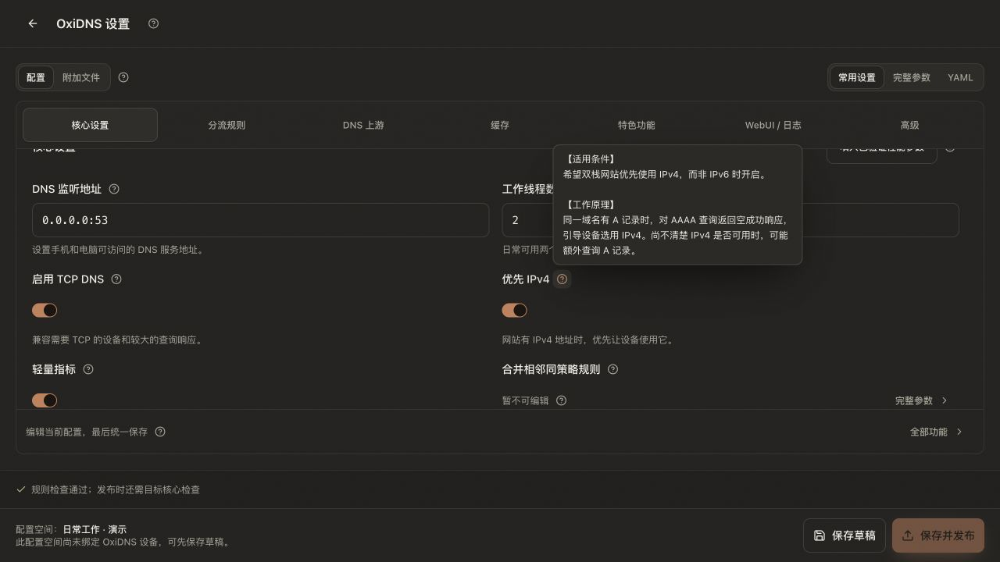

# ConfigFlow 使用指南

ConfigFlow 用来集中管理代理订阅、节点和规则，为不同设备或场景生成配置。日常操作在浏览器完成；需要远程发布、监控或网关功能时，再安装 Agent。

**第一次使用：**先按 [README 快速开始](../README.md#快速开始) 部署，再按 [第一次使用](../README.md#第一次使用) 完成一份 Mihomo 配置。

## 先找到对应入口

| 导航分组 | 页面 | 用途 |
| --- | --- | --- |
| 总览 | 数据统计、Mihomo 面板、OxiDNS 面板 | 查看配置健康和已接入设备的运行情况 |
| 共享资源 | 订阅来源、节点库、订阅聚合、规则库 | 维护所有配置共用的资源；聚合入口需在系统设置开启 |
| 当前配置 | 策略组、策略规则、域名发现、上游路由、配置生成 | 编辑顶部所选配置空间 |
| 系统 | 系统设置、配置空间、Agent、日志 | 管理服务、配置方案、设备和备份 |

桌面通过侧栏导航，手机通过底部分组和组内入口切换。页面上的作用域提示可以帮助确认本次修改影响哪里。

## 从资源到可用配置

1. **选择配置空间。** 在「系统 → 配置空间」新建，例如标识 `home`、名称「家庭网络」，再从顶部切换过去。
2. **添加订阅或节点。** 在「共享资源」添加自己的订阅并手动更新一次，或粘贴已有节点。ConfigFlow 不提供代理节点。
3. **创建策略组。** 在「当前配置 → 策略组」添加「代理选择」，选择订阅或手动节点；首次使用可以保留默认参数。
4. **安排规则。** 在「策略规则」添加单条规则或引用规则库，指定直连、拒绝或某个策略组。新增规则在列表顶部，通过「更多 → 调整顺序」把兜底 `MATCH` 放在最后并保存。
5. **生成和使用。** 在「配置生成」选择目标，点击「生成」，检查结果，再下载或复制配置 URL 到客户端。远程设备需要在 Agent 页面绑定配置并发布。

> 订阅、节点、聚合和规则库由所有配置共用；策略组、规则目标和生成参数分别保存。浏览器切换配置空间不会改变 Agent 的绑定。

## 支持哪些格式

| 目标 | 下载内容 | 说明 |
| --- | --- | --- |
| Mihomo / Clash Meta | `mihomo.yaml` | 支持配置 URL |
| Surge | `surge.conf` | 支持配置 URL；不能导出 Mihomo 代理链 |
| Loon | `.lcf` | 支持配置 URL 和 iOS 一键导入 |
| MosDNS | `mosdns-config.zip` | 包含主配置、规则和附加文件 |
| OxiDNS | `oxidns-config.zip` | 独立于 MosDNS 保存设置，支持 Agent 校验与发布 |

MosDNS / OxiDNS 的配置 URL 只返回 YAML；首次手动部署需要完整 ZIP。已有 Mihomo、Surge、Loon、Shadowrocket 配置，可在「配置空间 → 导入客户端配置」转换为新空间，导入结果会列出未支持的内容。

## 功能文档

| 我想做什么 | 查看文档 |
| --- | --- |
| 添加、更新订阅 | [订阅来源](module/subscription.md) |
| 添加、批量导入和测试节点 | [节点库](module/nodes.md) |
| 设置自动选择、故障转移或代理链 | [策略组](module/proxy-groups.md) |
| 维护在线或本地规则集 | [规则库](module/rule-library.md) |
| 安排规则顺序、模拟命中 | [策略规则](module/rules.md) |
| 下载文件、复制链接、备份配置 | [配置生成与备份](module/generate.md) |
| 发现域名并补充分流 | [域名发现](module/domain-discovery.md) |
| 管理多套方案、恢复旧数据 | [多配置与迁移](design/multi-config-management.md) |
| 用 MCP 客户端调用工具 | [MCP 服务](module/mcp.md) |

## 部署与设备文档

| 场景 | 查看文档 |
| --- | --- |
| 普通 Docker / NAS 主机 | [部署指南](module/deployment.md) |
| Mihomo / OxiDNS 安装及远程管理 | [Agent 安装、发布与回滚](../docs/AGENT_OXIDNS.md) |
| OxiDNS 参数、插件及配置包 | [OxiDNS 配置](../docs/OXIDNS.md) |
| Linux 选择性网关 | [Linux 网关安装向导](../docs/LINUX_GATEWAY.md) |
| RouterOS Container 与设备分流 | [ConfigFlow + RouterOS](../docs/CONFIGFLOW_AGENT_ROUTEROS_INSTALL.md) |
| 节点库测速 DNS、超时及组件安装 | [节点测速](../docs/NODE_LATENCY.md) |

## 备份前先分清范围

- 「系统设置 → 导出全部数据」用于完整配置备份，包含所有空间、共享资源、系统设置和 Agent。
- 「脱敏导出」适合分享排查，不能作为恢复备份。
- 「配置空间」导出只包含该空间的引用和独立参数，不携带共享资源本体。
- 更新镜像或迁移主机前，停服备份整个数据目录；只保存 `configflow.sqlite3` 或根 `config.json` 无法覆盖旧版多配置目录和运行缓存。

含访问令牌的配置链接同时具有 MCP 管理权限，请按密码保管。升级和恢复步骤见 [部署指南](module/deployment.md#备份与升级)。

## 界面与操作

支持深浅主题、移动端导航、键盘焦点与快速跳转。表单或配置页提示未保存时，先保存或取消再离开。排序模式需要显式保存，取消会恢复旧顺序。

共享资源无法删除时，按提示先解除配置或聚合中的引用；删除订阅还需移除从该订阅获取的节点。

## 界面预览

截图更新于 **2026-10-21**，均从本地隔离演示环境实际截取。仅使用虚构配置与缓存数据，未连接真实订阅或设备；节点地址使用文档专用 IP，规则使用 `.example` 域名，不含生产凭据。

### 配置生成工作台

选择目标软件后生成预览，再按需下载或发布。图中展示 OxiDNS 演示配置；未绑定设备时不能发布。

### 分层选项说明

选项下方先说明效果或适用场景，问号中的详细帮助按「适用条件 / 工作原理」分段，便于快速决策与核对技术细节。

各功能文档还提供 [订阅来源](module/subscription.md#界面预览)、[节点库](module/nodes.md#界面预览)、[策略组](module/proxy-groups.md#界面预览)、[规则库](module/rule-library.md#界面预览) 和 [策略规则](module/rules.md#界面预览) 的当前界面截图。

[Telegram 交流群](https://t.me/+fLt02_w38205OTNh)

## 实现参考

页面与分组名称来自 [导航定义](../frontend/src/navigation.ts)，生成目标来自 [生成工作台](../frontend/src/views/Generate.vue)，数据范围来自 [配置仓库](../backend/common/config_repository.py)。
