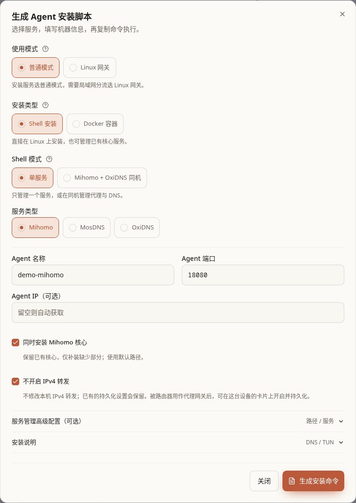
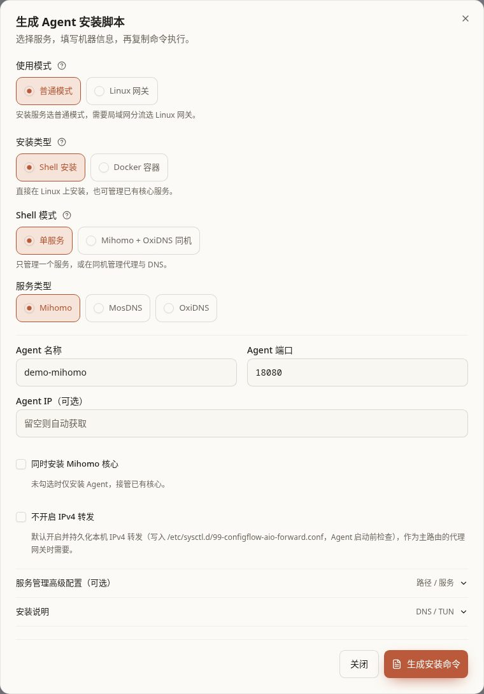
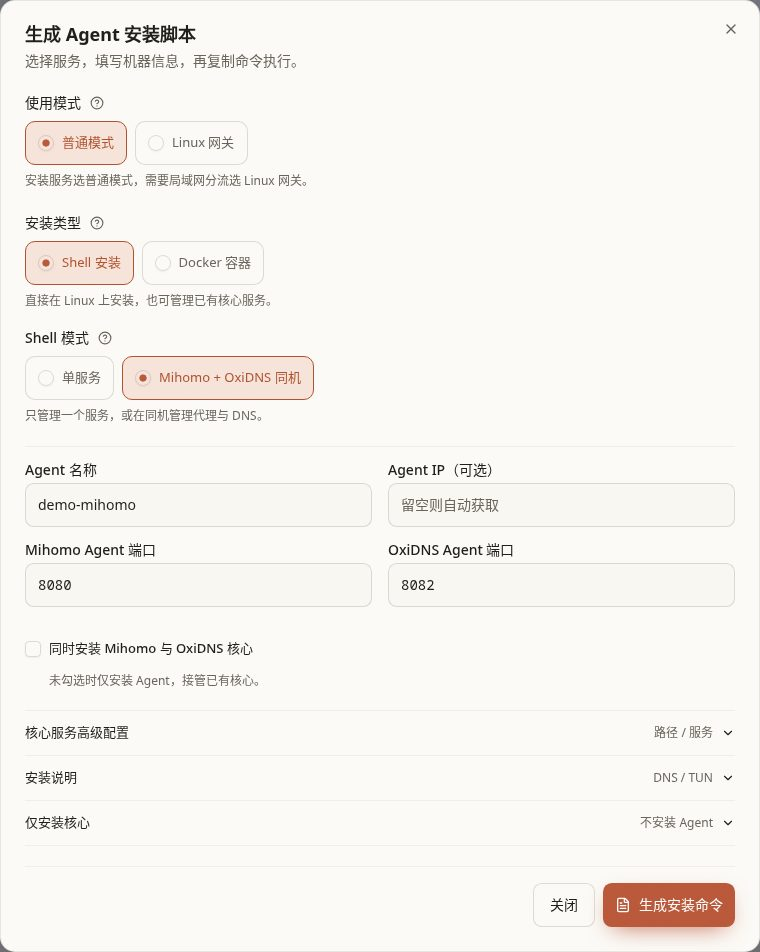
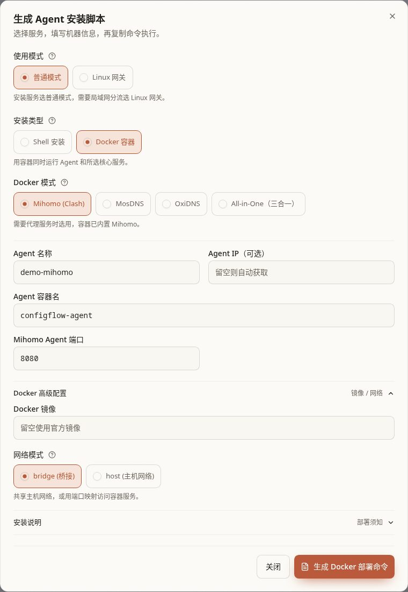
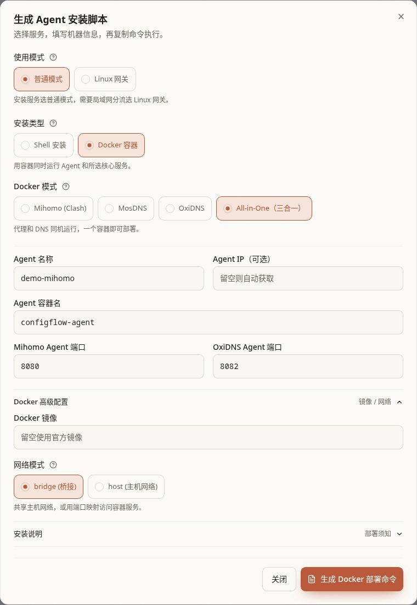

[文档首页](../README.md)

# 安装与接入设备

本章帮助你把实际运行代理或 DNS 的设备接入 ConfigFlow。**Agent 是设备上的小助手**，负责收配置、报状态；**核心是实际处理连接或查询的程序**，例如 Mihomo、OxiDNS、MosDNS。只装 Agent 不会凭空多出代理或 DNS 服务。

第一次安装整套 Linux 分流方案，建议先用 [首次使用向导](first-run.md)。本章用于单独装服务、接管已有服务、Docker／NAS、RouterOS，以及了解各种安装选项。

选择下面与你设备相符的安装方式，页面只显示这一种方式的步骤。已有程序不用先卸载，Linux 安装里有“接管已有程序”选项。

## 开始前准备

1. 确认 [管理面板](install.md)能打开。在「系统设置 → 服务域名」填写设备能访问的完整地址，例如 `http://192.168.1.10:5010`。
2. 确认目标设备能访问该地址，面板也能访问目标设备的 Agent IP 和端口。不同网段、Docker bridge、NAS 防火墙尤其要检查。
3. 为需要被其他设备访问的核心保留固定局域网 IP。
4. 已有核心时，先记下它使用的程序、配置路径、服务名称，并备份原配置。不要仅凭某个目录“看起来像默认目录”就接管。
5. Shell 路线准备 root、systemd 或 OpenRC，以及 curl／wget 中至少一种下载工具。安装器会检查并补齐所需依赖；仍需能够访问下载地址。
6. Docker 路线准备 Docker、可写的数据目录，以及没有冲突的 DNS、Agent、代理端口。

**Agent 端口、DNS 端口、面板端口是三件事。** `5010` 是本指南的面板访问示例；`8080／8082` 常用作两个 Agent 的管理端口；DNS 通常使用 `53`，同机 Mihomo DNS 常使用 `1053`。不能把 Agent 端口填到手机的 DNS 地址中。

普通安装入口：进入「系统 → Agent」，点击「生成安装脚本」。新开窗口默认「普通模式 → Shell 安装 → 单服务 → Mihomo」。填完后生成的是命令文本，**还需在目标设备执行才开始安装**。

## 先选安装路线

<DocsTabs id="agent-install-method" label="设备安装方式" :tabs='[{"id": "linux-install", "label": "Linux 安装"}, {"id": "docker", "label": "Docker / NAS"}, {"id": "gateway", "label": "Linux 网关"}, {"id": "routeros", "label": "RouterOS"}, {"id": "ha", "label": "OxiDNS 双机备用"}]'>

<template #linux-install>

命令要在准备运行核心的 Linux 设备上执行。先按服务数量或现有安装情况选择；复制命令后仍需执行，页面不会自动帮你安装。

装在 iKuai 虚拟机里？先准备 Linux

### iKuai 虚拟机：先准备 Linux

iKuai 负责提供一台虚拟电脑，Alpine 等 Linux 系统运行在里面，Mihomo、OxiDNS 和 Agent 再安装到 Linux。ConfigFlow 的安装命令不负责创建虚拟机或安装操作系统。

1. 在 iKuai 的「高级服务 → 虚拟机」添加 Linux 虚拟机，准备系统磁盘和 Linux 安装镜像。网卡桥接到实际使用的 LAN，让它能取得独立的局域网 IP；不要照抄其他设备的接口名称。
2. 从安装镜像启动，按 Linux 安装程序完成磁盘安装。选择 Alpine 时使用与机器架构相符的虚拟机镜像；安装到磁盘后，改为从系统磁盘启动并移除安装光盘。**安装时只选择为这台虚拟机新建的磁盘**，不要覆盖存放其他数据的磁盘。
3. 先确认 Linux 能联网，并能打开面板的服务地址。为它保留一个未被占用的固定 IP，默认网关填写 iKuai 的 LAN 地址；若用 DHCP 固定分配，核对绑定的是这台虚拟机的 MAC 地址。
4. 准备 root 终端与远程登录方式。Alpine 使用 OpenRC，其他系统可能使用 systemd，安装器会按实际系统处理。若网页 VNC 粘贴长命令后符号不对，先完成网络和 SSH 登录，再在 SSH 终端执行面板生成的命令。
5. 按实际组合继续：只增加 OxiDNS、已有另一台 Mihomo 时，使用 [Shell 单服务](#shell-single)；两项核心都放在这台 Linux 时，使用 [Shell 同机双服务](#shell-aio)。新机器勾选安装对应核心，已有服务按 [接管已有服务](#shell-existing)填写。
6. 发布配置并检查一台客户端，确认 DNS、代理和重启后运行都正常，再启用虚拟机开机自启或扩大接入范围。

**主路由分流时，地址按作用填写：**客户端网关仍指向 iKuai，DNS 指向运行 OxiDNS 的设备；转交给 Mihomo 的连接，下一跳填运行 Mihomo 的设备 IP。两项核心同机时，这两个设备 IP 才可能相同。需要主路由把连接交给 Mihomo 时，接着看 [上游路由](../manual/routers.md)：同网段部署确实需要回复经过主路由时，使用“自动配置回流”，核对差异后发布。它会处理相应受管规则；不要再叠加旧教程中的手工回流命令。若选择的是让客户端直接使用 Linux 作网关，按 [首次向导中的方案说明](first-run.md#choose)接入，不照搬这里的客户端网关地址。

<DocsTabs id="linux-install-choice" label="Linux 安装内容" :tabs='[{"id": "shell-single", "label": "一个服务"}, {"id": "shell-aio", "label": "Mihomo + OxiDNS"}, {"id": "shell-existing", "label": "接管已有程序"}, {"id": "cores-only", "label": "只安装核心"}]'>

<template #shell-single>

### Shell 单服务

#### 操作步骤

1. 选择「普通模式 → Shell 安装 → 单服务」。
2. 在「服务类型」选择 Mihomo、OxiDNS 或 MosDNS。
3. 填「Agent 名称」，建议用 `home-mihomo` 这类名字。只能使用字母、数字、短横线、下划线。
4. 核对「Agent 端口」。每次新开安装窗口会生成一个 `10000–60000` 范围的随机端口，可改为 `1024–65535` 中空闲的整数；安装核心时还要避开核心 DNS 端口。
5. 「Agent IP（可选）」可先留空让程序识别；多网卡、容器或识别错误时填面板实际能连接的地址。这里不会修改目标设备的 IP。
6. 按下表决定是否安装核心。已有自定义服务时展开高级配置，按 [接管已有服务](#shell-existing)填写。
7. 点击「生成安装命令」，选 curl 或 wget，复制到目标 Linux 的 root 终端执行。有安装／卸载菜单时选择安装项 `1`。
8. 等终端完成，再回 Agent 页确认在线状态。命令链接过期时重新生成；修改表单会使旧的页面生成结果失效，执行前重新复制最新命令。

#### 勾选和服务选择

| 选项 | 默认 | 适合谁／建议 | 勾选后的效果 | 不勾选后的效果与网络影响 |
| --- | --- | --- | --- | --- |
| 同时安装 Mihomo 核心 | **未勾选**；只在 Mihomo 单服务出现 | 新设备还没有 Mihomo 时勾选 | 先安装或保留默认布局的 Mihomo，再装 Agent；新核心会启动 | 只安装 Agent，要求已有可接管的 Mihomo；并不代表下方 IPv4 转发一定不变 |
| 同时安装 OxiDNS 核心 | **未勾选**；普通 OxiDNS 单服务 | 新设备还没有 OxiDNS 时勾选 | 先安装或保留默认布局的 OxiDNS，再装 Agent；新核心会监听 DNS 53 | 只装 Agent，要求已有 OxiDNS；自定义目录应不勾选并填写实际路径 |
| 不开启 IPv4 转发 | **未勾选**；只在 Shell 单独 Mihomo 出现 | Linux 要作为主路由的代理网关时保持未勾；只想接管本机服务、不希望安装器管理转发时勾选 | 不修改本机 IPv4 转发，已有持久化设置也保留；它不是“关闭转发”按钮 | 标准 systemd／OpenRC 安装会开启并持久化 IPv4 转发。这在执行安装命令时发生，不等到首次发布 |

MosDNS 单服务只安装 Agent：先自行准备可运行的 MosDNS 和系统服务，再接入。界面没有“同时安装 MosDNS 核心”选项。

图中演示“补装核心，但不让安装器修改 IPv4 转发”的选择，**两项都是手动勾选，初始默认均未勾选**。名称 `demo-mihomo` 和端口 `18080` 仅为示例；尚未生成或执行安装命令。

展开对照：两个勾选都保持默认时

采用自定义启停命令管理 Mihomo 时，「不开启 IPv4 转发」不可操作，安装器不会自动管理此项。若已有 Linux 网关接管记录导致安装器停止，应按提示勾选跳过转发、重新生成，或回到原网关管理流程处理，不能直接删除记录来绕过检查。

#### 新核心初始会做什么

| 新装核心 | 初始行为 | 尚未完成的事情 |
| --- | --- | --- |
| Mihomo | DNS 监听 `1053`，使用公共上游；检查 TUN 设备与权限，通过时启用 TUN 和自动路由，不通过时关闭并提示 | 初始没有你的代理节点，流量按直连处理；之后仍需保存、发布自己的配置 |
| OxiDNS | DNS 监听 `53`，使用公共 DNS 上游，可以独立运行 | 不会自动部署另一台 Mihomo；需要代理 DNS 时以后在设置中配置 |

TUN 是 Mihomo 接收连接用的虚拟网卡。新装 Mihomo 启用自动路由时，**会影响这台 Linux 自己的路由处理**，不要把“没有代理节点”理解为完全不改网络。已有核心及配置会保留；重跑安装器也不会自动把原来关闭的 TUN 改成开启。

</template>

<template #shell-aio>

### Shell 同机双服务

#### 操作步骤

1. 选择「普通模式 → Shell 安装 → Mihomo + OxiDNS 同机」。
2. 填 Agent 名称前缀和可选 IP。
3. 核对两个 Agent 端口：默认 Mihomo `8080`、OxiDNS `8082`；两者不能相同，也不要占用核心 DNS 端口。
4. 新设备勾选「同时安装 Mihomo 与 OxiDNS 核心」；已有核心则保留不勾选并核对高级配置。
5. 点击「生成安装命令」，在目标 Linux 以 root 执行，菜单中选择安装项。
6. 回面板确认出现两个独立 Agent，再检查它们绑定的配置空间。

同机模式分别显示两项 Agent 端口，安装核心仍需明确勾选。截图为隔离演示，已有核心时不要为了照图而覆盖自己的端口和路径。

| 选项 | 默认 | 勾选时 | 不勾选时 | 何时影响网络 |
| --- | --- | --- | --- | --- |
| 同时安装 Mihomo 与 OxiDNS 核心 | **未勾选** | 补装缺少的核心，保留已有核心与配置；使用默认路径，高级路径输入不可编辑 | 要求两个核心及系统服务已经存在；可填写自定义路径 | 新核心会在安装期间启动；新 Mihomo 的 TUN 检查通过时可能调整本机路由 |

**普通 Shell 同机安装会开启并持久化 Linux 的 IPv4 转发，即使没有勾选补装核心。** 这只是让 Linux 具备转发能力，并不替你添加主路由静态路由、修改手机网关或创建 Linux 网关的选择性接管规则。这里没有单服务 Mihomo 的“不开启 IPv4 转发”勾选。

新装默认 DNS 关系为：OxiDNS `53` → 同机 Mihomo `127.0.0.1:1053`。已有配置不会被安装阶段强行改写，应自行核对已有 OxiDNS 上游和 Mihomo 的 DNS 监听。后续发布仍会检查实际 DNS 设置。

普通单服务的旧共享 Agent 安装与同机的两个独立 Agent 目录不同。检测到旧共享部署时，同机安装器会停止；按终端提示先处理旧 Agent 并保留核心配置，不要往同一个目录叠装。卸载小助手不等于卸载代理／DNS 核心，也不等于恢复原来的网络接入。

</template>

<template #shell-existing>

### 接管已有服务与高级字段

已有核心使用自定义目录时，**取消勾选“同时安装核心”**，再展开「服务管理高级配置（可选）」或同机模式的「核心服务高级配置」。安装器不会根据填入的路径搬动你的原文件。

| 字段 | 默认／建议 | 填写后怎么使用 | 填错的后果／何时生效 |
| --- | --- | --- | --- |
| 配置文件路径 | `/etc/服务名/config.yaml`；已有服务填它真正读取的完整文件路径 | Agent 发布时管理这个文件；必须包含文件名 | 接管检查可能失败；若指向错误文件，原服务也不会读取你想发布的内容 |
| 服务管理方式 | 自动识别 systemd／OpenRC | 使用目标系统的服务管理器；只有标准方法不适用时才选「自定义命令」 | 决定以后的状态检查、停止、启动、重启与恢复方式 |
| 服务名称 | 单服务留空按核心名查找；同机默认 `mihomo`、`oxidns` | 填真实 systemd 单元或 OpenRC 服务名 | 它不是设备备注，不会重命名现有服务；错名可能无法控制服务 |
| 内核程序路径 | 可留空按程序名查找；同时安装核心时固定默认路径 | 填实际程序名或绝对路径 | 用于检查和管理实际运行的核心，应与服务使用的程序一致 |
| 重启命令（可选） | 标准系统服务留空 | 自定义部署可指定真实的重启操作 | 发布或点重启时执行，不是填完输入框立即执行 |
| 停止命令、启动命令、状态检查命令 | 自定义命令场景必须配套填写 | Agent 用来安全切换服务，并在发布失败时恢复 | 状态检查必须“运行时退出码为 0、未运行时非 0”；不能只打印一段“已启动”文字 |

同机模式分别填写两项核心的配置路径、服务名、程序路径，使用 systemd／OpenRC 管理。需要更特殊的单服务启停命令时，用对应单服务入口。

OxiDNS 有额外要求：启动参数 `-d` 指定的工作目录必须和配置文件所在目录一致，例如 `/opt/oxidns/config.yaml` 对应 `-d /opt/oxidns`。配置在 `/etc`、工作数据在 `/var/lib` 的分离布局不能直接套用这里的接管流程，应先按原服务的部署方式调整布局和规则资源，再接入。

安装接管期间会检查环境和现有核心；新配置真正投入使用要等后面的发布。先保留备份，读清检查结果，再发布，避免把“Agent 在线”当作旧配置已转换完成。

</template>

<template #cores-only>

### 只安装核心

适合想先把程序装好、暂时不接入面板的人。它与“只安装 Agent”正好是两个不同入口。

1. 在普通 Shell 安装中选择「Mihomo + OxiDNS 同机」。
2. 保持「同时安装 Mihomo 与 OxiDNS 核心」**未勾选**。
3. 展开「仅安装核心」。这一部分不用填写 Agent 名称或端口。
4. 选择要装的核心，点击对应的「生成…安装命令」，复制后以 root 执行。

| 选择 | 默认 | 执行后的行为 |
| --- | --- | --- |
| Mihomo + OxiDNS | 默认选择 | 补装缺少的 Mihomo、OxiDNS；新 OxiDNS 使用同机 Mihomo `1053` 作为上游，已有配置保留 |
| 仅 Mihomo | 未选 | 只补装 Mihomo，DNS 监听 `1053`；TUN 可用时启用，初始无节点、直连 |
| 仅 OxiDNS | 未选 | 只补装 OxiDNS，监听 `53`、使用公共上游，不依赖 Mihomo |
| curl／wget | 默认 curl | 只改变下载命令所用工具，不改变安装内容；目标机器有哪个就选哪个 |

仅装核心使用固定默认路径，不读取上方 Agent 高级路径。它会启动新核心，但**不安装或注册 Agent，不自动开启 IPv4 转发**；需要转发时会给出提示。已有 Mihomo 时要确认其 DNS 能从同机 `127.0.0.1:1053` 访问，才能供新装的 OxiDNS 使用。装好后想在 Web 管理，再按单服务或同机流程安装 Agent。

</template>

</DocsTabs>

</template>

<template #docker>

### Docker 单服务与双服务

#### 操作步骤

1. 进入「生成安装脚本 → 普通模式 → Docker 容器」。
2. 选择 Docker 模式，按下表核对内置服务。
3. 填名称、Agent 容器名、可选 Agent IP 和所需 Agent 端口。Docker 容器名会用作生成名称的前缀，最终名称以生成内容及上线卡片为准。
4. 展开「Docker 高级配置」，选择网络方式。普通页面默认 **bridge（桥接）**，不是 host。
5. 点击「生成 Docker 部署命令」，阅读生成的 Compose 和 Docker Run；选一种使用，不要两种都执行。
6. 推荐把 Compose 内容保存为目标设备上的 `compose.yaml`，在同一目录运行 `docker compose up -d`；NAS 可用项目／Compose 功能导入。
7. 等容器运行、Agent 上线，再发布实际配置。只生成、复制命令不会创建容器。

#### Docker 模式

| 页面选项 | 默认状态 | 容器里有什么 | 常见用途／需核对什么 |
| --- | --- | --- | --- |
| Mihomo (Clash) | 新窗口切到 Docker 后默认 | Mihomo + 对应 Agent | 只需要代理；检查代理、API 与 Agent 的端口 |
| MosDNS | 未选 | MosDNS + 对应 Agent | 已有 MosDNS 配置方案；需可用 DNS 端口 |
| OxiDNS | 未选 | OxiDNS + 对应 Agent | 单独 DNS；普通安装选「常规安装」，双机备用选「高可用安装」 |
| All-in-One（三合一） | 未选 | Agent + Mihomo + OxiDNS；分别管理两项核心 | 同一容器运行代理和 DNS；不是一键完成全网网关接管 |

Docker 镜像已经带核心，界面不提供普通 Shell 的“同时安装核心”勾选。默认 Agent 端口分别为 Mihomo `8080`、MosDNS `8081`、OxiDNS `8082`；有冲突可修改相应输入。

按服务数量查看对应的填写示例。截图只演示表单选择，尚未创建容器。

<DocsTabs id="docker-install-content" label="Docker 安装内容" :tabs="[{ id: 'docker-single', label: '一个服务' }, { id: 'docker-aio', label: 'Mihomo + OxiDNS' }]">

<template #docker-single>

只需要一个服务时，在「Docker 模式」选择 Mihomo、MosDNS 或 OxiDNS，再填写该服务的 Agent 名称、IP 和端口。展开「Docker 高级配置」可查看网络方式，普通安装默认使用 bridge。

</template>

<template #docker-aio>

希望同一个容器运行 Mihomo 与 OxiDNS 时，选择「All-in-One（三合一）」。页面会显示两个 Agent 端口，分别管理两项核心；核对它们没有冲突。这里的三项是 Agent、Mihomo 和 OxiDNS，不包含 MosDNS。

</template>

</DocsTabs>

#### Host 与 bridge 怎么选

| 选择 | 默认／适合谁 | 实际效果 | 不会自动完成的事情 |
| --- | --- | --- | --- |
| bridge（桥接） | 普通界面默认；通过发布端口使用代理／DNS 时可选 | 容器有自己的网络，生成文件为所选服务添加端口映射；面板连接宿主机发布的 Agent 端口 | 不自动配置容器出站 IPv6，也不把宿主机变成局域网网关 |
| host（主机网络） | Linux 宿主机希望直接使用其网络时可选 | 容器服务直接使用宿主机的监听端口，`ports` 映射不再起作用；需检查宿主机端口冲突 | 不自动开转发，不自动增加 TUN 设备权限，也不替你配置主路由／客户端 |

想用 Linux 网关或完整 TUN 时，优先使用对应的原生 Linux 向导。**仅把普通 Docker 的 bridge 改成 host，不等于已经具备 TUN、网络权限和可用的网关转发规则。**

#### 端口、目录和镜像字段

| 内容 | 当前生成行为 | 用户需要做什么 |
| --- | --- | --- |
| Agent 端口映射 | bridge 下按填写的端口作同端口映射 | 修改后保持实际监听与映射一致；面板必须能访问到它 |
| Mihomo bridge 映射 | 当前生成器包含 `7890`、`9090`、UDP `53` 和 Agent 端口 | 使用其他代理端口时，检查实际核心配置并另行配置映射；不要以为界面介绍过 `7891` 就一定已映射 |
| OxiDNS bridge 映射 | TCP／UDP `53` 和 Agent 端口 | 宿主机 DNS 53 已被占用时先处理冲突；设备通常只接受标准 53，单改成其他宿主机端口不一定适合客户端 DNS |
| MosDNS bridge 映射 | UDP `53` 和 Agent 端口 | 需要其他监听协议或端口时核对生成文件和核心配置 |
| 数据目录 | 单服务默认 `./mihomo_data`、`./oxidns_data`、`./mosdns_data`；双服务默认 `./aio_data`，下面分别保存 Agent 与核心数据 | 这些路径相对于 Compose 文件所在目录；NAS 建议改成明确绝对路径。重建时保留原挂载 |
| Docker 镜像输入框 | 默认空；当前普通生成器实际使用 `thsrite/config-flow-agent:latest` | 以生成内容中的 `image` 为准。当前仅改变输入框不会替换生成镜像；确需自定义时应修改生成后的 Compose，并自行确认兼容性 |

OxiDNS 和 MosDNS 都默认使用 DNS 53；不要在同一容器同时启用二者。分开容器时，也要使用独立地址或不冲突的宿主端口。All-in-One 当前选择的是 OxiDNS。

</template>

<template #gateway>

### Linux 网关与完整 TUN 的入口

普通安装是“装好服务”。网关向导还会检查并应用网络接入；选择时先想清楚是改主路由还是改客户端。

#### 已有配置空间，要增加 Linux 网关

1. 先切到准备使用的配置空间。建议使用专用空间，因为同空间设备会共用 Mihomo 和 OxiDNS 配置。
2. 打开「Agent → 生成安装脚本 → 使用模式：Linux 网关」。
3. 点击「开始或继续网关安装」，按「设备与网络 → 分流规则 → 安装核心 → 发布并检查 → 启用与验证」继续。
4. 填已有固定 IP／服务地址；默认自动读取网卡和网段，只有不准确时再手填高级网络字段。
5. 核对下面的选项，点击「检查配置与代理出口」，通过后「保存并生成安装命令」。这一步保存共用草稿、生成命令，真正安装仍需在目标 Linux 执行。
6. 等两项 Agent 登记后，「按顺序发布两项配置」；通过后先「检查并预览转发」，再「应用网关转发」。
7. 最后把一台测试设备的网关、DNS 改为 Linux IP，按 [首次向导的客户端检查](first-run.md#client)验证。

| 分流规则中的选项 | 默认与适合谁 | 勾选／开启 | 不勾选／关闭 | 生效时间 |
| --- | --- | --- | --- | --- |
| IP 接管 | 按本空间已有设置读取，可留空；适合 Telegram 等直接连接 IP 的应用 | 所选规则集的 IPv4 范围也交给 Mihomo，仍按 Mihomo 规则决定出口 | 未选 IP 由 Linux 直连转发；fake-IP 仍自动接管，不会被此处清空关闭 | 保存配置并发布、应用网关转发后 |
| 直连域名 | 沿用本空间已有选择 | 用直连 DNS 查询实际地址 | 取消后按其他规则或默认 DNS | 发布到 OxiDNS 后 |
| 代理域名 | 沿用本空间已有选择 | 查询交给 Mihomo DNS；返回的 fake-IP 连接自动接管 | 取消后按其他规则或默认 DNS | 发布到 OxiDNS 后 |
| OxiDNS 查询记录 | 读取已有设置；新普通网关配置默认关闭。首次使用向导则默认开启 | 查看每条查询，持续写入运行数据 | 不记录新的查询 | 发布后；不要把两个入口的默认值混用 |
| 允许转换为 OxiDNS 模板 | 仅已有原生配置时出现，默认不勾选 | 原生流程无法保留时，允许在备份后转换为模板流程；确认能接受这种改变才勾选 | 无法保留时停止，先处理配置 | 检查和保存配置阶段决定是否转换；发布后才用于设备 |

「直连网站使用的 DNS」建议先保留默认 IP 地址形式的 DoH，避免普通 DNS 53 被再次接管形成循环。高级网络字段只核对真实地址，不替你设置主机 IP 或默认路由。

#### 主路由分流使用完整 TUN

第一次使用从 [首次使用向导](first-run.md#choose)选择「Mihomo + OxiDNS 分流」。该方案安装时准备 TUN 并持久化 IPv4 转发，发布后检查“转发与 TUN”，再在主路由添加路由。

同一安装组件进入这种空间时，IP 规则选择显示为「主路由转发」：勾选的真实 IPv4 网段用于主路由静态路由，fake-IP 网段始终包含。真实网段需要在主路由按来源排除 Linux 本机；只能按目的地址配置时，先不加这些可选真实网段。

完整 TUN 空间不适用 Linux 网关的选择性接管开关。已有旧版接管记录时按页面提示清理或保留，不直接套用新方案。具体看 [Linux 网关的调整与停用](../manual/core-settings.md#linux-网关)。

</template>

<template #routeros>

### RouterOS 容器

RouterOS 上运行核心与“把 RouterOS 添加为上游路由器”是两件事。前者是在路由器内创建容器，后者是让 ConfigFlow 管理它的路由和 DHCP DNS；可以分别完成。

1. 先在 NAS 或其他 Docker 主机安装 ConfigFlow 面板，填写可从 RouterOS 容器访问的服务地址。
2. 确认 RouterOS 已有 Container 软件包、容器功能和可写磁盘；准备不冲突的 Mihomo、OxiDNS 容器 IP。
3. 按 [RouterOS 容器安装步骤](routeros-install.md#container-install)选择 WinBox 或命令行创建容器。镜像已带核心和 Agent，不要在 RouterOS 终端执行普通 Linux Shell 安装脚本。
4. 在 ConfigFlow「Agent」页看到两项在线记录后，把它们绑定到需要的配置空间，分别发布 Mihomo、OxiDNS 配置。
5. 需要自动配置路由时，再到「上游路由」添加 RouterOS、检查连接、预览改动并确认发布。
6. 先验证一台设备，再推广 DHCP DNS 或其他全网设置。

此路线的两个容器通常各有自己的 IP，不能照抄 Docker bridge 的主机端口映射。架构、虚拟网卡、挂载、环境变量和开机启动的完整步骤见 [RouterOS 安装手册](routeros-install.md)。

</template>

<template #ha>

### OxiDNS 高可用入口

高可用是两台设备共用一个可切换的 DNS 服务地址，让其中一台故障时另一台接替。它需要两台独立主机，不能只在同一宿主机起两个容器充当双机。

- 原生 Linux：普通模式 → Shell 安装 → 单服务 → OxiDNS → **高可用安装**。
- Docker：普通模式 → Docker 容器 → OxiDNS → **高可用安装**。
- 已有 OxiDNS Agent：从该设备的「DNS 高可用」入口继续，按实际部署方式准备与配对。

普通 OxiDNS 的「常规安装」默认选中；选择高可用才进入专用流程。从新安装窗口进入 Shell 高可用时，“同时安装 OxiDNS 核心”默认**勾选**，与普通 Shell 默认不勾选不同；首次接管自定义核心时应取消并填真实路径。从已有 Shell Agent 卡片打开高可用引导时，默认保留已有核心、不勾选补装，缺少依赖仍可运行准备命令。

图中是选择 Shell → 单服务 → OxiDNS → 高可用安装后的真实界面，展示的是准备阶段，并不表示已经配对成功。Docker 的 Host 和 macvlan 字段演示图及逐项填写步骤，见[高可用准备说明](oxidns-ha.md#prepare)。

Docker 旧容器自动迁移只接受受支持的官方单 OxiDNS 部署，需保留默认入口及原 Agent、OxiDNS 两个挂载。已有高可用或额外挂载等自定义部署，应按原 Compose 手动重建，不套用新装命令覆盖。准备、迁移、配对、虚拟 IP 验证与退回顺序统一见 [OxiDNS 高可用](oxidns-ha.md)。

</template>

</DocsTabs>

拿不准怎么选？查看安装方式对照

| 你现在的情况 | 页面怎么选 | 最终安装什么 |
| --- | --- | --- |
| 新 Linux，只需要 Mihomo 或 OxiDNS | 「普通模式 → Shell 安装 → 单服务」，选择服务，勾选「同时安装…核心」 | 所选核心和一个 Agent |
| 已有 Mihomo、OxiDNS 或 MosDNS | 「普通模式 → Shell 安装 → 单服务」，不勾选安装核心，填写实际路径 | 一个 Agent，管理现有核心；MosDNS 没有自动安装核心的勾选 |
| 新 Linux，要同时运行 Mihomo 与 OxiDNS | 「普通模式 → Shell 安装 → Mihomo + OxiDNS 同机」，勾选安装两项核心 | 两个核心、分别管理它们的两个 Agent |
| 同机已有 Mihomo 与 OxiDNS | 同机模式，不勾选安装核心，核对两项服务的路径 | 两个独立 Agent，接管两个现有服务 |
| 只想先安装核心，不接入面板 | 同机模式，不勾选安装核心，展开「仅安装核心」 | 按选择安装 Mihomo、OxiDNS 或两者；不安装／登记 Agent |
| NAS 或 Linux 上想用 Docker | 「普通模式 → Docker 容器」，选单服务或 All-in-One | 容器内已含 Agent 和选中的核心，没有“仅装 Agent”的勾选 |
| 想装在 iKuai 的虚拟机里 | 先按 [虚拟机准备](#ikuai-vm)装好 Linux，再选择 Shell 安装 | 程序运行在 Linux 虚拟机中；不是直接装到 iKuai 系统里 |
| 想让一台 Linux 做客户端网关 | 「使用模式 → Linux 网关」 | 专用向导准备规则、双核心、Agent，并在检查后显式应用转发 |
| 想通过主路由静态路由分流 | [首次使用向导](first-run.md#choose)选「Mihomo + OxiDNS 分流」 | Linux 双核心与完整 TUN，然后另行接入主路由 |
| 核心要放在 RouterOS 自己的容器里 | [RouterOS 路线](#routeros) | 使用 RouterOS Container 创建核心与 Agent，不能执行普通 Linux Shell 安装命令 |
| 两台 OxiDNS 互相备用 | 单独 OxiDNS 服务里的「高可用安装」 | 先准备两端，再配对；见 [高可用文档](oxidns-ha.md) |

“All-in-One（三合一）”中的三项是 **Agent + Mihomo + OxiDNS**，不是同时运行 Mihomo、MosDNS、OxiDNS。当前普通界面的双核心组合是 Mihomo + OxiDNS。

已有 DNS 想换成 OxiDNS，并继续使用原地址

### 替换旧 DNS，继续使用原地址

已有 MosDNS 或其他 DNS 服务时，建议先让新 OxiDNS 使用**另一个未占用的固定 IP**，完整测试后再替换。以下是普通单机迁移；使用双机备用时按 [OxiDNS 高可用](oxidns-ha.md)管理共同地址，不要手工占用其虚拟 IP。

**不必保留旧 DNS 地址时，推荐直接使用新地址。** 完成下面第 1、2 步后，按 [上游路由的 DHCP DNS 设置](../manual/routers.md#dhcp-dns-和强制-dns)把主路由下发的 DNS 改成新 IP，并让客户端重新连接或续租；手动填写 DNS 的设备也要修改。若启用过强制 DNS，核对它的转发目标一并改好并发布。确认设备都在使用新 DNS 后，再停止旧服务，无需执行第 3–5 步的旧 IP 接管。

1. **保留恢复材料。** 记录旧 DNS 的 IP、主路由 DHCP DNS、固定地址绑定、旧设备的启动方式，并备份原服务配置。新旧设备此时使用不同 IP，旧 DNS 继续服务。
2. **在新地址完成安装和发布。** 按本文 Shell 安装 OxiDNS，核对配置空间、上游 DNS、内网名称和分流规则。只把一台测试客户端的 DNS 改成新 IP，检查直连网站、需要代理的网站、内网设备名称，并确认重启新设备后仍正常。测试完成前不改全网 DNS。
3. **先让旧地址空出来。** 切换时停止旧 DNS，并关闭旧设备或移除它的旧 IP；同时取消会让旧设备再次获得该地址的 DHCP 绑定和开机自启设置。**仅停止 DNS 程序不会释放设备的 IP，两台设备不能同时使用同一个地址。**
4. **让新设备接收原 DNS 地址。** 为保留已经验证的 Agent 管理连接，建议继续保留新机的测试 IP，并在 Linux 网络设置中把旧 DNS IP 添加为第二个固定地址，保存为重启后仍生效的设置。原来由 DHCP 分配旧地址时，先调整对应绑定，保证不会再分给旧设备或其他设备。OxiDNS 若仅监听测试 IP，添加原 DNS IP 后，还要在其设置中调整 DNS 监听地址并发布，使它能够接收原 DNS IP 上的查询。
5. **从原地址再次验证。** 让测试客户端的 DNS 改回原地址，确认查询和上网正常；再检查 Agent 在线、面板能读取 OxiDNS 状态。客户端原本已经使用这个 DNS IP 时，无需逐台改地址。仍要保留旧设备和配置，等运行稳定后再清理。

这次切换可能短暂影响 DNS，不保证连接完全不中断。出现问题时，先从新设备移除接管的旧 DNS IP，确认地址已经空出，再恢复旧设备及其原地址绑定、DNS 服务和启动设置；不要让新旧设备同时抢占旧地址。

**先保留新机的管理地址。** Agent 已登记的地址不会因为 Linux 改 IP 就自动跟随变化。上述步骤保留测试 IP，是为了继续通过原地址管理新 Agent；不要在切换 DNS 时顺手删除它。需要让新机最终只保留旧 IP，或同时迁移面板、Mihomo、HA 服务时，应另行安排对应管理地址和依赖关系的迁移。

## 确认成功、发布与退回

### 安装后检查

1. Agent 页出现预期的服务条目，状态在线；同机双服务应分别看到 Mihomo、OxiDNS。
2. IP、Agent 端口、服务类型正确，核心的运行状态正常。
3. 核对卡片上的配置空间。普通安装后不要假定新 Agent 已自动绑定到刚才浏览的空间；以实际卡片显示为准，再按需要改绑。
4. 点对应「设置」编辑当前空间的配置；只点「保存草稿」只保存到面板，点「保存并发布」才发送到选定设备。
5. 检查发布结果、DNS 检查以及需要时的「应用并启动」。发布可能重新加载或重启核心，会短暂影响使用它的连接。
6. 最后用一台真实设备测试。普通装好核心并不等于已经替你设置了手机代理、主路由静态路由或 DHCP DNS。

### 遇到问题如何退回

| 发生在什么时候 | 处理方式 |
| --- | --- |
| 只生成了命令，还没执行 | 直接关闭或修改表单重新生成；目标设备尚未安装 |
| Shell 安装失败 | 保留终端报错，按提示处理依赖、路径或端口后再重试。核心阶段已成功而 Agent 阶段失败时，已安装核心会保留，不必盲目重装核心 |
| Docker 启动失败 | 在部署目录查看 `docker compose logs --tail=100`，或 NAS 容器日志；重点检查端口和挂载。先保留数据目录 |
| 发布失败 | 看具体失败步骤与是否已自动恢复；普通单机有可用记录时，通过「发布记录与回滚」恢复到发布前配置，该操作会重启核心。OxiDNS HA 不允许单独回滚一个成员，应修正目标配置后重新发布整组 |
| 想停止使用分流 | 先恢复客户端网关／DNS、主路由路由，确认不再把连接交给该设备，再停止对应核心或容器 |
| 想卸载 Shell Agent | 通过卡片菜单「卸载 Agent」或对应安装脚本菜单执行，先读确认范围。卸载小助手不等于卸载核心，也不等于关闭持久化的 IPv4 转发 |
| 只想清理已离线的列表项 | 「删除记录」仅删除管理记录，不卸载远程程序；仍运行的 Agent 可能重新登记。不要用它代替退回网络或卸载 |

不要在仍有设备把它作为网关或 DNS 时直接停核心。普通 Shell 安装持久化的 IPv4 转发会为避免影响仍运行的服务而保留；完整停用前先核对是否还有其他服务依赖它。

下一步：日常发布、日志、重启、更新和设备管理见 [Agent 使用说明](../manual/agents.md)；从零接入局域网见 [首次使用向导](first-run.md)，双机 DNS 见 [OxiDNS 高可用](oxidns-ha.md)。
