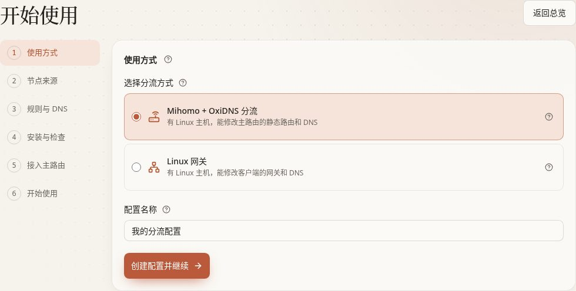
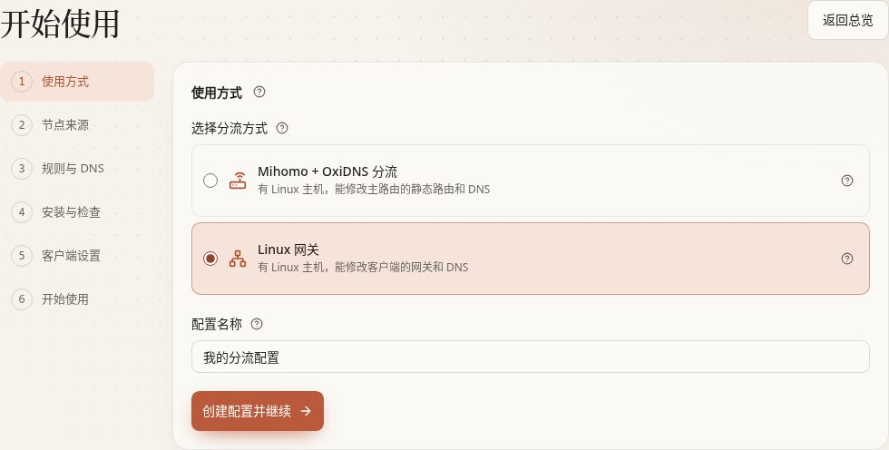

[文档首页](../README.md)

# 首次使用：让一台 Linux 帮家里分流

本章从已经能打开的 ConfigFlow 管理面板开始，完成“选节点 → 生成设置 → 安装设备上的程序 → 发布 → 接入一台测试设备”。先让一台手机或电脑验证通过，再考虑全家使用。

这里的 **Agent 是设备上的小助手**，负责接受面板的设置；**Mihomo 核心实际处理网络连接，OxiDNS 核心实际处理 DNS 查询**。DNS 查询可以理解为“先问网站叫什么地址”，之后的连接才是访问网站的数据。DNS 去哪里查、连接走直连还是代理，是两个不同设置。

前四步两种方案共用。到第 5 步，在选项卡中选择与你实际方案相同的接入方式，只看这一组操作。

## 开始前准备

| 准备项 | 要求 |
| --- | --- |
| ConfigFlow 面板 | 已按 [安装管理面板](install.md) 部署，Linux 设备能访问它的地址 |
| 一台处理流量的 Linux | x86_64 或 ARM64，使用 systemd／OpenRC 管理服务，能用 root 或 sudo；普通受限容器不适用本向导 |
| 固定的局域网 IPv4 | 建议在主路由为 Linux 保留地址；网关方案中 Linux 与测试设备需在同一网段 |
| TUN 设备与权限 | Linux 要有 `/dev/net/tun` 和管理网络的权限；向导会检查，缺少时按提示修复 |
| DNS 端口 | Linux 的 `53` 端口要能供 OxiDNS 使用；发现冲突时先确认原服务用途 |
| 可用的代理节点 | 服务商订阅链接，或已经添加到 ConfigFlow 的订阅、手动节点 |
| 一台测试手机／电脑 | 记下当前网关、DNS，以及 IPv6、浏览器安全 DNS 等原设置，方便退回 |

面板可以运行在 NAS 的 Docker 中；本向导安装核心的目标是 Linux 系统服务。若要把核心也放进 Docker、RouterOS 容器，或者已有核心使用自定义目录，改走 [安装与接入设备](agent-install.md)，不要把这份 Linux 安装命令直接放进容器执行。

打开总览里的「开始配置」。没有看到入口时，到「系统设置」点击「首次使用向导」。有未完成记录时可点「继续向导」或选择「最近的向导」，无需每次新建。

## 第 1 步：选择使用方式

两种方式都安装 Mihomo 和 OxiDNS，区别是**谁把连接交给 Linux**。

| 页面选项 | 默认状态 | 适合谁／怎么选 | 接入后手机和电脑怎样设置 |
| --- | --- | --- | --- |
| **Mihomo + OxiDNS 分流** | 新向导默认选中 | 能在主路由添加静态路由和修改 DNS。希望客户端继续使用原来的主路由作为网关时选它 | 网关仍是主路由；DNS 指向 OxiDNS。主路由把指定目标网段交给 Linux |
| **Linux 网关** | 默认未选 | 不能或不想添加主路由静态路由，但能修改客户端网关和 DNS 时选它 | 测试设备的网关、DNS 都改为 Linux 的 IP |

选择要查看的方案说明。截图只演示界面选择，还没有创建方案、安装或修改设备网络。

<DocsTabs id="first-run-mode" label="查看使用方式" :tabs="[{ id: 'mode-router', label: '主路由分流' }, { id: 'mode-gateway', label: 'Linux 网关' }]">

<template #mode-router>

在向导中选择「Mihomo + OxiDNS 分流」，这是新向导的默认项；第 5 步显示「接入主路由」。

这一方式使用「完整 TUN」：Mihomo 的虚拟网卡接收**已经被主路由转给 Linux**的连接，并按规则决定直连或代理。它不表示全家所有流量都会自动进入 Linux，也不表示全部走代理。

</template>

<template #mode-gateway>

在向导中选择「Linux 网关」后，第 5 步变成「客户端设置」。

这一方式使用「选择性 TUN」：客户端先把连接交给 Linux，fake-IP 和选中的 IP 范围再交给 Mihomo，其余连接由 Linux 转发。fake-IP 是 Mihomo 用来识别域名的临时地址，不是网站真正的公网 IP。

</template>

</DocsTabs>

1. 按上表选择方式。
2. 填「配置名称」，默认是「我的分流配置」，可改成容易认出的名字。
3. 点击「创建配置并继续」。向导会创建一个独立的**配置空间（一套分流设置）**，不会直接替换其他空间。

配置创建后，这次向导的使用方式不能随意切换。要换方案可新建一次配置；原方案是否保留或清理，在最后一节说明。

## 第 2 步：添加节点来源

| 选项 | 默认／建议 | 选中或填写后 | 不选时 |
| --- | --- | --- | --- |
| 订阅链接 | 新向导默认；手里有订阅网址时使用 | 粘贴服务商给的完整 HTTP(S) 订阅网址，读取其中节点 | 改用已有资源；不是填服务商网站首页或登录页 |
| 已有资源 → 已有订阅 | 恢复已有选择时会保留可见选项；按需勾选 | 该订阅的节点供本配置使用，并重新读取一次 | 该订阅不供本次方案使用，原订阅及其他空间不受影响 |
| 已有资源 → 已有节点 | 按需勾选，可与订阅一起选择 | 引用已经保存的手动节点 | 不引用该节点，不删除节点 |

1. 粘贴订阅链接，或勾选已有订阅／节点。
2. 点击「读取并继续」。这一步会访问订阅、确认读到了可用节点。
3. 读取失败时修改链接或换一个来源，在本页重试。只有旧缓存且本次读取失败时，向导不会当作成功继续。

这里不安装程序，也不改设备网络。订阅链接可能包含访问凭据，不要贴到公开截图里。以后在「订阅来源」或「节点库」维护来源。

## 第 3 步：选择规则与 DNS

第一次使用可先保留页面推荐规则。规则从上到下判断，命中前面的规则后使用对应去向；没有命中时再看下面的“未匹配”设置。

| 选项／按钮 | 新向导默认 | 推荐与选中效果 | 取消／另一选择的效果 | 何时生效与以后在哪里改 |
| --- | --- | --- | --- | --- |
| 直连规则 | 页面已选推荐规则 | 无需代理的网站放在这里，域名由直连 DNS 查询 | 取消该条后，仍可能命中其他规则；都未命中才使用默认 DNS | 第 4 步发布后影响服务；以后在「策略规则」修改 |
| 代理规则 | 页面已选推荐规则 | 需要交给 Mihomo 处理的域名放在这里；最终连接出口还受 Mihomo 策略控制 | 取消不等于强制直连，仍按后续规则／默认行为处理 | 发布后生效；以后在「策略规则」修改 |
| 恢复推荐 | 按钮，不会自动执行 | 将本页规则选择恢复到当前推荐值 | 不点则保留自己的选择 | 只改本页草稿，还需生成、发布 |
| 改用规则库的「某规则」 | 仅遇到同名、内容不同的规则时出现 | 使用你现有规则库里的版本 | 保留内置选择时，会另建一份内置版本，不覆盖原规则 | 生成配置时保存；读清名称后的“内置／规则库” |
| 直连 DNS 上游 | `https://223.5.5.5/dns-query` | 新手可先保持；可填写 IP 地址形式的 DoH／DoT，每行一个，最多 16 个 | 不能留空；不要填普通 `8.8.8.8:53`、本机地址或绕回代理的地址 | 发布后生效；以后在 OxiDNS 设置修改 |
| 未匹配域名 | **Mihomo DNS** | 未命中任何域名规则时交给 Mihomo DNS 查询 | 选「直连 DNS」则交给上面填写的直连上游 | 只决定 DNS 查询，不单独决定连接代理与否 |
| 未匹配连接 | **走代理** | 已经进入 Mihomo 且未命中规则的连接，交给「🐟 漏网之鱼」，默认跟随「✈️ 节点选择」 | 选「直连」则为 DIRECT；不会让没有进入 Mihomo 的连接自动进入它 | 发布后生效；以后在策略规则中调整最后的 MATCH 规则 |
| 记录 DNS 查询（OxiDNS 面板用） | **开启** | 想查看每次域名查询、结果和耗时时保留；默认保留 7 天，会持续写入 OxiDNS 的存储 | 关闭后不再记录新的查询；使用闪存或 SD 卡且不需要记录时可关闭 | 发布后生效；以后在 OxiDNS 设置修改 |

Mihomo DNS 的监听、fake-IP 和上游由向导自动配置，OxiDNS 的代理上游指向同机 `127.0.0.1:1053`，本页无需再手填。

Linux 网关方案中，所选规则含 Telegram、Google 推送（FCM）时，向导还会把对应的 IP 网段交给 Mihomo，照顾不先查询域名、直接连接 IP 的应用。安装后可在「配置生成 → Mihomo → Linux 网关 → IP 接管」调整。

核对完成后，点击「生成配置并继续」。此时保存的是面板里的方案，**还没有把这套新配置发布到核心**。

## 第 4 步：安装与检查

### 1. 填设备地址

| 字段 | 默认与填写方法 | 会不会改变设备网络 |
| --- | --- | --- |
| 主机 IP（可选） | 默认留空，由 Agent 自动识别；有多张网卡或识别不准确时填目标 Linux 的固定局域网 IPv4 | 这里只记录现有地址，不替你给 Linux 设置 IP |
| ConfigFlow 服务地址 | 默认使用浏览器当前访问的协议、主机和端口；换成 Linux 能访问的实际地址，不能用 `localhost` | 不改面板监听；必须与系统设置里的可达服务地址核对一致 |
| 高级选项：手动指定网络 | 默认不填，安装登记后自动读取。确实需要时填主路由 IPv4、LAN 网卡名、LAN 网段 | 核对现有网络，不修改 Linux 的 IP 或默认路由；不确定时先自动识别 |

已有标准安装可以接入：程序在 `/usr/local/bin/`，配置在 `/etc/mihomo/config.yaml`、`/etc/oxidns/config.yaml`，系统服务同名。安装阶段先检查并保留已有核心、配置，缺失的部分才补装；后面的发布步骤才应用本次方案。自定义目录应走 [接管已有服务](agent-install.md#shell-existing)。

如果生成命令时提示服务地址与系统设置不一致，先确认哪一个地址能被两项核心和已有设备共同访问。需要沿用原地址就改回输入框；确定新地址适用于所有配置时，才点「将……设为系统服务地址并继续」。这个按钮会改变系统生成的规则、订阅和安装链接，不只是修改本次向导。

### 2. 生成并执行安装命令

1. 点击「生成安装命令」。这只是准备命令，还没有登录目标 Linux，也没有开始安装。
2. 点击安装命令旁的「复制」，在**目标 Linux** 的终端执行；需要管理员权限时先使用 root 或 sudo。
3. 等待终端完成检查、下载、安装和登记。命令含临时凭据并有有效期，不要公开分享。
4. 回到页面查看两项 Agent 的登记状态；需要时点击「检查安装进度」。

失败时按终端的具体提示处理，在同一台设备重跑尚未过期的命令；命令过期再重新准备。已经登记完成的服务不用因为发布失败而重装。

安装步骤已经可能启动核心程序：它不是单纯保存草稿。主路由分流方案还会准备 TUN、开启并持久化 IPv4 转发。已有设备上操作前，应知道哪些业务正在使用它；先不要改全网 DNS。

### 3. 发布两项配置

点击「按顺序发布两项配置」。页面先发布并检查 Mihomo，再发布 OxiDNS；第一项失败时会停止，不会把失败显示为完成。

- 成功：查看两项发布结果及 DNS 检查，再进入后续网络检查。
- 规则下载失败：使用页面给出的「规则下载代理」或「GitHub 代理域名」处理后，点击「保存并重试发布」；这些代理是供 ConfigFlow 服务器下载用的。
- 其他失败：展开具体原因，在 Agent 页面处理；回到这里点击「处理后继续发布」。

**发布会写入设备配置，并按需要重新加载或重启核心，正在使用该设备的连接可能短暂中断。** 关闭页面不会撤销已经开始的发布。

### 4. 按所选方案检查转发

| 第 1 步选择 | 这里会看到 | 需要做什么 |
| --- | --- | --- |
| Mihomo + OxiDNS 分流 | 「转发与 TUN」／「检查转发与 TUN」 | 确认 IPv4 转发已开启并持久化、TUN 正常。若出现「开启并持久化 IPv4 转发」，按提示执行，再重新检查；它会改变 Linux 的转发能力 |
| Linux 网关 | 「启用与验证」 | 先点「检查并预览转发」，阅读要增加的规则及检查结果；通过后点「应用网关转发」。预览不应用，应用按钮才真正改变 Linux 的转发规则 |

完整 TUN 方案不使用 Linux 网关的选择性接管开关，不要为了通过检查再去打开它。页面出现「转发过滤」提醒时，按报告检查 Linux 防火墙；“服务在线”本身不能证明防火墙允许客户端经过。

检查通过后，点击「继续接入主路由」或「继续设置测试客户端」。

## 第 5 步：选择接入方式

选择第 1 步实际采用的方案。手册中的切换不会改变向导已创建的配置，也不会修改设备网络。

<DocsTabs id="first-run-connection" label="选择第 1 步使用的方案" :tabs="[{ id: 'router', label: '主路由分流' }, { id: 'client', label: 'Linux 网关' }]">

<template #router>

### 第 5 步 A：接入主路由

仅适用于第 1 步选择「Mihomo + OxiDNS 分流」。客户端的默认网关仍然是原来的主路由。

| 配置方式 | 默认状态 | 适合谁 | 操作边界 |
| --- | --- | --- | --- |
| 手动配置主路由 | 默认选中 | 能自行管理静态路由和 DHCP DNS；不限品牌 | ConfigFlow 列出要填的值，你登录主路由修改；页面不能自动核验结果 |
| 自动配置主路由 | 默认未选 | 使用 iKuai 4.x 或 RouterOS 7.1+，愿意提供管理连接信息 | 保存连接信息只是记录；检查连接、预览差异并确认发布后，才修改主路由 |

<DocsTabs id="first-run-router-method" label="主路由的配置方式" :tabs="[{ id: 'manual-routes', label: '手动配置主路由' }, { id: 'auto-routes', label: '自动配置主路由' }]">

<template #manual-routes>

#### 手动配置：路由表在哪里、具体填什么

**网页里的表格位置：**打开 ConfigFlow 的「首次使用向导」→ 第 5 步「接入主路由」→ 选「手动配置主路由」→ 看「1. 在主路由添加静态路由」下面。

要先在第 4 步完成 Mihomo、OxiDNS 的发布和安装检查，以及 IPv4 转发、TUN 检查，这里才会显示实际路由表。提前打开第 5 步只能看到“安装检查完成后，这里会列出……”的提示。下面把填写内容直接列在手册里，便于提前准备。

##### 下一跳填写 Mihomo 所在设备的 IP

**下一跳 = 运行 Mihomo、负责接收主路由转发连接的设备的局域网 IPv4。** 本向导把 Mihomo 装在 Linux 上，所以界面目前写“下一跳（Linux IP）”；它指的是这台 Mihomo 设备，不是任意一台 Linux。只有面板与 Mihomo 同机时，下一跳才与面板所在主机的 IP 相同。

以下示例假设主路由是 `192.168.1.1`，Mihomo 设备是 `192.168.1.20`。把所有“下一跳”中的 `192.168.1.20` 换成你自己的 Mihomo 设备 IP。不要填主路由 IP、`127.0.0.1`，也不要加 `7890`、Agent 端口等端口号。

##### 先添加这一条：Mihomo Fake-IP

Fake-IP 是 Mihomo 为分流使用的临时地址。主路由需要把发往这段地址的连接交给 Mihomo。**保留默认范围时，填写下面这一行即可：**

| 目的网段（支持 `/` 写法时） | 目的网络（地址、掩码分开填时） | 子网掩码 | 下一跳（Mihomo 设备 IP） |
| --- | --- | --- | --- |
| `198.18.0.0/16` | `198.18.0.0` | `255.255.0.0` | `192.168.1.20` |

- 路由器只有一个“目的网段”输入框：填 `198.18.0.0/16`。如果把地址和掩码分开，分别填表中的第二、第三列。
- 若要求选接口，选能够到达 Mihomo 设备的局域网接口；同一 LAN 的设备通常选 LAN。将路由设为启用，其他距离、优先级等没有特殊要求时保留路由器默认值。
- Mihomo 配置可能显示 `fake-ip-range: 198.18.0.1/16`，它所属的**网络地址**仍是 `198.18.0.0/16`。若你改过 Fake-IP 范围，不能继续照填这个默认网段。
- 这里只添加指定网段，不修改主路由的默认路由；手机和电脑的默认网关仍然是主路由。

##### 需要 Telegram 直接连 IP 的流量也交给 Mihomo 时

**当前新建的“主路由分流”向导默认只列 Fake-IP。** 第 3 步在“代理规则”里选了 Telegram，并不等于已经把 Telegram 的 IP 网段加入主路由路由表。

需要 Telegram 真实 IP 分流时，按下面六行**另外在主路由添加**，不用等它们先出现在首次向导表中。首次向导的完成确认也不会自动检查这些额外路由。Google 推送（FCM）等其他直接连接 IP 的服务，同样需要单独决定是否转发，并使用对应规则集中的实际网段。

**先确认主路由能按来源排除 Mihomo 设备本身。** Telegram 使用真实 IP；如果 Mihomo 自己直连这些地址时又被送回自己，就会形成循环。因此要让这些规则作用于需要分流的客户端，并排除示例中的 `192.168.1.20`。如果路由器只有“目的网段、下一跳”两个字段、没有来源排除或策略路由能力，先只添加上面的 Fake-IP，不直接照填以下六行。

满足来源排除条件，并使用当前内置 Telegram 规则集时，在 Fake-IP 路由之外添加以下条目。**每一行的下一跳都相同，都是 Mihomo 设备 IP：**

| Telegram 目的网段 | 下一跳（Mihomo 设备 IP） |
| --- | --- |
| `5.28.192.0/18` | `192.168.1.20` |
| `91.108.0.0/16` | `192.168.1.20` |
| `109.239.140.0/24` | `192.168.1.20` |
| `139.59.210.98/32` | `192.168.1.20` |
| `149.154.160.0/20` | `192.168.1.20` |
| `196.55.216.167/32` | `192.168.1.20` |

`/32` 表示只匹配那一个 IP。以上六行是当前内置 [Telegram 规则内容](https://raw.githubusercontent.com/blackmatrix7/ios_rule_script/refs/heads/master/rule/Clash/Telegram/Telegram.list)中的 IPv4 条目，核对日期为 2026-10-28；规则源更新、换源或自行编辑后，以重新下载并检查后显示的网段为准。这张表不是 Telegram 官方网段清单，也不包含 IPv6 路由；规则中的域名或网络编号不会自动变成这里的 IPv4 路由。

添加路由只是把连接交给 Mihomo。还要在 Mihomo 面板确认 Telegram 策略组使用可用代理；如果该组选择了直连，连接仍会由 Mihomo 直连。

使用 iKuai 或 RouterOS、希望由 ConfigFlow 维护路由时，可到「上游路由 → 编辑路由器」，在「使用静态路由的 IP 规则集」（RouterOS）或「按 IP 路由给 Mihomo 的规则集」（iKuai）中选择 Telegram，再保存、查看差异报告、预览并确认发布。按设备范围分流时使用 RouterOS 的策略路由功能，见 [上游路由](../manual/routers.md)。这些是路由器页面的设置，不会让首次向导表自动同步显示 Telegram；也不要同时维护两份重复的手工和自动路由。

##### 填完后如何确认

1. 保存并启用主路由上的 Fake-IP 路由；需要 Telegram 真实 IP 分流时，再按上述条件添加其条目。
2. 先在一台测试设备上将 DNS 改为 **OxiDNS 所在设备的 IP**，不填 Agent 端口。本向导同机安装时，它与 Mihomo IP 相同；分开部署时分别使用各自地址。全网验证后再考虑改主路由 DHCP DNS。
3. 实际完成后，勾选「已配置主路由静态路由」「已将测试客户端 DNS 指向 OxiDNS」。这两个勾选**默认未勾**，只是你对已完成操作的确认，不会替你配置路由器。
4. 点击「确认设置并继续」。如提示规则集 IP 段未下载，先处理下载问题并点「重新检查」，不要把缺行的表格当作完整方案。

不要另填一个绕过 OxiDNS 的备用 DNS。依赖 DNS 分流的设备若使用自己的安全 DNS／私有 DNS，也可能不经过这套规则，应在测试时核对。

</template>

<template #auto-routes>

#### 自动配置

1. 选择「自动配置主路由」，添加主路由管理地址和账号。
2. 按页面先「检查连接」，确认识别的是目标主路由。
3. 查看差异报告，核对要添加或修改的路由、DHCP DNS 和所用设备，再确认发布。
4. 成功后点击「检查路由器并完成」。在此之前，添加账号或保存连接信息不会自行改主路由。

安装还没结束时可以先填写主路由信息，但实际发布要等安装、核心发布与检查完成。更多字段和撤销方法见 [上游路由设置](../manual/routers.md)；其他品牌按手动流程处理。

</template>

</DocsTabs>

</template>

<template #client>

### 第 5 步 B：设置测试客户端

仅适用于第 1 步选择「Linux 网关」。这一方案不用在主路由添加静态路由。

1. 确认页面显示转发已经就绪。如果显示失败，先点「重新检查转发」，或返回「安装与检查」处理，保留客户端原设置。
2. 在一台测试手机或电脑上记下原网关、DNS、IPv6 和安全 DNS 设置。
3. 将这台设备的**网关和 DNS 都改为页面显示的 Linux IP**。设备自己的 IP 保持在原网段。
4. 按页面接入说明，测试期间关闭该设备的 IPv6、浏览器安全 DNS 和系统私有 DNS。这条 Linux 网关路径管理的是 IPv4；需要 IPv6 时应另行配置对应路由，不能以面板能用 IPv6 访问代替。
5. 测试通过后，才在支持相应功能的主路由中用 DHCP 分发新的网关和 DNS；其他设备通常要重新联网或续租后生效。

修改客户端网络设置的动作由你在设备上完成，页面不会远程替手机或电脑修改。

</template>

</DocsTabs>

### 是否设为默认配置空间

在接入步骤中，可能看到「设为默认配置空间」。

| 状态 | 含义 |
| --- | --- |
| 默认是否勾选 | 取决于已有设备：原默认空间没有绑定 Agent 时，向导会建议勾选；已有设备依赖原默认空间时不建议。已是默认空间时不再显示此选项 |
| 勾选并完成 | 新打开的页面、未指定空间的链接、新注册且未指定空间的 Agent 会使用本空间；已经绑定的设备不随之改绑 |
| 不勾选 | 保留原默认空间，本次空间及绑定设备仍可使用 |
| 以后修改 | 「系统 → 配置空间」；客户端设备名称和 DNS 策略不会从旧空间自动搬来 |

此选项也会出现在主路由方案的接入步骤，不是只有 Linux 网关可以设置。

## 第 6 步：确认结果

向导显示「Mihomo + OxiDNS 已准备好」之后，再在真实测试设备上检查：

1. 能打开平时直连的网站。
2. 能打开预期使用代理的网站。
3. 到「Mihomo 面板」的连接列表，确认测试连接命中了预期规则和出口。
4. 开启了查询记录时，到「OxiDNS 面板 → 查询记录」，确认能看到测试设备的 DNS 查询及结果。
5. 重新连接网络后仍然正常，再推广到其他设备。

“Agent 在线”“核心发布成功”“路由已核对”“客户端真正能上网”是不同的检查。向导的完成提示不等于它已经代替你测试了手机和电脑。

## 中途退出、退回与后续修改

### 中途暂停或放弃

- 只想稍后继续：关闭页面即可，进度保存在服务器；从总览「继续向导」或系统设置重新进入。
- 想重新开始：使用「新建一次配置」。它不会自动卸载旧设备或撤销已发布的路由。
- 点击「放弃此向导」：先读确认框。未被设备使用的向导配置空间可能被删除；已经登记、使用中的配置会按实际情况保留。放弃向导不等于撤销网络设置。

### 上网异常时先恢复接入

| 使用方式 | 先做什么 | 再做什么 |
| --- | --- | --- |
| 主路由分流 | 将测试设备／DHCP DNS 恢复为原值，撤销本次加到主路由的静态路由；自动发布的设置按路由器页面的差异与恢复流程处理 | 确认客户端恢复正常，再排查 Linux、Mihomo、OxiDNS；不要先停止仍被主路由指向的核心 |
| Linux 网关 | 将测试设备网关和 DNS 恢复为原值，恢复原 IPv6／安全 DNS 设置 | 在「管理网络与撤销转发」或安装向导中撤销受管转发；只撤销转发不会关闭 Mihomo TUN，完全停用还需在「配置生成 → Mihomo → Linux 网关」关闭模式、保存并发布 |

老向导若提示「旧版 Linux 网关接管」，应按该提示维护：它依赖旧接管记录，不能照新完整 TUN 方案随意撤销。具体看 [Linux 网关的调整与停用](../manual/core-settings.md#linux-网关)。

### 后续常用入口

| 想改什么 | 去哪里 | 生效方式 |
| --- | --- | --- |
| 订阅或手动节点 | 「订阅来源」「节点库」 | 更新资源后按实际配置重新生成、发布 |
| 网站直连／代理、DNS 去向 | 「策略规则」 | 保存配置后发布到相关核心 |
| 当前实际用哪个代理节点 | 「Mihomo 面板」的策略选择 | 对运行中的核心操作，按面板反馈确认 |
| DNS 上游、查询记录 | OxiDNS 的「设置」 | 保存草稿或保存并发布，按按钮区分 |
| 主路由转发哪些网段 | 「上游路由」 | 查看差异，再确认发布 |
| 更多设备或另一种部署方式 | [安装与接入设备](agent-install.md) | 先安装、检查，再接入网络 |
