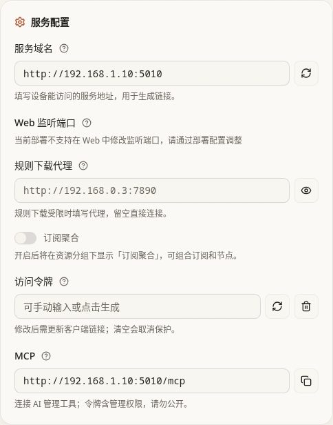

[文档首页](../README.md)

# 安装 ConfigFlow 管理面板

本章先把浏览器里的管理页面装好。完成后，你能登录、保存配置，并让其他设备连接它。此时家里的上网方式还没有改变。

ConfigFlow 管理面板负责保存和分发设置；**Mihomo、OxiDNS 等“核心”才是实际处理连接或 DNS 查询的程序**。核心所在设备还需要一个 **Agent（设备上的小助手）**，负责接收配置、检查运行状态。面板与核心可以放在同一台机器，也可以分开放。

先准备设备和地址，再选择一种安装方式。安装完成后，继续阅读共用的首次设置和检查步骤。

<a id="prepare"></a>
## 开始前准备

准备以下内容：

| 需要准备 | 怎么选 |
| --- | --- |
| 一台能运行 Docker 的服务器或 NAS | 安装并启动 Docker。选择 Compose 时还需 Docker Compose；也可以选下面的 `docker run` 命令。NAS 的“项目／Compose”功能也可以。 |
| 这台设备的局域网 IP | 例如 `192.168.1.10`。建议在主路由中为它保留地址，避免重启后变化。 |
| 一个长期保存数据的目录 | 例如 NAS 的 `/volume1/docker/configflow/data`。这是示例，需换成自己的实际路径。 |
| 未被占用的端口 | Bridge 示例从 `5010` 访问，Host 示例从 `8088` 访问。Host 还需要宿主机的 `5001` 和 `3001` 没被其他服务占用。 |
| 管理账号、密码和登录密钥 | 自己设置，不要原样使用示例里的占位文字。 |

下面的命令在**准备运行面板的设备**上执行。浏览器可以在另一台电脑或手机上打开。

**Compose、docker run、NAS 管理器三种安装入口选一种；Bridge 和 Host 两种网络方式也选一种。** 示例都会创建名为 `config-flow` 的容器，不要把不同示例连续执行，也不要让两个面板同时使用同一数据目录。已有安装要改方式时，先备份、停止并移除旧容器，再用原数据目录重新创建。

| 网络方式 | 建议怎么选 | 使用后的结果 |
| --- | --- | --- |
| **Bridge 模式（推荐）** | 普通安装先用；主要需要打开面板，或宿主机已有较多服务 | 访问 `http://设备IP:5010`；容器内部端口与主机分开，只需安排对外端口 |
| **Host 模式** | Linux 服务器／Linux NAS 上，希望面板直接使用宿主机网络，包括宿主机已有的 IPv6 网络能力 | 访问 `http://设备IP:8088`；与宿主机共用端口，需要检查 `8088`、`5001`、`3001` 冲突 |

Host 不会给宿主机增加本来没有的 IPv6。宿主机仍需有可用 IPv6 地址、路由及允许访问的防火墙设置；Bridge 的 IPv6 则取决于 Docker 网络配置。这里只选择面板容器的网络，不会替你改变 Agent 容器的网络。

<a id="install-methods"></a>
## 选择一种安装方式

点击适合自己的方式，只需完成该页签中的步骤。首次安装推荐 Docker Compose，后续改端口或更新时比较方便。

<DocsTabs id="panel-install-method" label="选择安装方式" :tabs="[{ id: 'compose', label: 'Docker Compose（推荐）' }, { id: 'docker-run', label: 'docker run' }, { id: 'nas', label: 'NAS 容器管理器' }]">

<template #compose>

### 用 Docker Compose 安装

#### 1. 建立部署目录

```bash
mkdir -p "$HOME/configflow/data"
cd "$HOME/configflow"
```

本例把部署文件保存在当前用户主目录下的 `configflow`，数据长期保存在其中的 `data`。也可以改成 NAS 或服务器上的其他固定目录；以后更新继续使用同一路径。

在这个目录创建 `compose.yaml`。点击下面的 **Bridge 模式（推荐）** 或 **Host 模式**，复制对应的**完整一份**内容。先把 `your-admin-name`、密码和密钥的占位文字换成自己的值，再启动。

::: code-group

```yaml [Bridge 模式（推荐）]
services:
  config-flow:
    image: thsrite/config-flow:latest
    container_name: config-flow
    ports:
      - "5010:80"
    volumes:
      - ./data:/data
    environment:
      DATA_DIR: /data
      TZ: Asia/Shanghai
      ADMIN_USERNAME: "your-admin-name"
      ADMIN_PASSWORD: "replace-with-your-own-password"
      JWT_SECRET_KEY: "replace-with-at-least-32-random-characters"
    restart: unless-stopped
```

```yaml [Host 模式]
services:
  config-flow:
    image: thsrite/config-flow:latest
    container_name: config-flow
    network_mode: host
    volumes:
      - ./data:/data
    environment:
      DATA_DIR: /data
      TZ: Asia/Shanghai
      CONFIGFLOW_WEB_PORT: "8088"
      ADMIN_USERNAME: "your-admin-name"
      ADMIN_PASSWORD: "replace-with-your-own-password"
      JWT_SECRET_KEY: "replace-with-at-least-32-random-characters"
    restart: unless-stopped
```

:::

Bridge 版通过 `5010:80` 把外部访问送进容器。Host 版不需要 `ports`，直接通过 `CONFIGFLOW_WEB_PORT` 指定 `8088`；这个环境变量存在时，网页里的 Web 监听端口会显示只读。希望以后从网页改端口时，先阅读 [环境变量与 Web 设置的关系](#port-priority)。

#### 2. 看懂需要修改的地方

启动前，按本页的 [账号、目录与其他参数](#deployment-parameters) 核对自己的值。该说明也适用于 docker run 和 NAS 安装。

#### 3. 启动

在 `compose.yaml` 所在目录执行：

```bash
docker compose config --quiet
docker compose pull
docker compose up -d
docker compose ps
```

这几条命令依次检查部署文件、下载镜像、创建并启动容器、查看状态。若报错，先处理报错，不要继续改家里的网关或 DNS。

#### 4. 打开管理页面

按所选模式打开：

| 采用的示例 | 浏览器地址 |
| --- | --- |
| Bridge | `http://192.168.1.10:5010` |
| Host | `http://192.168.1.10:8088` |

将 `192.168.1.10` 换成安装设备的实际 IP；改过端口就使用新端口。用刚设置的账号密码登录。只有浏览器和容器运行在同一台电脑上时，才可以把设备 IP 写成 `localhost`。

</template>

<template #docker-run>

### 用 docker run 安装

希望直接用命令创建容器时，完成这一页签即可。已经使用其他方式安装成功的用户，不要再次创建。

先按 [账号、目录与其他参数](#deployment-parameters) 替换账号、密码和登录密钥。命令中的 `$HOME/configflow/data` 是当前执行用户主目录下的固定数据目录；已有数据或 NAS 用户应把它改成自己的实际绝对路径，例如 `/volume1/docker/configflow/data`，并保证目录存在。不要在升级时换成另一个用户的主目录。

::: code-group

```bash [Bridge 模式（推荐）]
mkdir -p "$HOME/configflow/data"

docker run -d \
  --name config-flow \
  --restart unless-stopped \
  --network bridge \
  -p 5010:80 \
  -v "$HOME/configflow/data:/data" \
  -e DATA_DIR=/data \
  -e TZ=Asia/Shanghai \
  -e ADMIN_USERNAME='your-admin-name' \
  -e ADMIN_PASSWORD='replace-with-your-own-password' \
  -e JWT_SECRET_KEY='replace-with-at-least-32-random-characters' \
  thsrite/config-flow:latest
```

```bash [Host 模式]
mkdir -p "$HOME/configflow/data"

docker run -d \
  --name config-flow \
  --restart unless-stopped \
  --network host \
  -v "$HOME/configflow/data:/data" \
  -e DATA_DIR=/data \
  -e TZ=Asia/Shanghai \
  -e CONFIGFLOW_WEB_PORT=8088 \
  -e ADMIN_USERNAME='your-admin-name' \
  -e ADMIN_PASSWORD='replace-with-your-own-password' \
  -e JWT_SECRET_KEY='replace-with-at-least-32-random-characters' \
  thsrite/config-flow:latest
```

:::

Bridge 使用 `-p 5010:80`，从 `http://设备IP:5010` 访问；Host 使用 `--network host`，不加 `-p`，从 `http://设备IP:8088` 访问。Host 的网页端口只读；还需检查 `5001`、`3001` 是否占用。IPv6 使用宿主机已有的网络能力，详见 [网络方式和端口](#network)。

命令执行后，可以运行 `docker ps --filter name=config-flow` 查看状态，运行 `docker logs --tail=100 config-flow` 查看启动信息。Docker 会在本机没有镜像时尝试下载；若下载或创建报错，先处理报错。

保存你实际使用的完整命令，尤其是数据路径、账号、密码、密钥、网络方式和端口。以后更新或改参数需要用它重建容器；原样再次执行 `docker run` 会因同名容器已存在而失败。更新步骤见 [停止、更新与退回](#maintain)。

</template>

<template #nas>

### 在 NAS 容器管理器中安装

NAS 不同系统的按钮名称不完全相同，按功能找到对应入口即可。

1. 打开 NAS 的容器管理器，选择“项目”“Compose”或“从 YAML 创建”。
2. 建立一个独立的 ConfigFlow 项目。切到 [Docker Compose 页签](#compose)，选择 Bridge 或 Host 并复制完整内容，再回到 NAS 的项目编辑器粘贴。
3. 将 `./data:/data` 改成 NAS 上的实际目录，例如 `/volume1/docker/configflow/data:/data`。确认这个目录可写。
4. 按 [共用参数说明](#deployment-parameters) 设置账号、密码、密钥。Bridge 检查 `5010` 没被占用；Host 检查 `8088`、`5001`、`3001` 没被占用，保留 `CONFIGFLOW_WEB_PORT=8088`。
5. 点击管理器中的部署／启动，等容器状态变为运行。
6. Bridge 用 `http://NAS的IP:5010`，Host 用 `http://NAS的IP:8088` 打开面板。

如果管理器只有“创建容器”，没有 Compose，逐项填写：

| 容器管理器字段 | Bridge 模式 | Host 模式 |
| --- | --- | --- |
| 镜像 | `thsrite/config-flow:latest` | `thsrite/config-flow:latest` |
| 网络 | bridge／桥接 | host／主机网络；NAS 不支持时用 Bridge |
| 端口映射 | 主机 TCP `5010` → 容器 TCP `80` | 不填写映射 |
| 目录挂载 | NAS 的实际数据目录 → `/data`，可读写 | 同左 |
| 环境变量 | Bridge Compose 中 `environment` 的全部项 | Host Compose 中的全部项，包括 `CONFIGFLOW_WEB_PORT=8088` |
| 启动命令 | 使用镜像默认值，不另填 | 同左 |

NAS 部署和命令行部署二选一，不要为同一数据目录同时启动两个面板容器。

</template>

</DocsTabs>

<a id="deployment-parameters"></a>
## 账号、目录与其他参数

三种安装方式都要核对这些设置。Compose 用文件里的字段，docker run 使用对应的命令参数，NAS 则在容器管理器中填写。

| 设置 | 本例值／默认行为 | 什么时候修改 | 修改后的结果与生效时间 |
| --- | --- | --- | --- |
| `image` | `thsrite/config-flow:latest` | 普通安装使用这个官方面板镜像；需要固定版本时使用已发布的具体标签或摘要 | 拉取镜像、重新创建容器后生效。它不是 Agent 镜像。 |
| `ports`（Bridge） | `5010:80` | 访问端口冲突时，只把左边 `5010` 改成其他空闲端口 | 左边是设备对外端口，右边是容器内端口。重新创建后按新端口打开浏览器。Host 版不填写此项。 |
| `network_mode`（Host） | `host` | 选择 Host 版时保留 | 共用宿主机网络；不是额外创建一个独立 IP。Bridge 版无需填写此项。 |
| `CONFIGFLOW_WEB_PORT`（Host） | 本例为 `8088` | `8088` 已被占用时改成其他空闲端口 | 明确指定实际 Web 端口，优先于网页保存值；网页端口只读。重建容器后生效。 |
| `volumes` | `./data:/data` | NAS 或迁移旧实例时，改成自己的实际数据目录 | 左边的文件保存在设备上，右边 `/data` 保持不变。更新时必须继续使用同一个目录。 |
| `DATA_DIR` | `/data` | 按本例挂载时保持不变 | 告诉程序把数据存到容器的 `/data`；它应与挂载右侧一致。 |
| `ADMIN_USERNAME`、`ADMIN_PASSWORD` | 仓库示例默认不启用；本例已填写，建议保留登录保护 | 首次安装时设置自己的账号和密码 | 两项都非空才启用登录。只设置一项不会启用。修改后需重新创建容器。 |
| `JWT_SECRET_KEY` | 本例要求自行填写 | 首次安装设置足够长的随机字符串 | 用于保护登录会话。更新容器时保留原值；更换后原登录会话失效。 |
| `TZ` | `Asia/Shanghai` | 希望服务使用其他时区时 | 重新创建容器后生效。 |
| `restart` | `unless-stopped` | 普通安装保留 | Docker 启动后会按此策略恢复容器；你主动停止的容器需自行启动。 |

`./data` 是部署文件所在目录下面的 `data`，不是浏览器所在电脑的目录。已有实例不要随意换目录，否则会像新安装一样显示空配置。

一般不需要另外设置 `CONFIGFLOW_HTTP_THREADS`（默认 `8`，允许 `1–64`，控制服务同时处理请求的数量）或 `LOG_LEVEL`（默认 `INFO`，控制日志详细程度）。`LOG_LEVEL=DEBUG` 会启用开发调试模式，不建议普通部署长期开启。修改环境变量后需重新创建容器。

<a id="initial-settings"></a>
## 第一次打开后的设置

1. 进入「系统 → 系统设置 → 常规」。
2. 在「服务配置 → 服务域名」填写**其他设备能访问到的完整地址**：Bridge 示例为 `http://192.168.1.10:5010`，Host 示例为 `http://192.168.1.10:8088`。改过端口时填实际值，移开输入焦点后保存。
3. 如需保护配置下载链接，在「访问令牌」输入自己的令牌，或点击生成按钮。之后从页面复制完整配置链接，不要手工漏掉令牌。



图中是当前真实界面的隔离演示：`192.168.1.10:5010` 是 Bridge 示例地址；使用本页 Host 示例时应填 `8088`。截图使用独立开发服务，所以 Web 监听端口显示“不支持”；官方 Docker 容器里的端口设置按下一节操作。服务域名与监听端口始终是两项不同设置。

| 选项 | 默认／建议 | 设置后的作用 | 不设置时 |
| --- | --- | --- | --- |
| 服务域名 | 容器中新实例可能未保存；页面可显示当前浏览器地址。建议填可从其他设备访问的地址 | 生成订阅、规则和安装链接时使用它；不会改监听端口 | 从 `localhost` 打开时，生成的地址可能只有本机能用，其他设备安装或取规则会失败 |
| 访问令牌 | 默认空；需要限制配置链接访问时生成 | 下载链接需带令牌；此令牌也授权 MCP 管理操作，应像密码一样保管 | 配置令牌保护关闭；不要把它与网页登录账号混为一项 |
| Web 监听端口 | Bridge 示例内部为 `80`；Host 示例被环境变量指定为 `8088`，页面只读 | 改的是容器实际监听端口，详见下一节 | 沿用当前启动设置；不是服务域名里的地址文本 |

内置 Sub-Store 是转换订阅用的程序，默认按需启动，空闲约 5 分钟后休眠。首次转换需要等待启动；看到“休眠中”不代表故障。无需另装 Sub-Store，也无需对外开放其内部 `3001` 端口。

<a id="network"></a>
## 选择网络方式和修改端口

### 想改访问端口时，先看自己用的模式

| 网络方式 | 适合谁 | 端口怎么改 | IPv6 要看什么 |
| --- | --- | --- | --- |
| bridge（桥接，Compose 未指定网络时的普通用法） | 只需要面板正常访问，希望与宿主机其他服务分开 | 改 `5010:80` 左边；一般不用动 Web 设置里的端口 | Docker 网络需具备所需 IPv6 能力；改端口不会给容器增加 IPv6 地址 |
| host（主机网络） | Linux 上希望直接使用宿主机网络，包括已有的 IPv6 网络能力 | `ports` 映射不生效，使用 Web 监听端口或启动环境变量 | 宿主机本身要有可用 IPv6 地址、路由，相关防火墙也需允许访问 |

两种模式的完整 Compose 和 `docker run` 示例都已在上面提供。Bridge 通常只改对外映射端口，例如将 `5010:80` 改成 `5011:80`；Host 示例则修改 `CONFIGFLOW_WEB_PORT` 的值。Compose 改好后运行 `docker compose up -d`；`docker run` 创建的容器需按下方维护步骤停止、移除并重建。单纯重启不会读取修改后的参数。

<a id="port-priority"></a>
### 环境变量与 Web 设置的关系

优先顺序是 **`CONFIGFLOW_WEB_PORT` → 网页以前保存的端口 → 默认 `80`**。本页 Host 示例设置了 `CONFIGFLOW_WEB_PORT=8088`，因此会使用 `8088`，网页输入框只读；在环境变量存在时不能通过网页覆盖它。

想交回网页管理，需移除这个环境变量并重建容器。移除后会使用以前通过网页保存的端口；从未保存过就回到 `80`。因此先确认恢复后的端口空闲，再重建，不能只删环境变量后继续假定是 `8088`。

无论从哪个端口访问，Host 的面板后端 `5001`、内置 Sub-Store 默认 `3001` 仍与宿主机其他服务共用端口。只把 Web 改成 `8088`，不能解决这些内部端口的占用问题。

### 从 Web 修改监听端口

1. 进入「系统设置 → 服务配置 → Web 监听端口」。
2. 填写 `1–65535` 的整数；不要使用内部后端端口 `5001`、Sub-Store 使用的端口或其他已占用端口。
3. 点击「应用」，阅读当前连接可能断开的提示，再点击「应用新端口」。
4. 成功后按新端口访问。页面给的是 HTTP 直连参考地址；经过 HTTPS 反向代理时，先更新代理的后端地址，不必把原 HTTPS 域名改成该参考地址。
5. 如果设备访问 ConfigFlow 的完整地址也变了，另外更新「服务域名」以及已有 Agent 使用的服务地址，并更新客户端保存的配置下载链接。修改监听端口不会自动替这些地方换地址；仍使用同一反向代理域名时，只需按实际情况更新代理后端。

| 当前情况 | 接下来做什么 |
| --- | --- |
| Host 模式 | 使用宿主机 IP 和新端口；可能需要重新登录 |
| Bridge 模式 | 同时把映射右侧改为新端口，例如容器改为 `8088` 后使用 `5010:8088`，然后重新创建容器 |
| 端口显示只读 | `CONFIGFLOW_WEB_PORT` 已明确指定端口。先用环境变量管理；需要交回 Web 管理时，按下面的退回方法处理 |
| 保存时提示端口占用 | 新端口不会应用，选择其他空闲端口后重试 |
| 应用失败 | 系统会尝试恢复原配置。若明确提示“无法确认原端口已恢复”，按下方环境变量方法重建容器恢复访问，不要假定原端口仍然可用 |
| 连接断开，结果未确认 | 分别检查原地址与新端口，不能只凭连接断开判断成功或失败 |
| 源码运行或旧镜像显示不支持 | 该功能需要带端口管理组件的 Docker 镜像；先更新镜像 |

Web 保存的端口位于实际数据目录的 `web-listener.json`，不包含在页面 JSON 导出和 WebDAV 备份中。若要移除 `CONFIGFLOW_WEB_PORT` 后继续使用当前端口，先在此文件保存对应值，例如 `{"port":8088}`，再移除环境变量、重新创建容器。单纯移除环境变量，会恢复使用以前的 Web 保存值；从未保存过时回到 `80`。

IPv6 访问地址需加方括号，例如 `http://[2001:db8::10]:8088`，示例地址需换成自己的地址。主机支持 IPv6 时，面板会同时监听 IPv4 与 IPv6；内核禁用 IPv6 时仅监听 IPv4。

<a id="verify"></a>
## 确认安装成功

1. 从另一台局域网设备打开面板，确认不是只有宿主机自己能访问。
2. 刷新页面后能正常登录，系统设置仍然保留。
3. 确认数据挂载指向准备好的实际目录。
4. 对照「服务域名」，确认准备安装 Agent 的设备也能打开这个地址。

打不开时，Compose 用户查看 `docker compose logs --tail=100 config-flow`，`docker run` 用户查看 `docker logs --tail=100 config-flow`，NAS 用户查看容器管理器里的日志。按顺序检查容器是否运行、IP、对外端口、挂载权限和防火墙。`5001` 是后端服务端口，不是本章让浏览器访问的网页端口。

<a id="maintain"></a>
## 停止、更新与退回

| 要做的事 | Compose 安装 | docker run 安装 | 结果 |
| --- | --- | --- | --- |
| 暂停面板 | `docker compose stop` | `docker stop config-flow` | 停止面板、保留数据，不会替你停止其他设备的核心 |
| 再启动 | `docker compose start` | `docker start config-flow` | 按原容器设置启动 |
| 只是重启 | `docker compose restart` | `docker restart config-flow` | 不读取新环境变量，也不下载新镜像 |
| 应用改过的端口、网络或环境变量 | 修改原文件，再 `docker compose up -d` | 按下面的重建步骤，用改好的完整命令创建 | 数据目录、账号和密钥等要沿用原值 |
| 更新镜像 | 先备份，再 `docker compose pull`、`docker compose up -d` | 先备份，再按下面的更新步骤操作 | 更新面板；Agent 与核心仍需分别管理 |

### docker run 如何更新和重建

1. 先在「系统设置」**导出全部数据**，保留原来实际执行的完整 `docker run` 命令、镜像版本及数据路径。如果需要完整目录备份，先 `docker stop config-flow`，复制整个实际数据目录，确认副本保存好后可用 `docker start config-flow` 恢复服务。不要在服务运行时只复制数据库文件。
2. 下载新版镜像。此时还不会替换正在使用的容器：

   ```bash
   docker pull thsrite/config-flow:latest
   ```

3. 确认下载成功后，停止并移除旧容器：

   ```bash
   docker stop config-flow
   docker rm config-flow
   ```

   这两条命令停止并移除名为 `config-flow` 的容器，**不会删除本页示例挂载到宿主机的数据目录**。不要删除那个目录；也不要改成另一个空目录。
4. 重新执行自己保存的完整 `docker run` 命令。保留**相同的数据路径、账号、密码、JWT 密钥、网络方式和端口**，使用刚下载的镜像；不要把上面的占位文字当作原账号重建。如果这次就是要改某项参数，只修改那一项。
5. 查看 `docker logs --tail=100 config-flow`，然后按原模式打开 `http://设备IP:5010` 或 `http://设备IP:8088`，确认原配置仍在。改过端口就使用新端口，并更新服务域名及其他设备保存的地址。

只改端口或环境变量、不更新镜像时，也需要停止并移除旧容器，再用改好的命令重新创建；可以跳过下载镜像这一步。NAS 用户在原项目中修改并重新部署，不要另建一个同时使用原数据的新项目。

### 改错端口或需要退回

无法访问时，在原 Compose 或 `docker run` 命令中设置 `CONFIGFLOW_WEB_PORT` 为已确认空闲的端口。Bridge 同时把端口映射右侧改成这个值，然后按原安装方式重建；Host 直接使用这个端口。恢复访问后，再核对网页保存值及服务域名。

更新前，先从「系统设置」导出全部数据；如需完整保留运行文件，再正常停服并复制**整个实际数据目录**。不要在运行中单独复制数据库文件。JSON 导出不含端口文件和监控历史，具体看 [哪些内容需要另外备份](../manual/system-settings.md#backup-scope)。

更新后配置看似丢失时，先检查是否挂载了另一个空目录，保留原文件，不要立即重置。需要退回镜像时，应使用事先记录的旧版本及对应数据备份；不要盲目让旧版本打开已经迁移的数据。

<a id="next"></a>
## 下一步

- 第一次把一台 Linux 配成分流设备：继续 [首次使用向导](first-run.md)。
- 已经有 Mihomo／OxiDNS，或要用 Docker、RouterOS 部署核心：继续 [安装与接入设备](agent-install.md)。
- 面板已经安装，准备做两台 DNS 互为备用：先完成基础服务，再看 [OxiDNS 高可用](oxidns-ha.md)。
