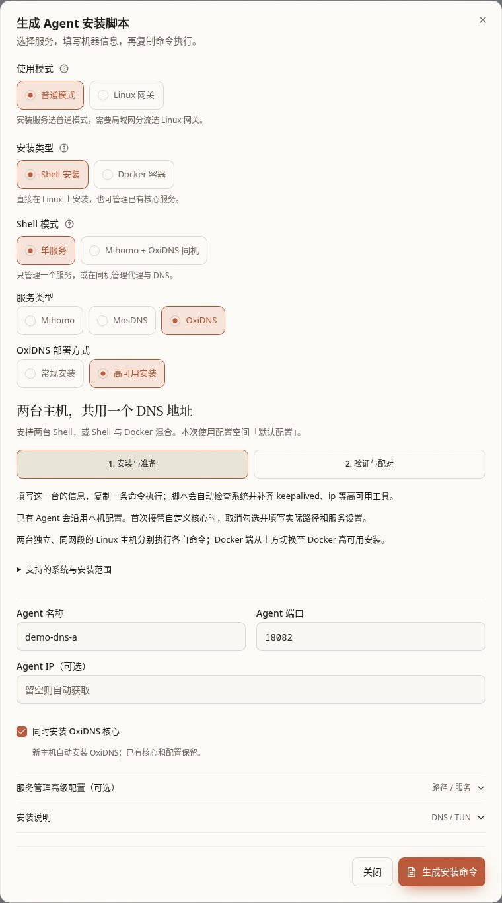
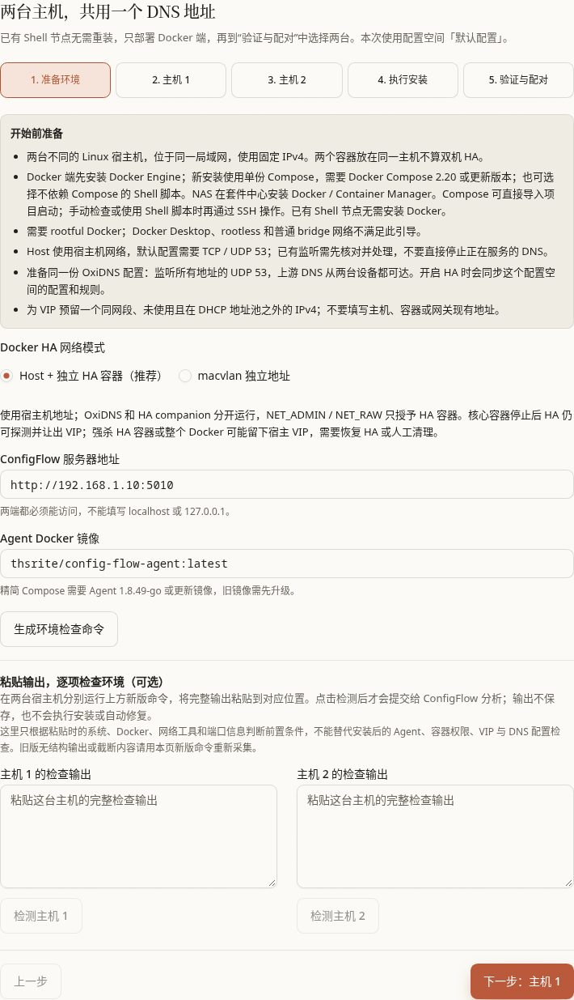
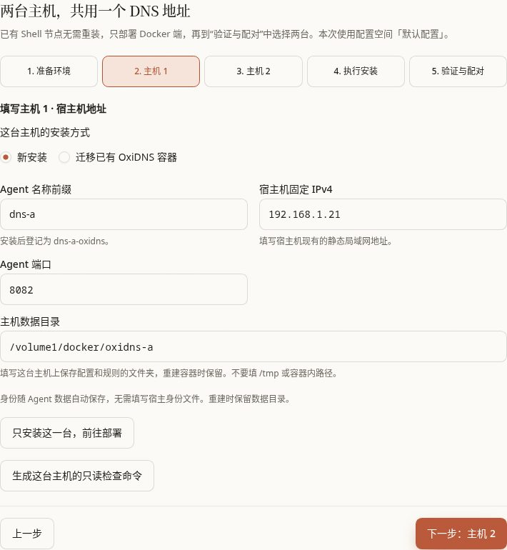
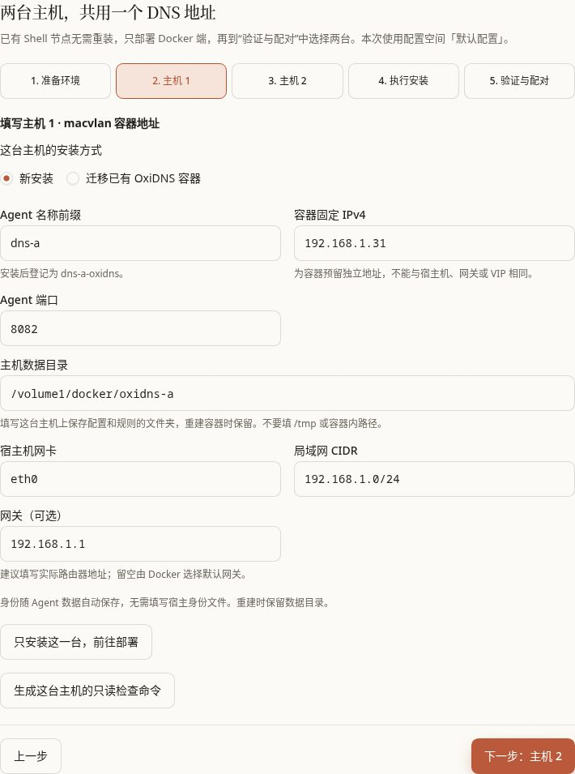
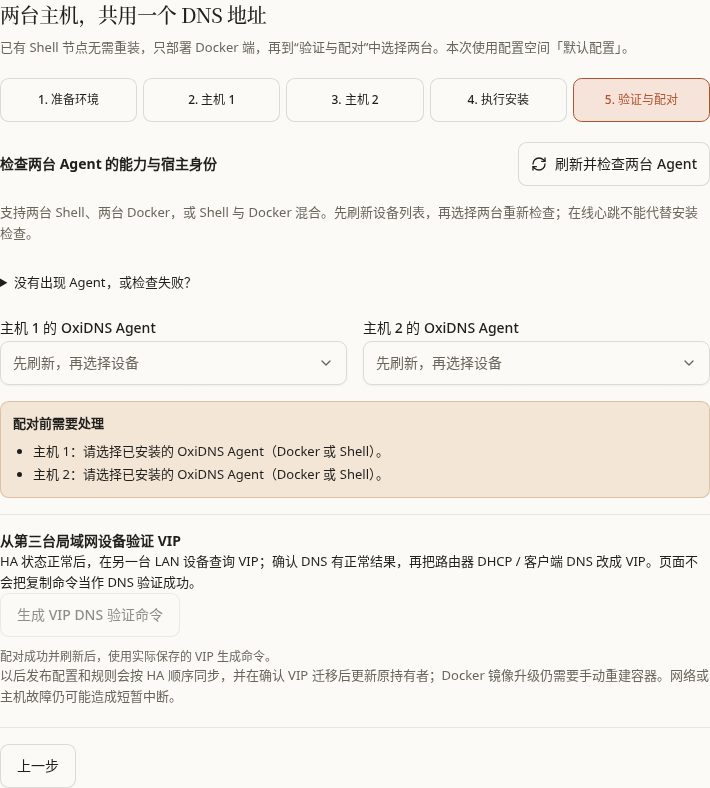

# OxiDNS 高可用：两台设备共用一个 DNS 地址

[文档首页](../README.md) · [Agent 安装](agent-install.md#ha) · [Agent 日常操作](../manual/agents.md)

这项功能让两台 OxiDNS 共用一个**虚拟 IP**，界面也叫 VIP。客户端只填写这个地址；正常时由其中一台回答，另一台待命。原来持有地址的一台出故障时，另一台可以接管同一个地址。

例如：设备 A 是 `192.168.1.21`，设备 B 是 `192.168.1.22`，预留 `192.168.1.53` 作为 VIP。客户端的 DNS 填 `192.168.1.53`。这里的数字只是例子，请按自己局域网的地址填写。

高可用默认**未开启**。安装 Agent、准备依赖、生成 Compose、复制命令都不会替你完成配对。要等“主备正常”，再从第三台设备验证 DNS，最后才把客户端改到 VIP。

本页目录：

- [先选部署组合](#combinations)
- [所有组合都要满足的条件](#requirements)
- [按所选组合完成部署](#combination-steps)
- [Shell、Host、macvlan 各怎么准备](#prepare)
- [已有服务如何迁移并保留身份](#migration)
- [配对、填写 VIP、开启](#pair)
- [把客户端 DNS 接到 VIP](#clients)
- [主备、抢占、发布和规则同步怎样工作](#operation)
- [升级、修改、停用与回退](#maintenance)
- [检查失败与常见问题](#troubleshooting)

## 先选部署组合

“Shell”表示直接装在 Linux 系统中；“Host”表示 Docker 容器使用宿主机的网络；“macvlan”表示 Docker 容器有自己独立的局域网地址。**两端不要求使用同一种安装方式**，但每一端都必须通过自己的高可用检查。

| 两端组合 | 当前支持情况 | 实际怎么准备 |
| --- | --- | --- |
| [Shell + Shell](#combination-shell-shell) | 支持 | 两台分别运行 Shell 高可用安装/准备命令，再在同一个配置空间配对。两端可分别使用 systemd 或 OpenRC。 |
| [Docker Host + Docker Host](#combination-host-host) | 支持，Docker 新装默认推荐 | 每台独立宿主机各建一份 Host 高可用项目。每份都有 OxiDNS 容器和独立的 HA 辅助容器。 |
| [Docker macvlan + Docker macvlan](#combination-macvlan-macvlan) | 支持，要求网络支持 macvlan | 两台宿主机各建一份 macvlan 高可用项目；两个容器各有固定局域网地址，再另留一个 VIP。 |
| [Shell + Docker Host](#combination-shell-host) | 支持 | Shell 端准备原生依赖；只为 Docker 端生成 Host 项目，然后选择这两个 Agent 配对。 |
| [Shell + Docker macvlan](#combination-shell-macvlan) | 支持 | Shell 端用本机地址，Docker 端用容器独立地址，两者与 VIP 都在同一网段。 |
| [Docker Host + Docker macvlan](#combination-host-macvlan) | 允许配对，但尚未单独完成这组组合的实机全流程验证 | 分别按 Host 和 macvlan 生成各自项目，再选这两个已上线的 Agent。当前向导一次只选一种 Docker 网络模式，需要分两次生成，保留第一台的文件。先在自己的网络完成验证。 |

配对时可以把任意一端选为优先主机；Shell 并不天然比 Docker 优先。要减少首次部署的变量，选两台 Shell，或两台 Docker Host。

以下情况不满足本功能：

- 同一 Linux 宿主机上的两个容器，或同机的两个服务。换两个 IP、容器名或身份文件不能变成双机保障；系统会检查真实宿主身份。
- 普通 Docker bridge 容器。映射 DNS 端口不等于具有管理局域网 VIP 的能力。
- Docker Desktop、rootless Docker，或只启动了普通 OxiDNS 镜像、没有专用 HA 设置的容器。
- 只安装 Mihomo/MosDNS，或把不同配置空间里的两台 OxiDNS 直接配成一组。
- 想把 IPv6 地址填进 VIP。当前高可用配对使用 IPv4。

虚拟机、LXC 可以用于实验，但若两台都放在同一台物理服务器上，物理服务器关机时它们会一起失效。生产环境应分散到真正独立的设备、电源或其他需要防护的故障范围。

## 所有组合都要满足的条件

先填好下面这张准备清单，再开始安装。

| 要准备什么 | 怎么确认 |
| --- | --- |
| 两个固定地址 | Shell/Host 填各自 Linux 宿主机的局域网 IPv4；macvlan 填容器的独立 IPv4。不要填 VIP，也不要填 `127.0.0.1`。 |
| 一个额外 VIP | 与两台 OxiDNS 在同一局域网、同一 IPv4 网段；不等于任一主机、容器或网关地址，也不在 DHCP 自动分配池中。先从路由器的地址分配表确认空闲。 |
| 两台互通 | 两台能互相访问，客户端能访问两端和 VIP 的 DNS 服务；网络/防火墙允许两端的 VRRP 通信。跨网段仅仅能 ping 通，并不满足同网段要求。 |
| 管理通道互通 | 两端都能访问 ConfigFlow 的完整服务地址，ConfigFlow 也能访问两台 Agent 地址和端口。Agent 端口与 DNS 的 53 端口是两回事。 |
| 同一份配置 | 两个 Agent 绑定同一个配置空间。先保存打算让两台共同使用的 OxiDNS 配置和规则。首次开启会把它们发布到两端。 |
| DNS 能回答 VIP | 配置至少有监听所有 IPv4 地址的 UDP 53，例如 `0.0.0.0:53`。只监听 `127.0.0.1:53` 或某台固定 IP 不行。建议同时配置 TCP 53，以满足需要 TCP 的 DNS 查询。 |
| 可用的上游 | 相同配置中的上游从两台都能访问。若代理 DNS 使用 Mihomo，两台都要转发到**同一个 Mihomo 的局域网地址**；不能各自填 `127.0.0.1`。 |
| 支持当前功能的 Agent | 配对页会实时检查高可用、Docker 环境和计划迁移能力。版本号新不代表环境一定就绪，以检查结果为准。 |
| 保留身份和数据 | 重启、升级、重建都要保留 Agent 身份、OxiDNS 配置与规则、HA 状态目录。不要把一台的身份文件复制给另一台。 |

如果启用了“DNS 联动”，把连接方式设为“指定网络地址”。“同一 LXC / All-in-one 容器（自动验证）”会使用本机连接，不适合跨两台设备的这组 HA。

如果 OxiDNS 会向 RouterOS 写入地址列表或路由，请检查“正常停止时清理临时条目”（原生编辑器中叫“关闭时清理”）。这项默认开启；HA 中建议关闭，保存并发布后生效，避免一台正常停止时清掉另一台还在使用的条目。关闭后旧条目会保留；若以后改回单机并需要停机清理，再开启并重新发布。

**IPv6 的范围：**当前 VIP、两端配对地址和自动下发的 HA DNS 入口都是 IPv4。这不等于 DNS 不能查询 AAAA 记录，也不等于 OxiDNS 本身不能另行配置 IPv6；只是本功能没有替你创建 IPv6 VIP，也不会同步配置路由器的 IPv6 DNS 下发。若客户端还从 IPv6 获得其他 DNS，可能会绕过这里的 VIP。

## 按所选组合完成部署

下面每组都使用**两台独立的 Linux 宿主机**，同处示例网段 `192.168.1.0/24`，主路由为 `192.168.1.1`，预留 VIP `192.168.1.53`。请替换为自己的网段和空闲地址；两个 Agent 最后绑定同一个配置空间，例如“家庭 DNS”。VIP 此时只做预留，不手工加到任一设备上。

步骤按新安装说明。已有服务先看 [迁移方式](#migration)，保留原身份和数据，再回到对应组合继续。每个“安装完成”都只表示这一端已经准备好；还要单独配对并开启，VIP 才会投入使用。

### Shell + Shell

设备 A 的 Linux 固定地址用 `192.168.1.21`，设备 B 用 `192.168.1.22`；这里没有 Docker 容器地址。

1. 为设备 A 选择 **普通模式 → Shell 安装 → 单服务 → OxiDNS → 高可用安装**。填 A 的名字、Agent 端口和 `192.168.1.21` 地址，新机器勾选安装 OxiDNS 核心，按 [Shell 准备步骤](#prepare-shell)生成命令。
2. 在 A 的 root 终端执行 A 的命令，等待安装完成并在 Agent 页确认上线。
3. 再为另一台独立设备 B 填名字、端口和 `192.168.1.22` 地址，单独生成并执行 B 的 Shell 命令。两台可以使用不同的 systemd/OpenRC 系统；不要把 A 的身份文件复制给 B。
4. 两台都上线后，在“验证与配对”选择这两个 OxiDNS Agent，核对同一配置空间。按 [配对步骤](#pair)填写预留的 `192.168.1.53` VIP 并开启。
5. 等状态显示一台持有 VIP、另一台待命，再按 [客户端验证](#clients)从第三台设备测试，成功后才修改全网 DNS。

### Docker Host + Docker Host

宿主机 A 用 `192.168.1.21`，宿主机 B 用 `192.168.1.22`。Host 容器使用各自宿主机的地址，不另外分配容器 LAN IP。

1. 选择 **普通模式 → Docker 容器 → OxiDNS → 高可用安装**，在准备环境中选 **Host + 独立 HA 容器**，按 [Host 准备说明](#prepare-host)核对两台的 53 端口。
2. 分别填写主机 1 的 `192.168.1.21` 和主机 2 的 `192.168.1.22`，使用不同 Agent 名称前缀、各自主机上的持久数据目录；新装可保留默认“精简 Compose”。
3. 先生成主机 1 的 `compose.yaml`，保存在标明 A 的目录并部署到 A；再生成主机 2 的文件，保存在标明 B 的目录并部署到 B。**两份文件分别保存，不用第二份覆盖第一份，也不在同一台宿主机启动两份。** 每台的 OxiDNS/Agent 容器和 HA 辅助容器都要保留运行。
4. 确认 `192.168.1.21`、`192.168.1.22` 对应的 Agent 都上线，在“验证与配对”选择它们，核对同一配置空间，按 [配对步骤](#pair)开启 `192.168.1.53` VIP。
5. 等主备状态正常，从 [第三台客户端验证](#clients) DNS，再让客户端使用 VIP；仅看到两个 Docker 项目启动成功还不算高可用开启。

### Docker macvlan + Docker macvlan

宿主机 A、B 可分别用 `192.168.1.11`、`192.168.1.12`；它们的 OxiDNS 容器分别用 `192.168.1.21`、`192.168.1.22`，另留 `192.168.1.53` 给 VIP。**配对使用容器的 `192.168.1.21`、`192.168.1.22`，不是宿主机的 `192.168.1.11`、`192.168.1.12`。**

1. 选择 **普通模式 → Docker 容器 → OxiDNS → 高可用安装**，准备环境选 **macvlan 独立地址**，先按 [macvlan 准备说明](#prepare-macvlan)确认网络和管理连接可用。
2. 主机 1 填容器 `192.168.1.21`，主机 2 填容器 `192.168.1.22`；两边分别填写实际 LAN 网卡、`192.168.1.0/24`、网关 `192.168.1.1` 和各自持久目录。网卡名称不一定相同，按各自主机填写。
3. 分别生成 A、B 的 `compose.yaml`，保存在两个标明设备的目录，上传到对应的独立宿主机并启动。保留各自生成的权限和挂载；不要把宿主机固定地址填成容器地址。
4. 确认 ConfigFlow 能连接 `192.168.1.21` 和 `192.168.1.22` 的 Agent，两端也能互通。选择这两个 Agent、核对同一配置空间，再按 [配对步骤](#pair)开启 `192.168.1.53` VIP。
5. 从 [第三台客户端验证](#clients) DNS，确认只有一端持有 VIP 后再接入客户端；若 macvlan 容器无法与面板互通，先处理网络，安装成功不能替代此检查。

### Shell + Docker Host

Shell 设备 A 用 `192.168.1.21`，独立 Docker 宿主机 B 用 `192.168.1.22`，VIP 用 `192.168.1.53`。B 的容器共用 B 的 `192.168.1.22` 地址。

1. 为 A 选择 **Shell 安装 → 单服务 → OxiDNS → 高可用安装**，按 [Shell 准备](#prepare-shell)生成并在 A 执行命令，确认它上线。已有 Shell Agent 时保留原服务，缺依赖再补准备命令。
2. 为 B 切到 **Docker 容器 → OxiDNS → 高可用安装**，选择 **Host + 独立 HA 容器**，只填写这台 Docker 主机的 `192.168.1.22` 地址、名称和数据目录。
3. 在“主机 1”页选择“只安装这一台，前往部署”，按 [Host 准备](#prepare-host)生成 B 的 `compose.yaml`，保存到 B 的项目目录并在 B 启动。这里生成的只有 B 的 Docker 文件，不需要为 A 再生成 Docker 项目。
4. B 上线后到“验证与配对”，选择 A 的 Shell Agent 和 B 的 Docker Agent，核对同一配置空间；按 [配对步骤](#pair)填写 `192.168.1.53` 并开启。
5. 主备正常后完成 [第三台客户端验证](#clients)。安装类型不决定谁优先，配对时按你的计划选择优先主机。

### Shell + Docker macvlan

Shell 设备 A 用 `192.168.1.21`；另一台 Docker 宿主机 B 用 `192.168.1.12`，B 的 OxiDNS 容器用 `192.168.1.22`，VIP 用 `192.168.1.53`。配对选 Shell 的 `192.168.1.21` 与容器的 `192.168.1.22`。

1. 为 A 选择 **Shell 安装 → 单服务 → OxiDNS → 高可用安装**，按 [Shell 准备](#prepare-shell)完成安装或补齐依赖，确认 A 上线。
2. 为 B 选择 **Docker 容器 → OxiDNS → 高可用安装 → macvlan 独立地址**，填写容器 `192.168.1.22`、B 的实际 LAN 网卡、`192.168.1.0/24`、网关 `192.168.1.1` 和持久目录。不要把 B 的宿主机 `192.168.1.12` 当作容器固定地址。
3. 在“主机 1”页点“只安装这一台，前往部署”，按 [macvlan 准备](#prepare-macvlan)生成并保存 B 的 `compose.yaml`，只在 B 启动。A 使用原 Shell 服务，不再为它建容器。
4. 确认面板能连接 `192.168.1.22` 的 Agent，且 Shell A 与容器 B 能互通；在“验证与配对”选择这两个 Agent，核对同一配置空间，按 [配对步骤](#pair)开启 `192.168.1.53` VIP。
5. 等主备正常，按 [客户端验证](#clients)从第三台设备查询 VIP，再修改客户端 DNS。

### Docker Host + Docker macvlan

Host 宿主机 A 用 `192.168.1.21`；独立宿主机 B 用 `192.168.1.12`，B 的 macvlan 容器用 `192.168.1.22`，VIP 用 `192.168.1.53`。**这组允许配对，但尚未单独完成实机全流程验证。** 先用测试客户端确认自己的网络能正常运行，再扩大使用。

1. 先为 A 选择 **Docker 容器 → OxiDNS → 高可用安装 → Host + 独立 HA 容器**。只填 A 的 `192.168.1.21`、名称和数据目录，点“只安装这一台，前往部署”，按 [Host 准备](#prepare-host)生成文件。
2. **先下载并保存 A 的 `compose.yaml`**，在 A 启动，保留 OxiDNS/Agent 和 HA 辅助容器。确认 A 上线后，再准备另一端。
3. 重新进入准备环境，切换为 **macvlan 独立地址**。填写 B 容器的 `192.168.1.22`、B 的实际 LAN 网卡、网段、网关和数据目录；仍选“只安装这一台”，按 [macvlan 准备](#prepare-macvlan)单独生成 B 的文件。
4. 把 B 的 `compose.yaml` 保存到另一个目录并在 B 启动。**必须分两次生成并保留两份文件：切换模式会使页面旧生成结果失效，不能用 macvlan 文件覆盖已经保存的 Host 文件。** 两端的容器结构不同，分别使用各自生成的内容。
5. 两个 Agent 上线后，在“验证与配对”选择实际对应 `192.168.1.21` 的 Host Agent 与 `192.168.1.22` 的 macvlan Agent，核对同一配置空间，按 [配对步骤](#pair)开启 `192.168.1.53` VIP。表单都曾使用“主机 1”，不代表它们是同一台设备。
6. 先完成 [第三台客户端验证](#clients)，再按后面的 [检查说明](#troubleshooting)确认主备状态和异常处理；不要仅凭“允许配对”或“安装成功”就把全网 DNS 切到 VIP。

## Shell、Host、macvlan 各怎么准备

入口有两个：

1. 还没安装：进入 **Agent → 安装脚本 → 普通模式**，选择对应安装类型及 OxiDNS，再把“OxiDNS 部署方式”从默认的“常规安装”改为“高可用安装”。
2. 已有 OxiDNS Agent：在卡片的 **DNS 高可用 → 设置** 中点“打开高可用安装引导”。向导使用这台 Agent 绑定的配置空间。

详细安装命令、核心路径和服务管理方式见 [Agent 安装](agent-install.md#ha)。下面说明高可用特有的选择。

### Shell 端

1. 进入“1. 安装与准备”，填写这一台的名字、Agent 端口和固定地址。
2. 新机器默认勾选“同时安装 OxiDNS 核心”，会补装缺少的核心并准备 HA 工具。已有核心会保留；首次接管自定义路径时，取消勾选并填写真实的配置路径、程序路径、服务设置。从已有 Agent 的卡片打开时，默认使用已有核心，不重新安装。
3. 复制这一台的命令，在对应 Linux 设备上执行。另一台 Shell 设备要生成它自己的命令。
4. 脚本会准备 keepalived、iproute2 和服务管理依赖；支持 systemd/OpenRC，能识别 Debian/Ubuntu、Alpine、Arch、Fedora/RHEL 等包管理器。依赖准备失败会停止并说明原因。
5. 等 Agent 上线后进入“2. 验证与配对”。安装结束仍没有 VIP。

已有 Shell Agent 如果缺少依赖，可重新运行准备命令。脚本会沿用本机已有身份、端口、核心路径和现有核心；不要为了补依赖删除 Agent 后重新登记。已有 keepalived 配置会保留，冲突或不完整安装需要先处理，再重试。

### Docker Host 端：默认推荐

1. 在“准备环境”选择默认的 **Host + 独立 HA 容器（推荐）**。
2. 填 ConfigFlow 服务地址。两台设备都必须能访问这个地址。
3. 给每台 Docker 主机分别填“宿主机固定 IPv4”和持久数据目录。Host 与宿主机共用网络，需先确认 DNS 要使用的 TCP/UDP 53 没有冲突。
4. 新安装默认选择“精简 Compose”。生成并保存各自主机的 `compose.yaml`，到那台主机启动项目，或导入容器管理器的项目后启动。需要 Docker Compose 2.20 或更新版本；界面提示精简 Compose 需要 Agent 1.8.49-go 或更新镜像。
5. 每台会运行 OxiDNS/Agent 容器和独立的 HA 辅助容器。管理网络地址所需权限只给 HA 辅助容器；不要删掉它，也不要把两个服务改回一个普通容器。

Host 的好处是使用现有主机地址。代价是受宿主机端口占用影响，并且强杀 HA 辅助容器或整个 Docker 可能留下宿主机上的 VIP。正常升级只先重建一台的核心容器，并保持辅助容器运行；后文说明恢复办法。

### Docker macvlan 端：容器有独立地址

1. 在“准备环境”选择 **macvlan 独立地址**。
2. 每台填“容器固定 IPv4”，与宿主机地址、网关、另一容器和 VIP 都不同。
3. 填实际接入局域网的“宿主机网卡”，例如 `eth0`；填“局域网 CIDR”，例如 `192.168.1.0/24`。这里的 `/24` 表示该网段范围，不能只填一个 IP。
4. “网关（可选）”建议填实际路由器地址；留空会由 Docker 选默认网关，未必符合你的网络。
5. 生成并启动这一台的 Compose。该模式在一个容器内运行 OxiDNS、Agent 和 keepalived，需要保留生成的权限和挂载。

macvlan 默认不能直接访问它所在的宿主机。若 ConfigFlow 恰好也在这台宿主机上，请先解决实际可达性，或把 ConfigFlow 放在另一台可达的局域网设备/合适的 macvlan 网络中。宿主机已有 53 端口不会直接占住容器的独立地址，但容器自己的 DNS 必须正常监听。NAS/交换机/网卡不支持这种网络时选 Host。

### 混合组合：只安装缺少的那一端

已有 Shell + 新 Docker：保留 Shell，在 Docker 向导只填并安装 Docker 端；“主机 1”页可以点“只安装这一台，前往部署”。上线后到“验证与配对”选择原 Shell 和新 Docker，不要为了让表单看起来一致重装 Shell。

Host + macvlan：先按一种模式为第一台生成并保存文件，再切换模式为第二台单独生成。切换网络或改表单会使旧生成结果失效，所以先把第一台文件保存好。两台都上线后，在配对页按**实际 Agent**选择，不按表单位置猜设备。两端必须仍在同一 IPv4 网段。

### Docker 表单里容易混淆的选项

| 字段或按钮 | 默认、建议及生效时机 |
| --- | --- |
| 这台主机的安装方式 | 默认“新安装”；真正已有容器时选“迁移已有 OxiDNS 容器”，先核对旧数据，见下一节。切换表单本身不会动远端。 |
| Agent 名称前缀 | 新装默认 `dns-a` / `dns-b`，登记名会加 `-oxidns`。两台用不同前缀；迁移则填原 Agent 完整名称。 |
| Agent 端口 | 默认 `8082`。这是管理端口，不是 DNS 端口；改后使用新生成的安装文件，并确认 ConfigFlow 能访问。 |
| 主机数据目录 | 默认空，需要填写宿主机上的持久目录，例如 NAS 的 `/volume1/docker/oxidns-a`。不要填 `/tmp` 或容器内部路径。 |
| Agent Docker 镜像 | 默认 `thsrite/config-flow-agent:latest`。固定版本时填实际目标镜像；仅改网页不会升级已经运行的容器。 |
| 新安装部署方式 | 默认“精简 Compose”；“Shell 脚本”是**在宿主机执行脚本来创建 Docker 容器**，不会把 Docker 端变成原生 Shell 端。没有合适 Compose 工具时可选它。 |
| 主机没有身份文件，安装时创建 | 脚本/迁移路径中默认不勾，通常使用 `/etc/machine-id`。确实没有稳定身份文件才勾，填持久保存路径，在各自主机分别创建；不能共用复制来的内容。 |
| 精简 Compose 的身份 | 自动保存在 Agent 数据目录，不需要填写单独身份文件。仍需保留生成的真实宿主证明挂载。重建时保留全部数据。旧方案若用身份卷，也要保留原卷。 |
| 生成环境检查命令 / 生成这台主机的只读检查命令 | 只生成检查命令；复制到对应宿主机执行，将完整输出按页面要求粘贴检查。它不代替安装，也不代表环境已通过。 |
| 主机 1 / 2 的检查输出 → 检测主机 1 / 2 | 默认留空，可选。分别粘贴各自主机的完整输出，点“检测”才提交分析；输出不保存，不安装、不自动修复。按“通过/需注意/未通过/无法判断”逐项处理，两份相同输出不能证明是两台主机。修改输出或网络模式后要重新检测。 |
| 执行命令的主机 | 在“生成并安装”中选择主机 1 或 2，默认先处理主机 1。生成、复制和执行前核对地址，不能把第二台的命令在第一台重复运行。 |
| 生成主机…的 Compose / 安装命令 | 按当前表单生成文件或命令。改变地址、目录、模式后要重新生成；不会自动在宿主机执行。 |
| 下载 compose.yaml / 复制 Compose / 启动项目 | 下载或复制后，去对应主机启动。首次安装凭据有效 24 小时，不要公开分享文件；过期时用相同设置重新生成。 |
| 查看 Compose 定义 / 日志命令 / 复制 | 展开是查看完整内容，复制只是放入剪贴板。日志命令要在对应宿主机执行；迁移的 Compose 定义只供核对，实际迁移仍要运行带检查与备份的安装脚本。 |
| 上一步 / 下一步 | 只切换向导页面。进入下一步不等于本步已经执行成功；以设备上线和实时检查为准。 |

环境检查只分析粘贴那一刻的系统、Docker、工具与端口信息，不能替代安装后的 Agent 权限、VIP 和 DNS 检查。出现“无法判断”时重新运行本页生成的新版命令，粘贴完整输出；不要删掉报错行来让结果变成通过。

## 已有服务如何迁移并保留身份

先区分三种情况，不能一律拿“新安装”文件覆盖旧容器。

| 现状 | 处理方式 |
| --- | --- |
| 已有原生 Shell OxiDNS/Agent | 优先直接验证与配对；缺依赖再运行 Shell 准备命令，保留本机身份和核心配置。首次接管自定义核心按安装手册填写实际路径。 |
| 官方单 OxiDNS 普通 Docker 容器，默认入口/启动命令，只有原 Agent 与 OxiDNS 两项数据挂载 | 可以选择“迁移已有 OxiDNS 容器”，用页面生成的迁移脚本完成检查、备份和重建。 |
| 已有 Docker HA，或有额外挂载、自定义入口/启动命令等 | 不在自动迁移范围。即使先停用 HA，旧容器仍有 HA 环境变量和挂载。保存原 Compose，在其基础上手动补充/调整 HA 定义，不能直接覆盖为新安装。 |

自动迁移时，先运行“只读检查命令”，从输出核对：旧容器精确名称、原 Agent **完整名称**、原 Agent 身份挂载、原 OxiDNS 数据挂载。挂载如果是“宿主目录”，填原绝对路径；如果是“Docker 数据卷”，填原卷名。默认表单选“宿主目录”，不要在不确认的情况下沿用。HA 持久目录和迁移备份目录均需另填持久绝对路径。

迁移脚本会停止并备份旧容器、保留旧容器再重建。这台 DNS 会暂停，所以要先安排临时可用 DNS。执行的是“安装或迁移容器”脚本；展开的 Compose 只是供核对，不能跳过迁移脚本直接启动。失败时使用页面生成的“迁移失败时回滚”命令，恢复后验证原 Agent 和 DNS。

已有 HA 需要更换部署方式、网络或持久目录时，按以下顺序：

1. 保存原 Compose/启动命令、环境、网络、全部挂载、镜像版本和数据备份，记下当前 VIP 持有者。
2. 把路由器 DHCP/客户端 DNS 暂时改到仍健康的一台 OxiDNS 固定地址，重新发布并实际验证客户端解析。
3. 在“DNS 高可用 → 设置”点“停用”，等两端清理完成。停用会让 VIP 下线。
4. 先处理原备用端，一次只重建一台，复用原身份、配置、规则和运行数据；确认它上线、DNS 正常、HA 环境检查通过。
5. 把临时 DNS 切到这台已经恢复的固定地址，确认解析后再处理另一台。
6. 两端恢复后重新配对，从第三台设备验证 VIP，再把客户端改回 VIP。

任何一步失败，先保持客户端使用健康的固定 DNS，停止新的容器，用原 Compose/旧容器和备份恢复；不要删原数据卷。身份损坏时先恢复原身份文件或数据备份，不要用“删除身份重新注册”绕过检查。

## 配对、填写 VIP、开启

这些截图使用真实页面和演示地址，展示填写位置；没有在截图环境执行安装或配对，也不代表已经通过双机验收。

1. 在“验证与配对”点 **刷新并检查两台 Agent**，拿到最新设备列表。
2. 选择“主机 1 的 OxiDNS Agent”和“主机 2 的 OxiDNS Agent”。主机 1 是优先主机，主机 2 是备用。已选设备改变后，再点一次“刷新并检查两台 Agent”。
3. 如果出现“绑定到「配置空间名」”，先核对这是你准备共同使用的空间，再绑定。绑定改变后续配置来源，不是复制另一台设备的在线文件。
4. 逐项解决“配对前需要处理”。在线心跳只说明 Agent 在报告状态，不能替代 HA 环境检查。Shell 显示身份已读取时，正式开启还会检查依赖、权限和 DNS。
5. 打开下方“DNS 高可用 → 设置”，选择备机，填 VIP；高级 VRID 通常留空。
6. 点 **开启**，确认首次同步说明。等两台配置/规则发布和 DNS 检查完成，再启用主备切换。关闭网页后，后台任务会继续。
7. 返回卡片展开 DNS 高可用详情，点“刷新状态”。正常应是两台都在线、OxiDNS 应答正常、keepalived 运行中，而且**恰好一台**显示“持有虚拟 IP”，另一台“待命”。

| 配对控件 | 默认与推荐 | 修改、验证和回退 |
| --- | --- | --- |
| 备机 | 默认未选；只选同空间、尚未加入其他组的另一台 OxiDNS。当前打开卡片的设备为配置主机。 | 选择后尚未生效；点“开启”才提交。已开启不能直接换对端，需先停用再配对。 |
| 虚拟 IP | 默认空，必须填自己预留的同网段 IPv4。 | 开启成功才由设备持有。改 VIP 需先安排临时 DNS、停用、重开，再修改客户端/DHCP。 |
| 高级选项 → VRID | 默认留空；自动取 VIP 最后一段，若为 0 或 255 则用 53。 | 同一局域网的其他 VRRP 组已占用此编号时，改成未使用的 1–255；一组的两端会使用同一编号。已启用需停用后重设。 |
| 开启 | 默认不执行。会同步已保存的配置和规则，不能把它当成只打开一个标记。 | 看“正在同步主备”直到完成；失败先看具体成员/步骤，不要把提交成功当作开启完成。 |
| 刷新状态 | 读取两端实际状态，不改配置。 | 网络恢复后用它确认结果。显示“上次结果”时，不应据此直接切客户端 DNS。 |
| 关闭 | 关闭对话框，不停用 HA，也不取消已提交的同步。 | 再打开查看；真的停用需点“停用”。 |

一台已经与其他设备配对时，不能直接拉进新组。更换成员、改 VIP/VRID、改绑定空间前，先按后面的停用步骤处理旧组。

## 把客户端 DNS 接到 VIP

1. 配对成功后，点 **生成 VIP DNS 验证命令**。页面使用已经保存的 VIP 生成命令。
2. 把命令放到**第三台局域网设备**执行，确认 DNS 有实际结果。不能只在持有 VIP 的本机检查，也不能把“已复制”当成验证通过。
3. 使用 ConfigFlow 管理上游路由时，到“上游路由”重新发布 DHCP DNS 与 DNS 劫持设置。路由器选择这组任意一个 OxiDNS 成员后，满足 HA 条件时实际下发的是 VIP。
4. 自己管理路由器时，把对应 DHCP 网段的 DNS 改成 VIP；静态配置的电脑/手机也改成 VIP。
5. 让客户端重新连接或续租 DHCP，然后核对它实际使用的 DNS，查询一个日常域名。

HA 页面不会自动替你重新发布路由器。已经拿到旧 DHCP 信息的设备也不会因为网页显示“已开启”立即换 DNS。

如果希望设备始终使用本组的规则，不要另外填一个公网 DNS 当“备用 DNS”：客户端可能随时选择它，从而绕过分流规则。高可用的备用已经在 VIP 后面完成。IPv6 DNS 下发、浏览器/系统自带加密 DNS 仍要按你的接入方式单独核对。

## 主备、抢占、发布和规则同步怎样工作

### 配置主机与当前主机不是同一个概念

界面的“配置主机”表示优先使用的设备，固定优先级为 **150**；“配置备机”为 **100**。目前没有让用户自填优先级或开启/关闭抢占的按钮。

正常情况下优先主机持有 VIP；它不能应答时，备用接管。优先主机恢复健康后会重新参与优先选举，通常会拿回 VIP。计划发布期间会临时让出 VIP，完成后恢复正常选举。判断当前是谁服务，要看“持有虚拟 IP”，不要只看设备名里的“主/备”。

本地检查主要确认 OxiDNS 是否有 DNS 应答，**不是逐个检查所有上游和所有域名**。例如外网故障导致服务返回失败应答，也不一定触发接管。计划迁移则会更严格地确认对端和 VIP 的 DNS 解析结果。两台都依赖的路由器、交换机、上游或电源坏了，双机 DNS 也无法替代这些共同依赖。

### 首次开启与之后的完整配置发布

首次开启：同一个已保存配置快照及规则 → 先同步备机并检查 → 再同步主机并检查 → 配置主备切换 → 确认 VIP。两台原来在线文件不同，也会以这次选择的配置空间为准。

之后从任一成员点“推送”或“保存并发布”，会作为**整组发布**：

1. 找出现在没有持有 VIP 的设备，先更新它。
2. 它成功并通过 DNS 检查后，把 VIP 迁移过去。
3. 确认 VIP 已迁移且能解析，再更新原持有 VIP 的设备。
4. 两端都完成后恢复正常选举并确认解析。

这是后台自动执行的顺序，界面没有单独“强制切换主备”按钮。普通“重启服务”也不等于这条计划发布流程。不要为了测试切换同时重启两台。

任何一步失败都会停止继续更新后面的设备。已经成功更新的一端不保证自动跟着另一端退回；请看每台结果，修正后将目标配置重新发布到整组。**主备发布不能单独点历史记录回滚一台**，后端会拒绝，以免两台使用不同内容。

### 三种规则操作怎么选

| 控件 | 默认及用途 | 开启/关闭后怎样生效 |
| --- | --- | --- |
| 规则库自动同步 | 默认关闭。需要自动跟进本空间已启用引用的规则集时开启。 | 开关保存后后台检查变化；需要先成功发布一次建立基线。只新增一个未引用的规则库条目不会下发。关闭阻止后续自动任务，不撤销已经提交的任务。 |
| 单条规则自动同步 | 默认关闭。希望已选择的单条规则修改后自动下发时开启。 | 同样需要成功发布基线；它不是“自动发布所有代理/DNS 草稿”。改其他配置仍需主动发布。 |
| 更新规则 | 手动按钮，没有常开状态。想立即刷新已发布配置使用的规则时点击。 | 在 HA 中从任一成员操作都更新整组，先处理一端再处理另一端。纯规则事务走热重载，不为此迁移 VIP；看两台最终结果。 |

首次开启 HA 时，两台采用**配置主机当时的两项自动同步开关**。之后在任一成员改开关，都会同时保存到两台。规则更新若提示缺少基线、管理 API 未配置、配置不一致或核心能力不足，先按提示完整发布或升级，再重试。

这里同步的是配置和受管规则，不应把它当作整个磁盘、DNS 缓存或所有运行状态的实时复制。重建时仍需保留两端各自的数据。

## 升级、修改、停用与回退

### 日常升级

- Shell Agent 可从卡片的“更新”发起在线更新；更新 Agent 不等于升级 OxiDNS 核心。先完成当前发布，再一次处理一端。
- Docker 的“更新”打开操作说明，网页不直接重建容器。沿用原 Compose 项目或原启动参数、身份和全部挂载。先更新未持有 VIP 的核心容器，确认它恢复，再处理另一台。Host 的 HA 辅助容器要保持运行。
- 更改 Docker HA 结构、网络模式、身份目录等，按前面的[迁移步骤](#migration)操作；普通拉取镜像不会给旧 bridge 容器补齐 HA 环境。

### 停用或更换 VIP、对端、配置空间

1. 先把客户端/DHCP 临时改到健康的固定 DNS 地址，发布路由配置并验证。
2. 等所有主备发布、规则更新结束；进入任一成员的 **DNS 高可用 → 设置 → 停用**。
3. 正常停用移除 ConfigFlow 管理的 HA 配置，恢复 keepalived 原来的服务状态；VIP 下线，不卸载 OxiDNS。
4. 刷新两端状态，确认都不再参与这组 HA。到上游路由重新发布，不能让设备继续拿着已经下线的 VIP。
5. 要换 VIP/对端/空间时，改好后重新配对和验证，再把客户端改到新入口。

| 恢复按钮 | 什么时候用 | 会做什么、不能代替什么 |
| --- | --- | --- |
| 清除残留配置 | 首次开启失败，页面提示设备可能留有配置时 | 尝试清除由 ConfigFlow 写入的残留并恢复原服务状态；完成后再重试开启。 |
| 强制清除记录 | 正常停用/清理失败后才会出现，例如设备离线 | 只清理 ConfigFlow 的记录，**不能保证离线设备上的 keepalived 和 VIP 已移除**。设备恢复后要按错误提示人工清理原 HA；否则它可能继续持有旧 VIP。 |
| 刷新状态 / 查询恢复状态 | 响应丢失、恢复中、结果待确认 | 先查原任务和两端状态；不要靠删除设备记录或重新注册来猜测操作是否成功。 |

Host 模式若 HA 辅助容器被强杀而留下 VIP，优先恢复原辅助容器和持久数据，再由正常停用流程清理。无法恢复时，需要在相应主机按原配置核对并移除残留；先确认另一端和客户端 DNS 正常，不要随意清空整个 keepalived 配置，因为它可能还管理其他业务。

## 检查失败与常见问题

| 看到的现象 | 先检查什么 | 修正后怎么确认 |
| --- | --- | --- |
| 找不到另一台备机 | 两台是否都是 OxiDNS、绑定同一空间、没有加入其他组；安装是否真的执行完成。 | 刷新列表，重新选择两台，再点“刷新并检查两台 Agent”。 |
| Shell 身份已读取，但开启失败 | root 权限、systemd/OpenRC、keepalived/iproute2、核心路径与 UDP 53 监听；已有 keepalived 配置是否冲突。 | 先读具体原因，必要时重跑准备命令；正式开启仍会再检查。 |
| Docker 环境未就绪 | 是否专用 HA 安装；Host 辅助容器、共享目录、只读宿主挂载是否完整；macvlan 固定地址、网卡和权限是否正确。 | 修正原部署文件并重建对应端，保留数据；上线后重新检查环境。 |
| 两台来自同一宿主 | 两容器是否确实放在同一 Linux 主机，或身份是否被复制。 | 换到独立主机；不要通过伪造身份绕过。 |
| Agent 在线，DNS 没有应答 | 核心是否运行、配置是否已应用、监听地址是否覆盖 VIP、53 端口是否冲突、客户端路径是否可达。 | 分别查询两个固定 DNS 地址和 VIP，再看卡片 DNS 检查。 |
| 虚拟 IP 冲突 | 两台都认为自己是主机，常见于两端 VRRP 通信被拦截；也要排除第三台设备已经使用 VIP。 | 修复通信或地址冲突，刷新确认只剩一台持有 VIP，再恢复客户端使用。 |
| 虚拟 IP 未生效 | 两台都没持有 VIP，可能是服务/健康检查/配置未完成。 | 查看两端日志与主备任务，不能仅凭“已保存”认定可用。 |
| 虚拟 IP 迁移待确认 / 同步结果待确认 | 网络中断、Agent 无响应或 DNS 检查没通过，后台尚未确认。 | 恢复连通性，查询原任务；确认结果后再提交下一次发布。 |
| 宿主机能访问，macvlan 容器不能访问 ConfigFlow | macvlan 与本宿主机的默认隔离，或实际路由/防火墙不通。 | 从容器所在网络验证服务地址，使用真正可达的地址后重新检查。 |
| VIP 可用，但有些设备没有走规则 | 客户端还用旧 DHCP DNS、手填其他 DNS、IPv6 DNS 或自己的加密 DNS。 | 核对客户端实际 DNS，续租/重连；HA 不会自动接管这些入口。 |

故障接管需要检测和选举时间，期间可能有短暂查询失败。首次上线先验证两台固定地址、VIP 和客户端解析；需要演练时，安排维护窗口、一次只停止一端并保留恢复入口。不要把实验中的秒数作为所有家庭网络的保证。
