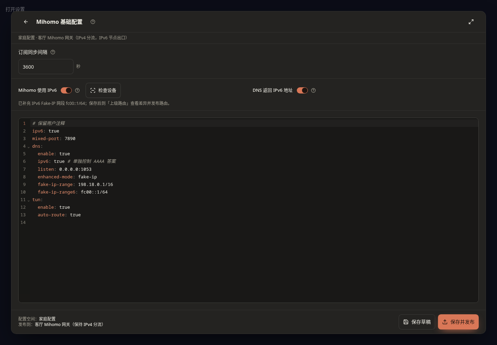
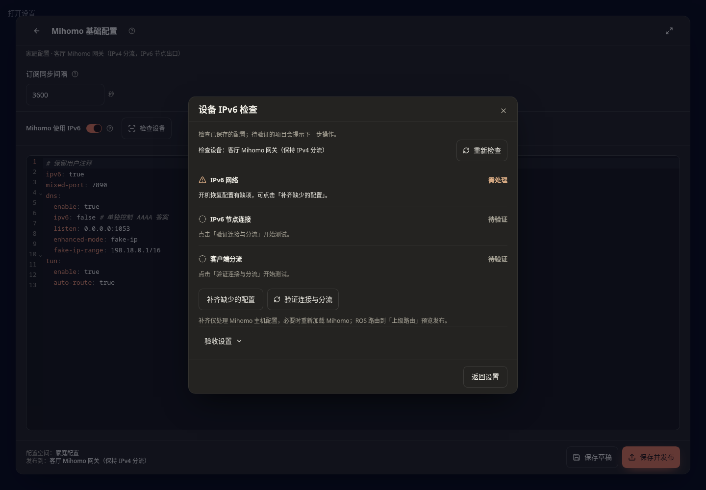

# Mihomo IPv6 检查与准备

适用于客户端继续以 IPv4 分流为主，同时让 Mihomo 使用 IPv6 节点的环境。客户端 IPv6 Fake-IP 还需要对应路由，相关问题会归到「客户端分流」结果中。

「Mihomo 使用 IPv6」允许 Mihomo 连接 IPv6 节点或网站，设备本身也要有可用的 IPv6 网络。「DNS 返回 IPv6 地址」决定 Mihomo DNS 是否给手机、电脑返回 IPv6 地址；客户端继续走 IPv4 分流时可以关闭，不影响 Mihomo 使用 IPv6 节点。

如果希望客户端也通过 IPv6 访问，还要准备好对应的 IPv6 路由。搭配 OxiDNS 时，应检查「优先 IPv4」等设置是否压下 IPv6 答案；只打开 Mihomo 的 DNS 开关不会自动修改 OxiDNS 或路由器设置。

## 使用流程

1. 在生成页的「Mihomo 基础配置」或 Mihomo 面板的设置中，分别设置「Mihomo 使用 IPv6」和「DNS 返回 IPv6 地址」。两个开关直接编辑同一份 YAML；手写配置会同步显示。在 IPv6 和 DNS 已启用、DNS 使用 Fake-IP 模式时，开启开关会自动补上缺失的 `fake-ip-range6: fc00::1/64`；已有网段沿用，关闭开关不删 YAML 网段。不会强行改变 DNS 模式或开启 TUN。空配置首次操作开关时使用实际默认模板。
2. 点击「保存草稿」后窗口保持打开，并提示保存成功，可继续修改或点击 IPv6 开关旁的「检查设备」，打开独立检查窗口。从设备面板进入时固定检查该设备；从生成页进入时选择本配置空间的 Mihomo 设备。检查是只读的，关闭窗口后保留 YAML 草稿。
3. 查看三项结果：**IPv6 网络、IPv6 节点连接、客户端分流**。通过的项目只占一行；需要处理的问题直接说明原因和下一步。页面不再展示逐条 RA、防火墙、NAT 或回程推演。预检发现地址和默认路由，只表示网络已就绪；实际连接通过需要运行验证。
4. 需要时点击「补齐缺少的配置」，仅处理 Mihomo 主机参数和开机恢复；这个入口不再写 ROS 路由。操作前重新核对配置、设备绑定和路由状态；实际草稿、目标设备或路由变更时停止。重复保存相同草稿、无关设备后台状态、路由列表返回顺序和 RA 有效期递减不会单独使检查失效。仅为已关联上游路由或启用 Linux 网关的设备自动开启转发。
5. 保存草稿后，到「上级路由 → 差异报告」查看 **IPv6 Fake-IP 分流路由**，核对网段、下一跳和状态。通过原有「预览发布」统一发布到 ROS。缺少稳定下一跳、网段冲突或读取失败时会阻止发布。
6. 通过「保存并发布」把 YAML 应用到 Mihomo。确认这次发布成功后，后台自动验收该设备和这次发布的配置版本。保存草稿、网络补齐、待激活或失败的发布都不会被当作发布成功。
7. 发布栏直接显示同样的三项结果。节点或客户端待验证时，点击「验证连接与分流」；尚未配置客户端时，先在「检查设备 → 验收设置」选择独立检测客户端。未取得实测证据不显示通过；配置未应用时提示先「保存并发布」。

## 路由由 ConfigFlow 统一管理

- **待添加**：预览发布后创建路由，并保存对象 ID 和配置记录。
- **已同步**：路由与当前保存的网段、下一跳一致，由 ConfigFlow 管理。重复发布不会重复添加。
- **沿用已有路由**：已有正确的手工或旧版路由，直接使用，不修改备注或接管归属；关闭开关时不会自动删除它。
- **待更新 / 待撤回**：改网段或关闭 IPv6 Fake-IP 后，再到差异报告预览并发布；只调整已确认归属的受管路由。
- **冲突 / 待确认**：地址不明确、网段重叠、受管对象被外部修改或读取失败时，保留现场并提示处理。

关闭开关只修改草稿；ROS 上的受管路由要经过上级路由发布才撤回。路由变更和原有发布共用状态复核、写后读取验证和失败补偿。自动 IP 规则同步不会顺带发布这些变更，出现 IPv6 差异时会暂停并要求手动预览。

## 验收设置

默认执行 Mihomo 主机自检。在设备检查窗口底部展开「验收设置」，可以选择独立检测客户端和检测网址。

- 不配置客户端时，检查主机、DNS 和代理访问；「客户端分流」显示「未配置」，说明尚未配置检测客户端。主机自检通过不代表手机、电脑的流量已测过。
- 检测客户端必须是本配置空间中独立的在线 Linux Agent，需要位于 ROS 后面，并使用平时的 DNS 和默认网关。Mihomo 主机自身不作为独立客户端。界面不会自动选择；原设备离线、改绑或不支持检测时，需明确重新选择或改为仅检查主机。
- 检测网址留空时使用这次发布快照中的健康检查网址，没有设置则使用默认检测网址。自定义地址只接受不含账号密码的 HTTP 或 HTTPS 网址。
- 保存设置后，后续手动验证和发布后验收使用这些设置。配置客户端后会检查它的 DNS、实际访问及对应的 Mihomo 连接证据；缺少任何必要证据时保留未验证或提醒，不把主机结果代替客户端结果。

验收在后台执行，可以关闭检查窗口或离开页面。结果会保存，重新打开设备检查可读取；发布栏的自动结果始终对应那次发布，不会把之后编辑的草稿算进来。设备、配置版本或验收设置已变化时，旧结果不能用于证明当前状态。

后端仍按规则顺序分析防火墙和 NAT，保留规则位置、条件和地址候选作为诊断依据，页面不再逐条展示这些内容。静态未知不会替代实际连通结论；发现确切问题时显示简短处理提示。检查不会自动关闭规则、添加 NAT66 或开启回流。

客户端验收同时核对本次请求的源地址、端口、网站、Mihomo 新连接与 ROS 连接记录。ROS 未启用连接跟踪、使用 `notrack` 或记录无法读取时，该段保留「未验证」；验收不会自行开启跟踪。当前请求级 IPv6 节点证据支持可明确核对实际远端的 SOCKS5/HTTP 节点；链式代理及无法取得证据的协议不冒充已通过。

## 自动修改的范围

- Linux Shell Mihomo Agent `1.8.50-go` 起支持。Docker 等不支持自动主机配置的环境保留只读说明。
- 检查实际上联网卡，补齐 IPv6 转发；依赖 RA 时，补齐该网卡的 `accept_ra=2` 和默认网关学习。已有静态默认路由不被改成 RA。
- 已有正确的用户 sysctl 配置保持原样，检查时核对来源文件及行号。仅缺失参数写入 `/etc/sysctl.d/99-configflow-ipv6.conf`，管理记录位于 Agent 配置目录的 `ipv6-readiness.json`。有后加载冲突、文件被外部修改或网卡身份变化时停止覆盖。
- 明确执行过准备后，Agent 开机恢复受管参数。启用 IPv6 Fake-IP 时，如果 Mihomo 早于主机 IPv6 就绪启动而缺少 IPv6 TUN 地址，会在地址和路由就绪后，对仍在运行且本地控制接口匹配的 Mihomo 热重载一次。不会启动已经停止的核心；等待超时、接口认证失败或配置不匹配会保留现状并给出检查提示。
- RouterOS 路由统一通过上级路由的差异报告、预览与发布管理。优先使用同 LAN 的稳定 ULA，或带 RouterOS 接口范围的链路本地地址。只创建、更新或撤回本功能有完整管理记录的 IPv6 Fake-IP 路由。已有正确的非受管路由沿用；错误、停用、冲突路由保留并提示。
- DNS、DHCPv6 `use-peer-dns`、RA 广播 DNS、NAT66、防火墙、MSS 和自动回流只检查或提示，不作为 IPv6 开关的固定修改项。保持现有 IPv4 分流。

## 结果的含义

| 结果 | 帮你确认什么 |
| --- | --- |
| IPv6 网络 | 主机网络是否已就绪，或当前检测路径是否已实际连通 |
| IPv6 节点连接 | 检测网站能否通过节点访问，并有实际 IPv6 连接证据 |
| 客户端分流 | 独立客户端的请求是否经过 ROS、Mihomo 并到达检测网站 |

「待验证」会提示下一步操作，不展示一长串未确认的规则。确切的配置错误、发布缺失、连接失败及开机恢复缺项会归到相关结果中，直接说明处理方法。未配置检测客户端保持中性；关闭 DNS IPv6 不会跳过 IPv4 客户端分流。旧版本、旧设备和中断的验收结果不能用于显示当前通过。

「配置开启」「发现持久化文件」「代理网站访问」「使用 IPv6 连接节点」「客户端全链路」「实际重启恢复」是不同证据。页面按检查范围显示结果，只有该范围所需项目都有通过证据时才显示通过。找到持久化文件不代表用户设备已经实测重启；网站访问成功也不能单独证明使用了 IPv6 节点或客户端路径正常。

关闭 YAML 中的 IPv6 开关不会立即删除已有系统网络参数或路由；上级路由发布会按预览撤回本功能受管的路由。外部网络、运营商前缀分配、多默认路由和无法确认的防火墙策略需要单独处理；自动准备不会猜测或重建这些配置。

开发验证记录见 [PVE IPv6 验收](testing/ipv6-readiness-pve.md)。
