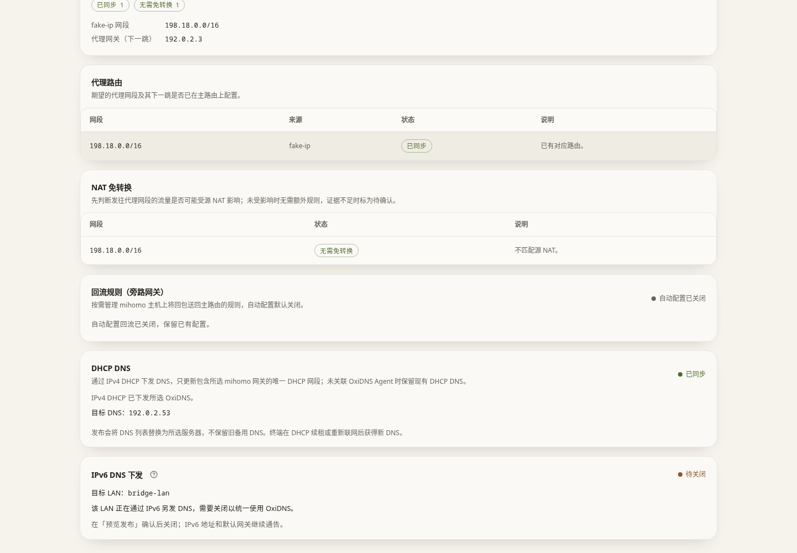

# 上游路由

这里的“上游路由”通常就是家里的主路由器。ConfigFlow 可以连接 iKuai 4.x 或 RouterOS 7.1+，把需要分流的连接交给 Mihomo，并让设备使用 OxiDNS。

**保存接入资料不等于修改路由器。** 正常流程是添加 → 探测 → 差异报告 → 预览发布 → 确认发布。实际写入前，请看清目的地址、代理设备和 DNS 地址。

## 添加路由器：每个字段怎么填

| 字段 | 填什么 / 默认值 | 推荐与效果 |
| --- | --- | --- |
| 名称 | 自己能辨认的名字，如“家里主路由” | 只用于识别 |
| 类型 | iKuai 4.x 或 RouterOS 7.1+ | 必须与实际系统一致，不能选择普通家用路由器代替 |
| 管理地址 | 完整地址，如 `https://192.168.1.1` | 填主路由后台地址，不是 Mihomo 的代理端口 |
| 用户名、密码 | 能使用相关管理接口的账号 | 编辑时密码留空表示保留旧密码；请先确认面板所在设备能访问路由器 |
| 校验 HTTPS 证书 | 默认开 | 有可信证书时保留；自己的路由器使用自签证书且确认地址正确时可关，否则证书验证失败会阻止连接。HTTP 下此开关不起作用 |
| 代理网关（Mihomo Agent） | 默认不关联 | 选实际接收主路由转发连接的 Mihomo。只保存关联不会自动让它具备转发能力 |
| DHCP DNS 服务器（OxiDNS Agent） | 默认不关联 | 选设备应使用的 OxiDNS；RouterOS 同时核对该 LAN 的 IPv6 DNS 下发。不关联则保留现有设置。关联 HA 成员时页面会提示实际使用 VIP |

RouterOS 的 HTTPS 管理服务需要 `www-ssl`；使用 HTTP 的 `www` 需要 RouterOS 7.9+。iKuai 4.x 通常把 HTTP 转到 HTTPS，出厂自签证书可能需要关闭上述校验。ConfigFlow 不会替路由器升级系统或打开管理服务。

首次使用向导中，安装完成后会自动关联那次安装的 Mihomo 和 OxiDNS，因此表单可能不显示手动选择框。

## 决定哪些连接交给 Mihomo

| 选项 | 默认 / 推荐 | 打开或选择后的结果 | 关闭或不选的结果 |
| --- | --- | --- | --- |
| 自动配置回流 | 默认关；只有网络确实要求回复先回主路由时才开 | 维护让 Mihomo 的回复经过主路由返回设备的规则；iKuai 会改用排除 Mihomo 自身的端口分流 | 普通静态路由方式；取消后需发布才清理本功能写入且不再被其他路由器使用的回流规则 |
| 使用静态路由的 IP 规则集 | 默认不额外选 | 所选清单中的 IPv4 目标地址交给 Mihomo，不限定某一台来源设备 | 仍自动包含 fake-ip 网段；不是完全关闭分流 |
| 使用策略路由的 IP 规则集（RouterOS） | 默认不选 | 只有指定的智能分流设备访问这些 IPv4 目标时才交给 Mihomo | 不建立这类按设备选择的目标规则；fake-ip 仍走静态路由 |

fake-ip 是 OxiDNS/Mihomo 用于分流的临时地址。已经通过这种方式分流的网站，不必再把它的所有真实 IP 手工加入静态路由。Telegram 等可能直接连接 IP 的应用，才需要另外考虑对应 IP 规则集。

需要自己登录路由器逐条填写时，见 [Fake-IP 与 Telegram 静态路由填写表](../guide/first-run.md#manual-routes)，其中列出了目的网段、子网掩码和下一跳。**下一跳填运行 Mihomo、负责接收转发连接的设备 IP**；真实 IP 规则还需按来源排除 Mihomo 设备本身。

静态规则集和策略规则集不能同时选同一项，移到一组会从另一组移除。取消勾选后必须**保存、预览并确认发布**，才会清理对应受管规则；单纯关掉窗口不会修改路由器。

## DHCP DNS 和强制 DNS

关联 OxiDNS 后，发布会尝试修改能唯一确定的 IPv4 DHCP 网段，**用所选 OxiDNS 替换该网段的 DNS 列表，不保留旧备用 DNS**。设备通常要重新连接网络或续租地址才会取得新值。如果无法唯一判断网段，应先核对网络和预览，不要猜。

### IPv6 DNS 下发（RouterOS）

设备即使已通过 IPv4 DHCP 获得 OxiDNS，也可能通过 IPv6 路由器通告（RA）再收到另一套 DNS。关联 OxiDNS 后，差异报告会在「DHCP DNS」下方显示「IPv6 DNS 下发」，检查**所选 Mihomo 网关所在的同一 LAN**。



| 检查结果 | 含义与下一步 |
| --- | --- |
| 待关闭 | 该 LAN 仍通过 RA 下发 DNS。点「预览发布」，核对 LAN 接口和改动，再确认发布 |
| 无需调整 | 该 LAN 当前没有通过 RA 下发 DNS，本次不需要改这一项；不代表已测试所有设备的 DNS 查询 |
| 需处理 | 还不能安全确定修改范围，或通告配置无法读取、存在动态或无效条目；本次发布跳过这一项，其他改动照常发布。按显示的原因处理后重新检查 |

未关联 OxiDNS 时不显示此检查项，也不读取或修改 IPv6 DNS 下发，不能据此认为路由器已经关闭它。

确认发布时，ConfigFlow **先写入并核对 IPv4 DHCP 的 OxiDNS 地址，再把已确认 LAN 的 `advertise-dns` 改为 `no`**。IPv6 地址前缀和默认网关仍照常通告，设备仍可获得 IPv6 地址并使用 IPv6 网络。检查本身不写入，也没有跳过预览的单独关闭开关。写入后会回读核对；失败时尝试回滚本次已完成的修改，需查看发布与回滚结果。

「需处理」只影响这一项：预览会提示「IPv6 DNS 下发本次跳过」，路由、规则和 DHCP DNS 照常发布，发布记录中这一项标为需处理，RA 通告保持原样。自动规则同步也不会因此暂停。

RouterOS 出厂只有一条共享的 `interface=all` 通告。DNS 通告来自它、又没有该 LAN 的专用条目时，ConfigFlow 不会直接关闭 `all`，以免连带影响其他网段或上网接口。卡片会给出一条可复制的命令，例如：

```
/ipv6 nd add interface=bridge advertise-dns=no ra-interval=3m20s-10m ra-lifetime=30m ...
```

它为该 LAN 单独建立通告条目，除 `advertise-dns=no` 外的参数照抄当前 `all` 条目；专用条目优先于 `all` 生效，`all` 和其他接口保持不变。在 RouterOS 终端执行后重新生成差异报告，这一项显示「无需调整」。该 LAN 已有停用的专用条目或存在多条通告时，不提供命令，请在 **IPv6 → ND** 中手动整理。

关闭后，设备可能仍暂时保留先前获得的 DNS，需要重新联网或等待旧 DNS 通告过期。这项操作只调整该 LAN 的 RA DNS 下发，**不修改 ROS 自身 DNS、上游连接的 `use-peer-dns` 或 DHCPv6 服务器设置**。设备手写 DNS、应用自带的加密 DNS，以及其他设备发出的 DNS 通告仍可能走别的路径；此项不等于接管全部 DNS 流量。

### 强制 DNS（RouterOS）

RouterOS 还提供以下选项：

| 开关 / 输入框 | 当前初始值 | 启用后的作用 | 推荐与未启用结果 |
| --- | --- | --- | --- |
| 强制局域网 DNS 走 OxiDNS | 关，需先选 OxiDNS | 把 IPv4 设备发往其他地址的普通 53 端口查询转给 OxiDNS；自动放行 Mihomo 和 OxiDNS 本身 | 先保持关、验证基础方案。关闭时，写死公共 DNS 的设备可能绕过 OxiDNS |
| 拦截加密 DNS（853 端口） | 关 | 拒绝 853 端口连接，促使支持回退的设备改用普通查询 | 只在需要时开。指定了私人 DNS 主机名的手机可能直接无法解析，需要把手机改成自动。它不是对所有加密 DNS 的统一拦截 |
| OxiDNS 故障时自动暂停 | 开 | 每 10 秒检查 OxiDNS 的 TCP 53，无应答时停用劫持，恢复后再启用 | 推荐保留。关闭时故障期间仍会强制转发；该开关不修改路由器自身 DNS，也不能保证所有设备都有可用备用 DNS |
| 放行设备 | 空 | 每行填一个 IPv4 地址或网段，允许它保持原 DNS | 测试机或确需例外的设备使用；不要重复填写自动放行的核心设备 |

以上强制 DNS 功能只处理这里注明的 IPv4 流量，不会替你接管 IPv6 DNS 或所有通过 HTTPS 的名称查询。

## 表格里的按钮

| 按钮 | 做什么 | 是否影响真实设备 |
| --- | --- | --- |
| 探测 / 检查连接 | 检查地址、账号和接口，显示版本与结果 | 不发布网络设置 |
| 差异报告 / 查看改动 | 比较现有状态与期望状态 | 只检查 |
| 预览发布 | 列出将新增、修改或删除的内容 | 尚未执行发布 |
| 确认发布 | 按预览写入并回读检查 | 会；失败会尝试撤销本次改动，必须查看发布和回滚结果 |
| 编辑 | 修改 ConfigFlow 中的接入资料和目标设置 | 保存后仍需发布 |
| 删除 | 移除 ConfigFlow 的接入记录 | 不删除路由器上的既有设置；不是撤销发布按钮 |
| 静态路由 | 查看并手动管理具体路由 | 每次新增、修改、删除先预览，确认后才写入 |
| 策略路由 | 管理 RouterOS 按设备与目标地址分流 | 见下节 |
| 规则同步 | 安排已发布 IP 清单的自动更新 | 开启后会按计划写入变化 |

差异报告中的“NAT 免转换”是让被转交的连接保留必要信息的处理；“回流规则”是让回复走正确返回路径的处理。阅读每项展开详情，确认 IP、网关及增删数量，而不是只看到绿色状态就发布。

发布失败后不要连续重复点确认。若显示回滚未完成或结果待确认，先阅读具体失败项、核对路由器当前状态，再决定重试。

## 手动管理静态路由

“刷新路由”读取当前列表。“新增路由”填写目的网段、下一跳和可选备注：

- **目的网段**是要送去处理的地址范围，例如 `192.168.50.0/24`。
- **下一跳**是负责接手的设备 IPv4，不是随意挑选一个同网段地址。
- **启用路由**新增时默认打开，确认写入后该条路由才参与转发；关闭后确认写入会保存为停用状态。

点“预览路由变更”，核对后确认写入。删除也要先预览并确认。界面不允许编辑的系统条目不能强改；带 `cf` 标记的受管路由之后可能被自动发布调整。这里的手工操作不会同时调整 NAT、DHCP DNS 或 Mihomo 回流配置。

## RouterOS 按设备分流

1. 到 [客户端设备](client-devices.md)，把需要参与的 IPv4 设备或网段设为“智能分流”。更具体的直连例外和 Mihomo 自身会排除。
2. 回到“策略路由”，检查来源设备，选择代理网关和目标 IP 规则集。需要时点“编辑规则内容”。
3. 在“OxiDNS 发布目标”核对需要同步的设备，首次加载默认勾选页面列出的全部来源 OxiDNS。勾选会发布该空间完整已保存配置，包含其他草稿；全部取消则只发布 RouterOS。
4. 点“保存并预览”，核对改动。预览后再改发布目标会使预览失效，需要重新点“保存并预览”。
5. 点“确认发布”。选了 OxiDNS 时先逐台发布 OxiDNS，再发布 RouterOS；中途失败或结果未确认时暂停后续步骤。

“重新载入”用于重新读取保存状态；有未保存修改时先处理提示。“核对发布结果”用于结果未确认时查询实际进度，不是重新发一遍。已经成功的设备保留成功结果，不能假设任一步失败就把所有设备同时退回。

## 自动同步规则到 ROS

默认关闭，检查频率默认每小时，可选 15 分钟到 24 小时。先成功发布一次建立基准，再开启。

开启后只追踪**已选中并成功发布过的远程规则集中的 IPv4 变化**：静态组更新路由，策略组更新目标地址列表。不会把域名自动转换成 IP，也不会接管无登记的手工路由。

| 按钮 / 状态 | 怎么处理 |
| --- | --- |
| 自动同步规则到 ROS | 开启后定期写入 IP 增删；关闭只停止后续检查，不删除已发布规则 |
| 检查频率 | 普通使用先保留每小时，不必频繁刷新 |
| 刷新状态 | 查看最新任务结果，不触发一次规则同步 |
| 立即同步 | 满足条件后提前执行一次；不是首次发布的替代 |
| 已暂停，需核对 | 格式异常、原来可用 IP 全消失等情况会保留旧规则；修复后重新预览并确认发布，建立新基准 |

修改来源设备、网关、规则集选择或其他路由设置后，仍要手动预览发布。这里的自动同步只负责 RouterOS，Mihomo 和 OxiDNS 仍按各自的更新流程工作。
