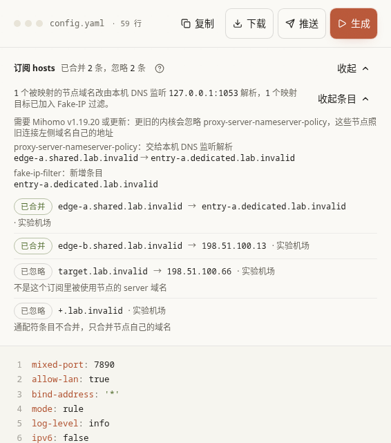

[文档首页](../README.md)

# 订阅来源：把服务商的节点列表接进来

本页目录：[先做一次](#先做一次) · [表单怎么填](#表单怎么填) · [健康检查](#健康检查) · [页面按钮与状态](#页面按钮与状态) · [修改什么时候生效](#修改什么时候生效) · [订阅自带的 hosts](#订阅自带的-hosts) · [常见问题](#常见问题)

入口：**共享资源 → 订阅来源**。这里保存服务商给你的订阅链接，并定时取得节点。订阅是所有配置空间共用的；在这里改链接、筛选或停用，会影响所有引用它的策略组和聚合。

## 先做一次

1. 点「添加订阅」，填一个能认出来的名称，例如“日常订阅”。
2. 粘贴完整订阅链接。不确定格式时先用「通用」。
3. 更新间隔先保留新建时的 `86400` 秒，也就是一天；保留启用。
4. 保存后点该订阅的「获取节点」或更新操作。展开预览，确认有节点，而不只是“剩余流量”“到期时间”等说明行。
5. 去 [策略组](proxy-groups.md)，选择这个订阅作为节点来源，再去 [配置生成](generate.md) 使用。

取得节点不等于把它们全部复制成手动节点。订阅节点可从缓存供策略组、聚合、节点库预览与测速使用。

## 表单怎么填

| 选项 | 是做什么的 | 推荐怎么填；改动结果 |
| --- | --- | --- |
| 订阅名称 | 面板里识别这个来源 | 使用容易区分的名称；不是服务商登录账号。不能为空。 |
| 订阅类型 | 声明来源采用的节点格式 | 通常先选「通用」；来源明确提供 Mihomo 或 Surge 格式时选对应项。它不决定最后只能生成哪一种客户端配置。 |
| 订阅链接 | ConfigFlow 服务器实际访问的地址 | 原样填写完整链接，包括服务商提供的参数。链接经常含凭据，不要公开。浏览器能打开，不代表服务器也能访问。 |
| 节点筛选 | 只保留名称符合表达式的节点 | 初次留空。要按地区保留或排除说明行，可参考表格后的例子。此筛选作用于所有引用该订阅的配置与聚合；只想改一个策略组，应去策略组筛选。 |
| 订阅源更新间隔 | ConfigFlow 多久重新访问一次服务商 | `86400` 为一天；允许 `0` 或 `60–604800` 秒整数。`0` 只关闭定时拉源，仍能手动更新，设备也仍能读取已有缓存。不要为追求及时性把大量订阅都改成一分钟。 |
| 健康检查 | 生成给设备的来源级节点检测参数 | 展开后按下一节设置。它与“订阅多久更新一次”、节点库即时测速都不是同一个开关。 |
| 引用配置 | 哪些配置空间使用了这个来源 | 修改前看一眼影响范围；显示“暂无引用”时，添加后还需在策略组或聚合里选它。 |
| 订阅启用中／订阅已停用 | 是否允许作为正常来源参与使用 | 开启是常规状态；关闭会让依赖它的配置失去这一来源，不会把服务商账户注销，也不等于删掉数据。临时排查可停用；停用后检查相关策略组是否还有节点。 |
| 保存／取消 | 保存这次表单，或放弃尚未保存的输入 | 保存修改面板记录；取消不撤销之前已经完成的更新操作。 |

输入正则时，竖线表示“或者”。例如保留地区时输入 `香港|HK|日本`，排除说明行可输入 `^(?!.*(到期|剩余)).*$`；大小写和具体名称需与你的节点一致。表达式无效时应先修正，不能把“匹配零个节点”当作正常完成。

## 健康检查

这是设备读取生成配置后，对这个来源内节点做的健康检测。新建来源默认启用，URL 为 `https://www.gstatic.com/generate_204`，间隔 300 秒，超时 5 秒，懒惰检测为“是”，预期状态为 `204`。旧记录的「未设置」保留原有生成行为，不会自动改成所有新建默认值。

| 选项 | 推荐与效果 |
| --- | --- |
| 测试 URL | 选这些节点确实应该访问成功的 HTTP(S) 地址。访问内网或回家节点时，公共外网站点可能不适合作为唯一判断。 |
| 测试间隔（秒） | 来源默认 300 秒。越短越快发现变化，但会产生更多检测请求；范围 1–86400。 |
| 超时（秒） | 默认 5 秒。太短可能把较慢的可用节点判为失败；界面按秒填写。 |
| 预期 HTTP 状态 | 应与测试地址一致；`204`、`200-299/304` 都是合法示例。把返回 200 的地址配成只接受 204，会得到错误结论。 |
| 懒惰检测 | “是”减少未使用来源的无效探测；“否”让核心按配置持续检查。想减少探测负担先保留“是”。“未设置”不等于强制关闭。 |
| 启用 | “是”生成来源健康检查；“否”关闭此来源级检查。策略组自己的自动测速仍有独立参数，不会因此一起关闭。 |

不要仅为了改变一个策略组的检测频率而修改共享订阅；策略组检测在 [策略组页面](proxy-groups.md#健康检查和负载策略) 单独配置。

## 页面按钮与状态

| 操作或显示 | 用法 |
| --- | --- |
| 搜索名称或地址、全部／已启用／已停用／获取失败 | 只筛选当前列表，不修改订阅。 |
| 卡片／列表切换 | 换一种看法，不改变数据。 |
| 更新全部 | 更新已启用订阅；已停用的会跳过。更新失败时保留此前可用缓存。 |
| 获取节点／单个更新 | 立即访问该来源并更新缓存；节点预览可展开查看真实配置。 |
| 节点数量 | 开启筛选后可能同时显示筛选后数量与原始数量。零个先检查链接、过滤条件和订阅到期情况。 |
| 流量、到期时间、最近获取 | 来源提供这些信息时展示；没有数据不等于无限流量或永不过期。 |
| 地址显示／隐藏、复制地址 | 隐藏只是防止旁观者看到；复制仍会得到完整订阅地址。 |
| 调整顺序 | 调整展示顺序后要「保存」；「取消」放弃本次排序。 |
| 编辑、启用／停用 | 保存表单或点击状态操作后修改共享记录；不是对远程设备立刻发布。 |
| 删除 | 被配置、聚合引用，或仍有已获取并保存的节点时会被阻止。按提示先解除使用，再删除；删除不是撤销按钮。 |

「拉取失败，已使用缓存」表示现在展示的是上次成功取得的数据，不能据此认为服务商已恢复。想查定时更新失败原因，去「系统设置 → 定时任务」。

## 修改什么时候生效

保存订阅记录后，面板下一次预览、生成、读取来源时使用新设置；运行中的设备仍需获取新来源或重新发布配置。来源内容自动更新与 Mihomo「订阅同步间隔」配合使用：前者决定面板何时找服务商，后者决定设备何时找面板。设其中一个为 0，不会自动把另一个也关闭。

完整数据导出包含来源配置；要保留缓存、运行记录等部署文件，迁移时仍应停服备份整个数据目录，不能只保留导出的 JSON。

## 订阅自带的 hosts

有的服务商在 Clash／Mihomo 订阅里，`proxies` 旁边还写了一段顶层 `hosts`，例如：

```yaml
hosts:
  node-1.example.net: entry-1.example.net
  node-2.example.net: 203.0.113.10
```

Mihomo 从订阅（proxy-provider）里只读取节点，不读这一段。ConfigFlow 在更新订阅时把它和节点一起保存，生成 Mihomo 配置时写进顶层 `hosts`：

| 规则 | 说明 |
| --- | --- |
| 只合并节点自己的域名 | 条目的域名必须等于这个订阅（或包含它的聚合）里、本次配置实际使用的节点的 `server`，才会合并。订阅借机改写其他网站（例如 `google.com`）的条目一律忽略；被节点筛选、聚合筛选排除的节点也不算。 |
| 不合并的条目 | 通配符（`*.`、`+.`、`.` 开头）、取值 `lan`、不是 IP／IP 列表／域名的取值、超过 8 个 IP 的条目、每个订阅超过 1000 条的部分，以及会和已有 hosts 形成映射环的条目。 |
| 优先级 | Mihomo 基础配置里手写的 hosts 最优先，通配符覆盖到的域名也算；其次是推送给 Agent 时同步的 MosDNS 自定义 Hosts；最后才是订阅。多个订阅给同一个域名不同的值时，按本页列表的顺序采用排在前面的订阅，其余标为忽略。 |
| 来源格式 | 只有订阅地址直接返回 Clash／Mihomo YAML 时才有这一段。base64 链接列表、经 Sub-Store 转换的内容（包括地址里带 `#` 参数的订阅）没有 hosts，直接跳过。 |

在[配置生成](generate.md)生成 Mihomo 后，结果区显示「订阅 hosts 已合并 N 条，忽略 M 条」，点「详情」查看每条的来源订阅和忽略原因：



### 域名到域名的映射怎样对节点生效

Mihomo（实测 v1.19.33）连接节点前，会先在 hosts 里顺着映射查找节点域名：最终落到 IP（例如 `node-2.example.net: 203.0.113.10`），就直接连接这个 IP；最终落到一个 hosts 里没有 IP 的域名（例如 `node-1.example.net: entry-1.example.net`），就放弃映射，改用节点原来的域名去问 DNS。Mihomo 自己的 DNS 监听（`dns.listen`）则把「域名 → 域名」当作 CNAME，再完整解析右边的域名。所以只有 `node-1.example.net` 经本机 DNS 监听解析时，节点才会连接 `entry-1.example.net` 的地址。

合并后至少有一条「域名 → 域名」条目最终没有落到 IP 时，ConfigFlow 在生成的配置里只补两处：

| 设置 | 做法 |
| --- | --- |
| `dns.proxy-server-nameserver-policy` | 为每个被映射的节点域名加一条「节点域名: 本机 DNS 监听」，例如 `node-1.example.net: udp://127.0.0.1:1053`。监听地址从 `dns.listen` 推导：`0.0.0.0:端口`、`[::]:端口`、`:端口` 写成 `udp://127.0.0.1:端口`，具体 IP 原样使用。其他节点照旧用你的 `proxy-server-nameserver` 解析，不经过监听。 |
| `dns.fake-ip-filter` | 只在 `enhanced-mode: fake-ip` 时加：只加入映射目标（`entry-1.example.net`），否则监听会把目标解析成假地址，节点就连不上。同一个可注册域名下的多个目标合并成 `+.共同后缀`，公共后缀（包括 `github.io` 这类）不会合并成通配。已被你的过滤条目覆盖的目标不重复加入；没写过 `fake-ip-filter` 时先保留 Mihomo 的默认条目。 |

你手写的 `proxy-server-nameserver` 一律保留原值。下面这些情况不改动，结果区写明原因：没有开启 DNS、没有 `dns.listen`、监听地址不是「IP:端口」、`dns.use-hosts: false`（监听不用 hosts）、`fake-ip-filter` 不是列表、手写的 `proxy-server-nameserver-policy` 不是映射，以及**没有写 `proxy-server-nameserver`**：Mihomo 规定设置了 `proxy-server-nameserver-policy` 就必须有 `proxy-server-nameserver`，否则拒绝加载整份配置，ConfigFlow 不替你填写。

几种特殊情况：

- **你已为同一个节点域名写了 `proxy-server-nameserver-policy`：** 保留你的设置，结果区提示冲突，这条映射对该节点不生效；你写的值本来就指向本机 DNS 监听时不算冲突，照常加入映射目标。通配条目（如 `+.example.net`）覆盖到节点域名也算。`geosite:`、`rule-set:` 条目无法检查，Mihomo 按顺序先匹配它们。
- **`fake-ip-filter-mode: whitelist`：** 列表里的域名才返回假地址，ConfigFlow 不改动列表。名单覆盖了某个映射目标时，改走本机 DNS 监听会让这个节点拿到假地址，所以这条映射不加 policy，结果区写明原因。
- **`fake-ip-filter-mode: rule`：** 在最前面加入映射目标的 `DOMAIN,…,real-ip` 或 `DOMAIN-SUFFIX,…,real-ip` 规则。
- **`redir-host` 等非 Fake-IP 模式：** 只加 policy，不加过滤。

**内核版本：** `proxy-server-nameserver-policy` 从 Mihomo v1.19.20 开始支持。更旧的内核不报错，但会忽略这一项，映射不生效，节点照旧连接左侧域名自己的地址，和没有这项功能时一样。Agent 开启了域名发现时会上报 Mihomo 版本：推送给上报版本早于 v1.19.20 的 Agent 时，ConfigFlow 不加 policy 和过滤，生成结果区点名提示这台 Agent，升级内核后重新推送即可。拿不到版本时（没开域名发现、通过配置 URL 使用的客户端）照常加入，并在结果区注明版本要求。

生成后，结果区写明「N 个被映射的节点域名改由本机 DNS 监听解析，M 个映射目标已加入 Fake-IP 过滤」，点「查看条目」只读列出每个节点域名对应的映射目标和新增的过滤条目。没有这类映射时，生成的配置与以前完全相同。

**订阅更新后：** 节点由设备按「订阅同步间隔」自己拉取；hosts、policy 和映射目标写在主配置里，只有重新发布才会更新。订阅里用同一个被映射域名的新节点不用推送就能用（policy 按域名生效）；订阅更新后 hosts 有变化时，Agent 卡片立即显示「有变更，待推送」，推送后生效；通过配置 URL 使用的客户端在下次更新配置时得到新的 hosts。规则自动同步不会带上 hosts 和 `dns` 段的变化。

## 常见问题

- **保存成功但没有节点：**保存只是记住地址，先手动获取，再检查服务器网络和来源格式。
- **只剩零个节点：**先暂时清空「节点筛选」再更新；筛选在来源这一层过严时，所有使用者都会受影响。
- **服务商更新了，设备还没变：**分别检查面板的更新任务和设备的来源同步间隔，不要只连续点生成。
- **订阅里的 hosts 没出现在配置里：**先在「配置生成」结果区的「订阅 hosts」详情里看原因：只有本配置所用节点自己的域名才会合并；已有的订阅要重新更新一次才会保存 hosts。
- **「域名 → 域名」映射对节点不生效：**看结果区「订阅 hosts」下方的原因，常见的是没有写 `proxy-server-nameserver`、没有开启 DNS 或 `dns.listen`，或你自己为这个节点域名写了 `proxy-server-nameserver-policy`；设备上的 Mihomo 早于 v1.19.20 时会忽略 policy。做法见[域名到域名的映射怎样对节点生效](#域名到域名的映射怎样对节点生效)。
- **删除被阻止：**根据提示进入对应配置空间、聚合或节点库解除引用；不要试图靠切换当前配置绕过共享资源保护。

下一步：[策略组](proxy-groups.md)；要把多个来源合在一起，读 [订阅聚合](subscription-aggregation.md)。
