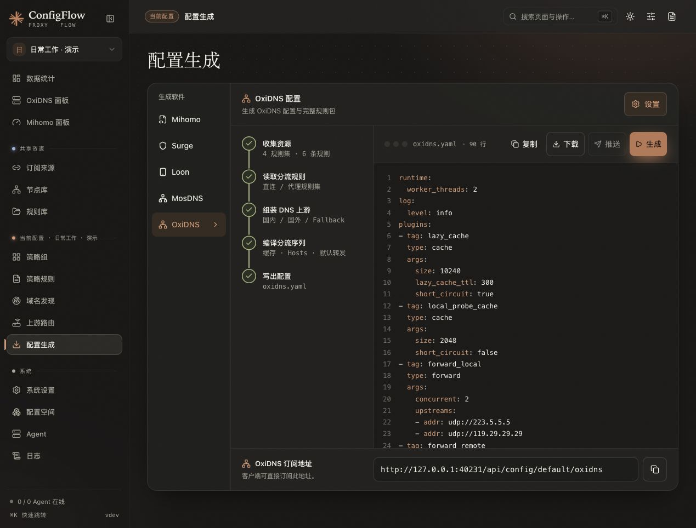

# 配置生成与备份

> 新手请先阅读[新版操作手册](../manual/generate.md)，包含选项建议、操作结果和当前页面说明。本页保留作为补充资料。

入口为 **当前配置 → 配置生成**。这里为顶部所选配置生成客户端文件；系统备份位于「系统设置」，两者用途不同。

## 界面预览

以下为 2026-10-21 的隔离演示截图，展示 OxiDNS 配置的实际生成预览；配置链接仅指向本机测试服务，未绑定或发布到真实设备。

## 生成第一份文件

1. 确认策略组已选择订阅或节点，规则已设置好目标和顺序。
2. 选择生成软件，例如 Mihomo。
3. 点击「生成」，在结果区查看配置；错误会显示原因，先修正再继续。
4. 点击「下载」，或复制下方的配置 URL 到客户端。
5. 在客户端启用该配置。远程设备则选择 Agent 目标并发布，等待最终结果。

生成、下载或预览可能读取远程订阅和规则，需要等待完成。它们遵守订阅来源的更新间隔，不会因为反复点击就跳过缓存。

## 下载格式

| 软件 | 下载文件 | 说明 |
| --- | --- | --- |
| Mihomo / Clash Meta | `mihomo.yaml` | YAML 主配置，可能引用在线 Provider 和规则 |
| Surge | `surge.conf` | Surge 配置，不能等价导出 Mihomo 代理链 |
| Loon | `<配置名称>.lcf` | 支持 iOS「导入 Loon」；名称会清理不适合作为文件名的字符 |
| MosDNS | `mosdns-config.zip` | 包含 `config.yaml`、规则及附加文件 |
| OxiDNS | `oxidns-config.zip` | 独立 DNS 配置包，详见 [OxiDNS](../../docs/OXIDNS.md) |

不同软件的节点、策略和规则支持范围不同，生成错误应按目标检查，不保证任意格式都能无损互转。

## 设置、草稿和发布

| 操作 | 作用 |
| --- | --- |
| 基础配置 / 设置 | 编辑当前目标的参数，不改变其他配置空间 |
| 保存草稿 | 保存到面板，设备还没有应用 |
| 生成 | 查看当前配置的生成结果 |
| 下载 | 获取文件，客户端或服务仍需导入或部署 |
| 发布到 Agent | 按该 Agent 绑定的配置准备并校验文件，再应用到设备 |

只有最终发布状态成功，才能认为设备应用完成。「已受理」或「等待激活」不是完成；等待激活时按页面进入 Agent 激活。

Mihomo 的「订阅同步间隔」控制核心向面板请求内容，与订阅来源向提供方下载的间隔独立。详情见 [订阅来源](subscription.md#三种间隔各管什么)。

## 使用配置链接

先在「系统设置」填写设备能访问的完整「服务域名」，例如 `http://192.168.1.10:5010`。使用页面生成的 URL，不要手工遗漏配置空间 ID 或访问令牌。

- URL 带配置空间 ID，不跟随浏览器之后切换的空间。
- 客户端需要能访问面板和配置中引用的在线文件。
- MosDNS / OxiDNS URL 仅返回 YAML，首次手动部署必须下载完整 ZIP。
- 访问令牌同时授予 MCP 管理权限，含令牌的链接不要公开分享。

## 备份与恢复

### 备份整个系统

在「系统设置 → 备份与恢复」点击「导出全部数据」。完整 JSON 包含系统设置、共享资源、全部配置空间和 Agent，含恢复所需凭据。

「脱敏导出」用于分享排查，会去除敏感内容，不能代替恢复备份。WebDAV 可以手动备份，也可在保存配置变化后自动备份；自动备份不是定时下载远程订阅。

### 导入整个系统

1. 先导出当前数据，或停服复制整个数据目录。
2. 点击「导入全部数据」，选择完整备份。
3. 确认覆盖范围包括全部空间、资源、设置和 Agent。
4. 完成后核对配置、服务域名及 Agent 绑定。

支持原版单文件、包含完整内容的 schema 2 备份，以及当前 schema 5；单独的旧 `system.json` 索引和开发中间格式不能作为完整备份导入。验证失败不会覆盖现有数据，详见 [升级、备份与恢复](../design/multi-config-management.md#升级备份与恢复)。

### 只迁移一个空间

在「配置空间」导入或导出单配置引用与参数。目标实例必须已有其引用的共享资源 ID；跨实例完整迁移请使用全量备份。

要导入已有客户端文件，使用「导入客户端配置」，会新建空间，并按支持范围转换节点、订阅、规则和基础配置；结果会列出跳过项。

## 常见问题

| 问题 | 检查方法 |
| --- | --- |
| 生成结果没有节点 | 检查当前组是否引用订阅或节点，筛选是否为空，来源是否启用 |
| 设备下载失败或提示登录 | 检查服务域名、端口、访问令牌及设备网络 |
| 保存后设备仍是旧配置 | 更新客户端远程配置，或显式发布到 Agent |
| ZIP 中缺少主机上的状态文件 | 查询数据库、学习结果等运行状态不属于配置包，需要单独备份 |

## 实现参考

[生成工作台](../../frontend/src/components/generate/GenerateStudio.vue)、[五种目标与下载名称](../../frontend/src/views/Generate.vue)、[生成接口](../../backend/routes/generate.py)、[系统备份界面](../../frontend/src/views/SystemSettings.vue)、[WebDAV 触发与上传](../../backend/utils/webdav_backup.py)。
