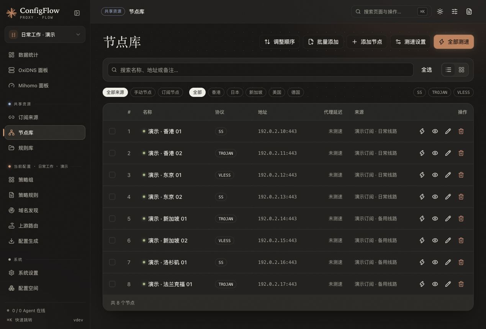

# 节点库

> 新手请先阅读[新版操作手册](../manual/nodes.md)，包含选项建议、操作结果和当前页面说明。本页保留作为补充资料。

入口为 **共享资源 → 节点库**。手动节点和订阅缓存可以在这里查看；共享节点的名称、参数和启用状态会影响所有引用它的配置。

## 界面预览

以下为 2026-10-21 的隔离演示截图，节点名称与来源均为虚构数据，地址使用文档专用的 `192.0.2.0/24` 网段，未执行真实测速。



## 添加一个节点

1. 点击「添加节点」，填写名称。
2. 粘贴提供方给你的完整节点链接，或 Mihomo 格式的 JSON / YAML。
3. 保存后，到当前配置的「策略组」勾选「节点」来源，并在「包含节点」中选择它。
4. 生成或发布配置，设备才会使用这个节点。

也支持通过 Sub-Store 解析 Surge / Loon 等客户端节点行，具体协议以转换结果和目标核心支持为准。不要仅依据页面协议标签判断节点能否连接。

下面展示同一个结构的 JSON 和 YAML 写法，地址与密码都是示例，需要替换为真实节点参数。

```json
{
  "name": "示例节点",
  "type": "ss",
  "server": "hk.example.com",
  "port": 8388,
  "cipher": "aes-256-gcm",
  "password": "replace-with-your-node-password"
}
```

```yaml
name: 示例节点
type: ss
server: hk.example.com
port: 8388
cipher: aes-256-gcm
password: replace-with-your-node-password
```

## 批量添加

点击「批量添加」，粘贴完整节点内容。支持 URI、JSON、YAML 和客户端节点行，忽略空行及 `//` 注释。导入后检查成功数量、失败原因和名称；不要把多个多行对象误当成一条节点。

需要转换的客户端节点行通过后端逐项解析，单次解析请求最多 500 行。保存节点不代表已通过真实代理连接测试。

## 查看和测速

- 可按来源、地区、协议和名称筛选，切换列表或卡片。
- 「全部测速」及单项测试均由 ConfigFlow 所在机器发起，不使用远程设备的网络。
- 测速设置中的 DNS 仅影响节点库测速，不修改系统、Mihomo 或 OxiDNS 的 DNS。
- 详细的批次上限、超时及组件安装见 [节点测速](../../docs/NODE_LATENCY.md)。

## 编辑、排序和删除

| 操作 | 行为 |
| --- | --- |
| 编辑名称、原始配置 | 修改共享节点定义，使用者需要重新生成或发布 |
| 启用 / 禁用 | 控制节点是否作为可用候选，正在被启用链使用时仍受依赖校验约束 |
| 调整顺序 | 进入排序模式，保存后生效，取消恢复旧顺序 |
| 删除 | 被配置、代理链或聚合使用时拒绝删除，先解除引用 |
| 批量删除 | 逐项处理，可能部分成功；保留失败项并显示原因 |

订阅节点跟随订阅来源更新。要更新整份订阅，请回到「订阅来源」，不要把订阅缓存节点 ID 当作可直接引用的手动节点 ID。

## Mihomo 代理链

在「当前配置 → 策略组」新增「代理链（仅 Mihomo）」，设置名称、前置引用和落地引用。两端均支持手动节点或策略组，订阅与聚合通过组使用。组合按稳定 ID 存于当前配置的 `proxy_groups`，不修改共享资源：

```json
{
  "id": "chain-a-b",
  "name": "经 A 的 B",
  "type": "chain",
  "enabled": true,
  "chain": {
    "entry": { "type": "node", "id": "a" },
    "exit": { "type": "node", "id": "b" }
  }
}
```

前置或落地策略组均使用 `{"type":"group","id":"group-id"}`。链通过普通策略组 CRUD 和 MCP `manage_proxy_group` 管理；共享节点 CRUD 不接受 `dialer_ref`，不提供直接选择订阅缓存节点的入口。

### 独立出口与引用

- 手动节点落地：复制协议参数，以链名生成独立 proxy，并设置解析后的 `dialer-proxy`；不输出 Mihomo 不支持的 `type: chain`。
- 策略组落地：复制组类型、节点来源、嵌套结构、筛选、顺序、测速及负载均衡参数，在链内独立选择。`url-test` 对经前置的候选测速，`fallback` 在链内故障切换，`load-balance` 按策略分流；不与原组同步当前选中项。
- 策略组内的手动节点支持仅以 JSON/YAML `proxy_string` 保存协议参数，不要求节点资源外层另存 `type`；链内 `exclude-type` 按转换后的 Mihomo 类型筛选，外层类型缺失或过期不会改变筛选结果，也不会回写共享节点。
- 前置组直接引用原组；切换前置组选择后，新连接使用新前置，已有连接不自动迁移。继续嵌套前置链即可组成 A → B → C → D。
- 链专用 Provider 使用独立名称和路径，复用原来源 URL；先按原节点名筛选，再施加 `链内组名_来源名_` 的可读前缀和 `override.dialer-proxy`，内部 ID 与文件路径仍隔离。链内手动节点和子组显示为 `链名_原名称`，生成名称冲突时追加编号。多段筛选以 `排序_段号_` 标记保留跨 Provider 排序，原始节点名不能以 `排序_` 开头；筛选段仍按 Mihomo 原生反引号分隔。名称中的反引号在生成的匹配正则中编码为 `\x60`，实际名称保留原样。订阅刷新后链内候选随之变化，不必重新生成主配置；修改组定义、链名或链结构仍需重新生成，客户端旧的链内选择可能需重选。
- 普通策略组可同时选择原节点/原组与命名链，规则也可直接以链名为目标；同一资源可组成多条链，各配置独立保存组合。改名通过稳定 ID 解析，链改名同步当前配置规则目标。
- 原节点字符串或 `params` 中的原始 `dialer-proxy` 仍属于共享定义。链副本使用所选前置，原节点保留原始行为；若要移除原始拨号，需要显式编辑共享节点。

### 校验与范围

- 前置引用必须存在且启用；启用链的落地引用也必须存在且启用。支持显式订阅、聚合、静态子组、跟随组与无环链组合；不支持隐式 `include-all` 来源。直接节点引用只接受手动节点，不接受订阅缓存节点 ID。
- 落地组不能包含 `DIRECT` / `REJECT` 等内置候选：这些候选无法等价施加前置拨号，不能通过静默跳过或直连降级处理。前置组内用户显式选择的内置策略保持原语义。
- 所有分支、实际 Provider 候选及原始拨号边参与循环检测；自引用、互相引用或经动态来源形成的循环均拒绝。跟随模式不能引用链，请使用普通策略引用。
- 字段形状错误返回 `400`；依赖冲突、缺失、禁用、循环、名称冲突及引用中的删除按现有接口返回 `409`，事务不保存。禁用链可保留存在但禁用的落地节点或组并正常改名；重新启用前须启用或更换落地，界面不会自动清除或启用引用。
- 生成和交付会再次验证实际名称、候选与 Provider。空来源、筛选后空候选、名称冲突和内容错误明确报错，不退回 `DIRECT` 或用旧缓存掩盖。失败不覆盖生成产物或缓存、不推送 Agent；真正的传输失败只可使用通过验证的原始缓存。
- 原始订阅缓存与聚合 Provider 保留原节点，不写入链专用候选；Agent 使用绑定配置的同一份快照下发主配置和独立 Provider 文件。URI/base64 的实际转换结果在生成时验证，写配置时不发起网络转换。
- Surge 不能等价生成此拓扑，拒绝启用链及原始拨号，不会静默删除字段。MosDNS 不增加代理链功能。
- 已使用 Mihomo `v1.19.32` 验证动态 Provider、链内独立选择、多段筛选排序、刷新及四跳真实 HTTP 转发。旧内核应先升级验证，不承诺未测试版本。作者原版迁移边界见[多配置与共享资源](../design/multi-config-management.md#升级备份与恢复)。

## 实现参考

[节点页面](../../frontend/src/views/Nodes.vue)、[保存与节点行解析](../../backend/routes/nodes.py)、[独立测速](../../backend/utils/node_latency.py)、[代理链校验](../../backend/utils/dialer_references.py)。
