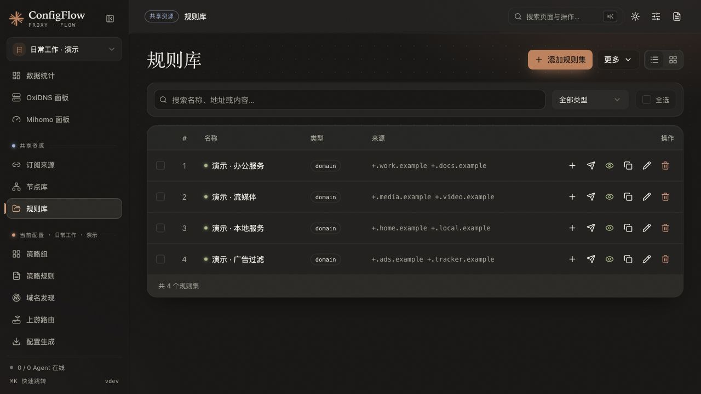

# 规则库

规则库是所有配置共用的来源目录，保存规则的名称、URL 或正文。每个配置在「策略规则」引用来源，并分别指定策略、启用状态和顺序。

## 界面预览

以下为 2026-10-21 的隔离演示截图，规则正文仅使用 `.example` 演示域名，不包含真实访问记录或私有服务地址。



## 添加一个自己的域名集合

1. 打开「共享资源 → 规则库」，点击添加。
2. 名称填写「公司内网」，来源选择「规则内容」，类型选择 `domain`。
3. 粘贴需要的域名，保存。
4. 点击「加入当前配置」，选择目标策略；也可回到「策略规则 → 更多 → 添加规则集」选择来源。
5. 在当前配置调整匹配顺序，再生成或发布。

内容保存在 ConfigFlow 的配置文档中，不需要另建数据库。以下是内容示例，实际域名按自己的网络替换：

```yaml
payload:
  - '+.office.example'
  - 'git.office.example'
```

## 三种规则类型

| 类型 | 内容 | 用途 |
| --- | --- | --- |
| `domain` | 域名及其匹配表达式 | 网站分流 |
| `ipcidr` | IPv4 / IPv6 地址段 | IP 分流 |
| `classical` | `DOMAIN-SUFFIX`、`IP-CIDR` 等规则行 | 混合条件集合 |

来源可以选择 URL，也可以直接编辑内容。URL 必须返回与所选类型相符的规则；代理与 DNS 目标可转换的内容不同，不能把任意二进制或任意客户端规则视为通用文本。

## 导入已有 rule-providers

页面「批量导入」支持带 `rule-providers` 的 YAML。下面只展示结构，`example.com` 是占位地址，使用前换成真实规则来源：

```yaml
rule-providers:
  office:
    type: http
    behavior: domain
    url: "https://example.com/office.yaml"
```

导入后检查名称、类型和来源，再加入当前配置。库中排序只影响共享列表的展示顺序，不决定配置里的匹配优先级。

## 编辑与删除的影响

| 操作 | 影响 |
| --- | --- |
| 改正文或来源 URL | 影响所有引用该来源的配置；设备获取新内容仍受刷新或同步方式控制 |
| 当前配置更改目标策略 | 只影响该配置，其他配置可使用同一来源走不同策略 |
| 停用共享来源 | 引用它的生成配置不再使用该来源 |
| 删除当前配置的引用 | 保留共享来源 |
| 删除共享来源 | 仍被配置引用时拒绝删除并列出引用者 |
| 调整共享顺序 | 进入调整顺序后保存，不改变各配置的规则顺序 |

「添加规则」用于往内容型规则集增加条目；「加入当前配置」用于建立引用，两种操作不同。

## 下载、连通性和代理

可对 URL 来源测试连通性或下载缓存。连通只表示当前请求结果，不证明正文格式正确，也不代表已经发布到设备。批量操作以页面的逐项结果为准。

下载受限时，到「系统设置 → 服务配置 → 规则下载代理」填写面板所在环境能访问的 HTTP/HTTPS 代理，移开输入框后保存。例如：

```text
http://192.168.1.20:7890
```

- 这是全部配置共用的后端下载设置，覆盖规则下载、缓存更新、测试、DNS 转换与推送前准备。
- 支持带用户名和密码的代理，特殊字符需 URL 编码；完整备份会包含该设置，脱敏导出会移除。
- 容器内 `127.0.0.1` 表示容器自身，不代表 NAS 宿主机。
- 代理不可用时不会自动改走直连；已有缓存能否使用按当前缓存规则判断。
- 清空后恢复原网络方式，原有环境代理仍可能生效。
- GitHub 代理域名属于下载地址前缀，可与此设置同时使用；不会改变客户端、外部 Sub-Store 或 Agent 自行下载时的网络设置。

## 什么时候会更新到设备

修改面板规则库不等于所有设备立即生效。现有引用的内容由核心刷新、手动更新规则，或已开启的 Agent 规则自动同步处理；新增引用、顺序或策略变化需要相应发布。

详见 [Agent 规则自动同步](../../docs/AGENT_OXIDNS.md#每台-agent-的规则自动同步)。

## 实现参考

[规则库页面](../../frontend/src/views/RuleLibrary.vue)、[规则库接口](../../backend/routes/rule_library.py)、[下载与代理处理](../../backend/utils/rule_fetch.py)、[共享资源和引用](../../backend/common/config_repository.py)。
