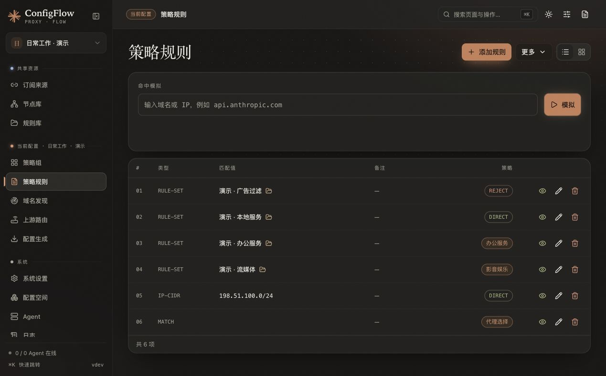

# 策略规则

规则决定一次连接走直连、拒绝还是某个策略组。入口为 **当前配置 → 策略规则**。规则目标、启用状态和顺序只属于当前配置；规则库中的正文和来源由所有配置共用。

## 界面预览

以下为 2026-10-21 的隔离演示截图，规则与策略均为虚构数据，示例网段使用文档专用的 `198.51.100.0/24`。

## 添加第一条规则

1. 点击「添加规则」。
2. 类型选 `DOMAIN-SUFFIX`，值填 `example.com`。
3. 策略选 `DIRECT`，保存。这表示该域名及其子域名直接连接。
4. 再添加类型为 `MATCH`、值留空、策略为「代理选择」的规则。
5. 打开「更多 → 调整顺序」，将 `MATCH` 移到最后，保存。

**新规则默认加在最前面。规则从上往下匹配，命中第一条后就使用它的策略。** 修改规则后还需更新客户端配置或发布 Agent。

## 编辑器支持的类型

当前下拉框有 **15 种**类型。以下描述用于选择编辑器选项；各生成目标支持范围不同，DNS 配置主要转换可表达的域名和 IP 条件。

| 类型 | 用途 | 值的示例 |
| --- | --- | --- |
| `DOMAIN` | 精确域名 | `www.example.com` |
| `DOMAIN-SUFFIX` | 域名及子域名 | `example.com` |
| `DOMAIN-KEYWORD` | 域名中的关键字 | `example` |
| `IP-CIDR` | IPv4 地址段 | `192.168.0.0/16` |
| `IP-CIDR6` | IPv6 地址段 | `2001:db8::/32` |
| `IP-SUFFIX` | 目标核心的 IP 后缀条件 | 按目标核心语法填写 |
| `DST-PORT` | 目标端口 | `443` |
| `SRC-PORT` | 来源端口 | `12345` |
| `GEOIP` | GeoIP 类别 | `CN`，需要目标核心的地理数据库 |
| `GEOSITE` | GeoSite 类别 | `cn`，需要目标核心的站点数据库 |
| `RULE-SET` | 已生成的规则集名称 | 新手建议使用下文的「添加规则集」选择来源 |
| `AND` | 所有子条件均满足 | `((DOMAIN-SUFFIX,example.com),(DST-PORT,443))` |
| `OR` | 任一子条件满足 | `((DOMAIN,one.example),(DOMAIN,two.example))` |
| `NOT` | 子条件取反 | `((GEOIP,CN))` |
| `MATCH` | 匹配此前未命中的连接 | 留空，放在最后 |

逻辑规则在「类型」中选择 `AND`、`OR` 或 `NOT`，值中只填括号内表达式，不再重复类型或策略。IP 类及逻辑规则可设置 `no-resolve`；逻辑子条件的生成由后端处理。

## 从规则库添加规则集

1. 先在「共享资源 → 规则库」添加一个 URL 或内容来源。
2. 返回「策略规则」，打开「更多 → 添加规则集」。
3. 选择共享来源，再选择本配置使用的策略，保存。
4. 调整位置，确保需要优先生效的规则位于兜底规则之前。

配置只保存来源 ID、目标、启用状态和顺序。来源的名称、URL、格式或正文需要在规则库修改，修改后会影响所有引用配置。

从当前配置删除规则集引用，不会删除共享规则库本体；后端会清理当前配置相关的 DNS 规则选择。

## 排序与分组

- 进入「更多 → 调整顺序」后移动规则或分组，点「保存」提交；点「取消」恢复原顺序。
- 连续使用同一策略的规则和规则集可以折叠显示，分组只改变展示方式。
- 规则库本身的显示顺序，不会改变这里的匹配顺序。
- 常见顺序是：内网或精确例外 → 广告或特定服务 → 通用分流 → `MATCH`。最终以自己的需求为准。

## 命中模拟与重复检查

在「命中模拟」输入域名或 IP，页面会展示后端能确认的匹配规则和策略；命中的折叠组会展开。它不实际建立代理连接，也不代表目标设备已经部署这份配置。

模拟器只有域名或 IP 输入，无法完整还原来源端口、目标端口、进程等连接条件，也不能保证展开目标核心的全部地理数据库或逻辑条件。显示未命中时，请结合生成结果和设备实际连接记录核对。

「更多 → 查找重复」帮助检查重复条目和策略冲突。当前页面没有独立的批量导入域名按钮；大量自定义域名可在规则库建立内容型规则集，再引用到当前配置。API / MCP 另有批量添加接口，见 [MCP 文档](mcp.md)。

## 实现参考

[规则页面与类型选项](../../frontend/src/views/Rules.vue)、[新增与排序接口](../../backend/routes/rules.py)、[命中模拟](../../backend/utils/rule_matcher.py)、[Mihomo 规则生成](../../backend/converters/mihomo.py)。
