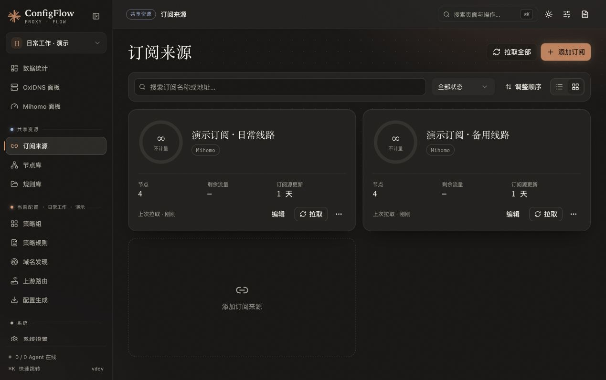

# 订阅来源

订阅是提供方给你的一条节点更新链接。入口为 **共享资源 → 订阅来源**。订阅和原始缓存由所有配置空间共用，各配置在策略组中选择要使用的订阅。

## 界面预览

以下为 2026-10-21 的隔离演示截图，订阅名称与节点缓存均为虚构数据，未使用真实订阅链接。

## 添加第一个订阅

1. 点击「添加订阅」，填写便于辨认的名称。
2. 粘贴自己的订阅链接，按提供方说明选择 Mihomo、Surge 或通用格式。
3. 第一次使用可保留更新间隔 `86400` 秒。
4. 保存后手动更新一次，确认页面显示节点。
5. 切换到目标配置，在「策略组」中选择这个订阅，再生成配置。

镜像内置 Sub-Store，在需要解析或转换时自动使用。普通 HTTP 订阅会复用下载正文及流量信息；带特殊参数的链接仍可能交由 Sub-Store 处理。

## 三种间隔各管什么

| 设置 | 控制对象 | 默认或范围 |
| --- | --- | --- |
| 订阅源更新间隔 | ConfigFlow 多久允许重新请求订阅提供方 | 默认 `86400` 秒；`0`，或 `60–604800` 秒整数 |
| Mihomo 订阅同步间隔 | Mihomo 多久向 ConfigFlow 请求订阅、聚合 | 默认 `3600` 秒；在 Mihomo 基础配置中设置 |
| Provider 健康检查间隔 | 目标核心多久测试候选节点 | 新建来源默认 `300` 秒；不是下载订阅的间隔 |

**订阅源设为正数时，到期后的下一次请求才允许刷新，不是固定时间的后台下载任务。** 间隔内使用持久缓存，重启面板或重复预览不会提前到期。

设为 `0` 表示仅手动更新。此时首次使用或更换链接后，必须先手动更新得到当前链接的可用缓存；没有缓存会明确提示，不能直接生成或发布。

只想避免面板自动访问提供方时，将订阅源设为 `0` 即可；Mihomo 仍可定时从面板获取已有缓存。

## 筛选、排序与删除

- 订阅自身的节点名称筛选作用于所有使用者；策略组内的筛选只属于当前配置。
- 排序时进入「调整顺序」，完成后保存；取消恢复旧顺序。共享列表顺序会对所有配置生效。
- 删除前先取消配置和聚合的使用，并移除从该订阅获取的节点。仍有依赖时会保留资源并列出引用者。

## 更新失败怎么办

| 现象 | 处理方法 |
| --- | --- |
| 提示没有可用缓存 | 先手动更新，确认 URL、订阅类型和网络可用 |
| 连续点击结果没有变化 | 请求可能命中短时缓存或防连点窗口，不会每次都访问提供方 |
| 提示稍后重试 | 失败后有逐步延长的等待时间；403 / 429 会暂停立即重试，手动更新也遵守等待时间 |
| 订阅里有节点，生成结果没有 | 检查目标配置的策略组是否选择了订阅，以及筛选条件是否排除了所有节点 |
| 提示 Sub-Store 不可用 | 在「系统设置 → 第三方依赖」检查状态；按需模式首次转换需要等待组件启动 |

## 实现参考

[订阅页面](../../frontend/src/views/Subscriptions.vue)、[订阅接口](../../backend/routes/subscriptions.py)、[来源刷新与间隔校验](../../backend/utils/subscription_refresh.py)、[Provider 健康检查默认值](../../backend/utils/health_check.py)。
