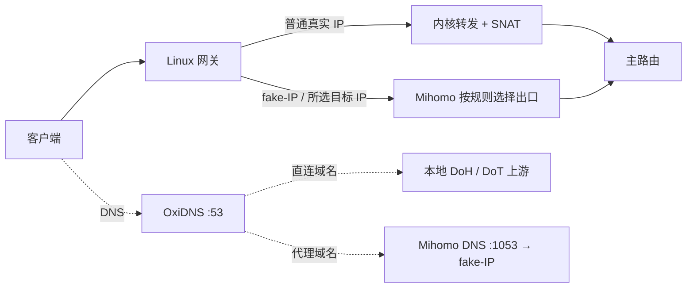

# Linux 选择性网关：Mihomo + OxiDNS

首次安装入口：**Agent → 生成安装脚本 → 使用模式：Linux 选择性网关 → 开始或继续网关安装**。向导把网络信息、规则选择、核心与 Agent 安装、配置发布、转发应用串成五步。

已有网关的后续管理入口仍是 **当前配置 → 配置生成 → Mihomo → Linux 网关**，用于调整接管规则、检查状态和恢复网络。默认使用普通安装模式；只有明确选择网关安装才进入本流程，普通模式沿用原安装器。

本向导适用于同一局域网中的 Linux 单网卡、单出口、IPv4 网络，CPU 为 x86_64 或 arm64。需要运行中的 systemd 或 OpenRC、root 权限、`iproute2`、`nftables` 和可用的 `/dev/net/tun`。不支持通过此向导修改 Docker 宿主机网络。

网关一体安装需要 **Agent `1.8.25-go` 或更新**。新设备会安装固定版本的 Mihomo `v1.19.32`、OxiDNS `v1.6.1`，逐个核验 SHA256；Mihomo 已有核心至少需稳定版 `v1.19.0`。ConfigFlow 服务器也必须提供新版、匹配架构的 Agent 二进制。

## 五步各自会做什么

| 步骤 | 你需要做什么 | 设备何时改变 |
| --- | --- | --- |
| 设备与网络 | 在目标机运行只读检测命令，粘贴输出并核对固定地址 | 检测不改 IP 或路由 |
| 规则与配置 | 选择接管范围，检查两份配置与代理出口 | 继续时保存面板草稿 |
| 安装 | 在目标 Linux 执行页面生成的完整命令 | 安装缺少的核心和两个 Agent |
| 发布 | 按顺序发布 Mihomo，再发布 OxiDNS | 应用核心配置，失败停止后续步骤 |
| 转发与验证 | 先预览，再应用网关转发 | 此时才开启受管主机转发；之后测试一台客户端 |

此向导不是 RouterOS 的安装入口，也不会修改 Docker 宿主机网络。已经是普通同机 Agent 的设备，可核对后接入现有实例；安装方式和恢复归属不应混用。

## 先理解流量怎么走

示例地址仅供理解，实际地址在界面填写：

| 设备 / 参数 | 示例 |
| --- | --- |
| 主路由 | `192.168.1.1` |
| Linux 固定 IP | `192.168.1.2` |
| Linux 网卡 | `eth0` |
| LAN 网段 | `192.168.1.0/24` |
| Linux 自身默认网关 | `192.168.1.1` |
| 客户端默认网关、DNS | 都填 `192.168.1.2` |

客户端所有出网流量先到 Linux，但只有 fake-IP 和勾选规则集中的目标 IPv4 进入 Mihomo。其他 IPv4 流量通过 Linux 内核转发和 SNAT 到主路由，不经过 Mihomo 用户态代理。主路由不需要静态路由。



“接管”只表示进入 Mihomo。命中的规则若为 DIRECT，或策略组选择了 DIRECT，Mihomo 仍会直连。不要用接管列表代替原有分流规则。

## 开始前准备

1. 在 ConfigFlow 中添加自己的代理节点或订阅，建立引用这些节点的策略组，并把需要代理的规则指向该组。ConfigFlow 不提供代理节点；向导检查发现没有被规则引用的代理出口时会停止，并提示先完善节点和规则。
2. 建议为网关建立专用配置空间。向导只修改所选空间的 Mihomo 与 OxiDNS 配置，不改变共享规则库、节点、其他配置空间或 MosDNS。使用同一空间的其他设备仍会看到这份空间配置，发布时请核对目标。
3. 为 Linux 配置固定 LAN IPv4，保持它自身的默认网关指向主路由。界面里的网络信息描述现有设备；向导不会给网卡分配 IP，也不会修改 Linux 默认路由。
4. 确认 Linux 可以访问 ConfigFlow 与 GitHub 下载地址。ConfigFlow 地址不能填写浏览器自己的 `localhost`。启用登录验证并选择真实 IP 接管规则时，还需在“系统设置”配置订阅令牌，以便 Mihomo 自动刷新；向导不会自行创建或改写系统令牌。

安装命令需要 `curl`。依赖缺失时，按终端提示安装后重跑，例如：

```sh
# Debian / Ubuntu，以 root 执行
apt-get update
apt-get install -y ca-certificates curl iproute2 nftables tar gzip coreutils

# Alpine，以 root 执行
apk add ca-certificates curl iproute2 nftables tar gzip coreutils
```

主路由无需静态路由。先手动设置一台客户端；验证成功后，若主路由 DHCP 支持自定义网关和 DNS，可统一下发 Linux 地址。不支持时逐台设置客户端。

## 第 1 步：设备与网络

打开 **Agent → 生成安装脚本**，选择 **Linux 选择性网关**，点击“开始或继续网关安装”。核对顶部的配置空间，填写设备名称和服务地址：

- 设备名称，例如 `home-gateway`；两个 Agent 将分别命名为 `home-gateway-mihomo` 和 `home-gateway-oxidns`。
- Linux 能访问的 ConfigFlow 地址；如果系统设置已经填写服务地址，必须使用同一地址。旧值为 `localhost` 时先在系统设置修正，再回到向导重新读取。

复制页面上的检测命令，在目标 Linux 终端执行，再将输出的 JSON 粘贴回页面。网卡名、Linux IPv4、主路由和 LAN 网段会自动填入。需要纠正时，可以展开手动填写。

检测只读取默认路由和网卡地址，无需 root，不修改网络，也不需要先安装 Agent。命令需要 `curl`、`ip` 和 `awk`；脚本由当前 ConfigFlow 的 `/api/agents/gateway-network-probe.sh` 提供，不包含登录或安装凭据。网卡名没有 `eth` 或 `enp` 前缀限制，`ens18`、`br0`、`bond0.10` 等名称均可使用。

检测要求只有一个 IPv4 默认出口，且出口网卡只有一个 IPv4 地址；出现多个出口或地址时会报错。地址仍需提前在主路由保留，或在 Linux 配为静态地址。最终应用前，Agent 会再次核对实际网络，发现不一致不会应用。

## 第 2 步：分流规则与两份配置

界面显示当前配置空间已经关联的 IP-CIDR / Classical 规则集。需要新增时，先到“规则库”添加，再到当前空间的“策略规则”关联并启用，然后返回勾选。

- **fake-IP 网段自动包含**，使用当前 Mihomo DNS 的 `fake-ip-range`；不必创建或维护额外规则。未选择任何真实 IP 规则时，只接管 fake-IP。
- 勾选必须代理、可能直接连接真实 IP 的服务集合，例如已有 Telegram IP 规则。确认对应规则的出口策略是可用代理组，且没有被前面的直连规则覆盖。
- 不要勾选中国 IP、普通直连 IP 或覆盖全网的集合。接受的目标 IPv4 范围为 `/8` 至 `/32`，`0.0.0.0/0`、`/1` 等超大范围会被拒绝。
- Classical 只提取无条件的目标 `IP-CIDR`，忽略域名、来源 IP、端口、逻辑条件及 IPv6。支持 text / YAML；MRS 二进制规则暂不能用于这里的 IP 提取。
- 在同一步分别选择“直连域名”和“代理域名”，同一集合不能同时勾选两边。国内或内网域名通常放直连，明确需要代理的域名放代理。这里不根据名称猜测分类；界面同时显示现有 Mihomo 策略，供你核对。
- OxiDNS 的 Classical 选择会使用其中可转换的域名和 IP 条件；不要把混合规则误认为只有域名。代理域名获得 fake-IP，无需手工维护每个域名解析出的真实 IP。

规则关联使用稳定 ID。规则库内容刷新后，已部署 Mihomo 约 **5 分钟**内刷新接管范围和所选规则的原始分流内容；改名不丢失关联。规则在当前空间或共享库中停用、删除后，关联地址会在刷新时清空。网络获取失败会保留运行中的旧规则，而不是清空为未知状态。

**新增 / 取消勾选、修改出口策略或规则顺序、开关网关模式，都需要保存并重新发布 Mihomo。** 内容刷新是沿用规则库的刷新结果，不会每 5 分钟重新下载所有外网规则源；多个 provider 的运行时刷新也不是一次原子切换。

填写直连加密 DNS，默认 `https://223.5.5.5/dns-query` 可直接使用。允许多行 IP 地址的 DoH / DoT；不接受普通 UDP / TCP 53、本机回环或依赖域名解析的上游，避免与 Mihomo 接管形成循环。

点击“检查配置与代理出口”。预览只生成并校验两份配置，不保存、不安装、不执行网络命令。检查通过后继续，向导把两份草稿一次保存到同一配置版本，随后创建安装命令。配置在其他页面被修改时，会要求重新读取和检查，避免覆盖新内容。

| 服务 | 向导准备的配置 |
| --- | --- |
| Mihomo | rule / fake-IP 模式、TUN 与选择性接管，DNS `127.0.0.1:1053` |
| OxiDNS 监听 | `0.0.0.0:53`，UDP 与 TCP，优先 IPv4 |
| OxiDNS 直连上游 | 所填写的 IP 地址 DoH / DoT，返回真实 IP |
| OxiDNS 代理上游和备用上游 | 均为 `127.0.0.1:1053`，由 Mihomo 返回 fake-IP |
| 未匹配域名 | 默认交给 Mihomo；最终出口仍由 Mihomo 规则及策略组决定 |

现有节点、策略组、规则顺序和无关 OxiDNS 设置会保留。现有原生 OxiDNS 配置若能安全识别，就只更新对应参数；遇到自定义执行链会停止并说明原因。只有明确勾选允许转换时，才改用向导模板；原生配置及附件会备份在 `gateway_onboarding_native_backup`，可从配置导出中恢复。

Mihomo 缺少 DNS 上游时会补入默认加密上游；已有非循环上游保留。不能让 Mihomo DNS 再指回 OxiDNS。创建安装会话时，向导还会结合所填 Linux IP 检查 Mihomo 各类 DNS 上游，拒绝指向这台 Linux 的 53 / 1053 端口。需要代理的域名也不能被 `fake-ip-filter` 改为返回真实 IP。向导不会替你改变规则出口；没有代理 MATCH 兜底、所选集合仍指向 DIRECT 等情况会明确提示。

开启网关后，生成输出使用 `auto-route`、`auto-redirect` 和 `route-address-set`。旧的 `route-address` / 排除地址从本模式输出中移除，避免与选择范围交叉限制。`routing-mark`、旧的 `tun.include-interface` / `exclude-interface` 或 MAC / UID 等过滤会阻止启用，需先在基础配置中核对并处理。不要手改生成的 `cf_gateway_` provider 或网关标记。

发布到目标 Agent 时，会自动把这台 Linux 的 LAN IPv4 `/32` 和回环网段加入 `route-exclude-address`，让客户端访问网关 53 端口时进入 OxiDNS。Mihomo 的 `auto-redirect` 有独立的 53 端口接管规则，仅修改 `dns-hijack` 端口不足以保护 OxiDNS。Agent `1.8.34-go` 起，每次发布和激活都会读取本机活动接口的全部 LAN IPv4，为每个地址添加精确 `/32` 排除项。显式 `agent_ip` 必须属于当前本机，不能代替其他地址的保护；留空也会自动检测全部地址。已注册的旧 Agent 无需重新注册，但应更新到包含该修复的版本。无法获取地址或显式地址不属于本机时，在替换配置前阻止发布。

激活已准备的配置之前，会再次检查当前地址是否被候选配置覆盖；如果期间 IP 变化而产生漏排除，会在停止服务或替换文件之前拒绝激活，提示重新发布。普通原生 AIO 开启 TUN 自动重定向时也会补充本机 DNS 排除项，并保留已有排除地址。手动部署生成文件时，也必须补入实际网关 IP 的 `/32` 排除项。

## 第 3 步：安装核心和 Agent

把网页中的整条安装命令复制到**目标 Linux** 终端执行。它会按顺序：

1. 检查操作系统、架构、权限、TUN、nftables、端口和已有安装。
2. 只为缺少的核心下载固定版本 Mihomo / OxiDNS，并下载当前 ConfigFlow 提供的 Agent，核对 SHA256 并验证可运行。完整的现有核心直接校验接入，不依赖重新访问 GitHub；只缺配置的受管核心使用原二进制校验引导配置。
3. 对缺少的核心创建配置和 systemd / OpenRC 服务，并设置开机启动。初始配置只提供本机 DNS，不启用网关 TUN 或转发。
4. 安装两个独立 Agent，默认端口分别为 `8080` / `8082`，登记到本次安装所选的配置空间。

新核心目录为 `/etc/mihomo`、`/etc/oxidns`，可执行文件为 `/usr/local/bin/mihomo`、`/usr/local/bin/oxidns`；Agent 配置分别位于 `/opt/configflow-agent/mihomo` 和 `/opt/configflow-agent/oxidns`。

已有标准路径且服务正常的核心会被核对并接入，不覆盖核心或现有配置。非标准路径、不完整安装、端口占用或外部修改过的服务会停止，说明如何处理；需要自定义路径时使用普通同机 Agent 接入，之后从生成工作台管理网关。安装器不会停止 systemd-resolved 等现有 DNS 服务来抢占 53 端口。

安装命令包含本次会话的临时凭据，有效期 24 小时，请勿公开分享，也不要在另一台机器运行。中途失败时按提示修复后重跑同一命令；已经完成的核心和配置会保留。首次注册响应丢失时，同一安装凭据可以找回本次创建的 Agent；不会接管独立安装的其他 Agent。已有双 Agent 的接入会核验两份凭据、保留原 ID，并同步本次填写的名称、地址、端口和配置空间；有未完成的发布或升级时会停止。

尚未登记时凭据过期，需要在向导重新准备安装命令；已完成登记后，管理员仍能继续原发布和网络恢复。填错信息可以点击“修改安装信息 / 准备另一台设备”。**此时不要修改客户端网关或 DNS。**

## 第 4 步：发布并检查

回到向导，确认两项 Agent 都已登记，点击“按顺序发布两项配置”。服务端使用本次保存的配置版本，先发布并启动 Mihomo，等待其健康检查成功后再发布 OxiDNS；任一步失败都会停止后续操作。

发布过程复用事务部署和核心原生校验，失败时按部署状态检查原因。网页关闭或网络中断不会取消已提交任务；再次从同一入口打开可读取记录并继续。配置空间、设备绑定或安装配置被修改时会阻止继续，请按提示重新准备；不会自动换到其他设备。

两项发布均成功后，才进入转发步骤。只有下一步点击“应用网关转发”才会首次修改主机转发配置。

## 第 5 步：启用转发与客户端验证

向导使用本次登记的 Mihomo Agent，核对第 1 步填写的网络信息。先点击“检查并预览转发”，解决所有阻止项，再点击“应用网关转发”。它会：

- 核对已部署配置属于当前空间且已启用网关，地址与实际网卡、默认路由一致。
- 记录系统参数原值，开启 IPv4 转发，关闭相关 ICMP redirect，避免客户端被引导直接绕过 Linux。
- 在独立的 `ip configflow_gateway` nftables 表中建立转发规则和 LAN 出网 SNAT。
- 保存带归属信息的状态记录，Agent 启动时恢复已应用配置；后续成功部署会协调已有网络状态。没有应用记录时，发布或重启 Agent 不会自动开启主机网关。

已有自动回流、UFW / firewalld 或不兼容的 FORWARD 规则时，检查会停止，不会清空现有防火墙。需要先明确原有网络用途再处理，不能直接关闭所有防火墙来绕过检查。第一次从主机模式开启 Linux 转发会触发内核的路由行为调整，包括禁用 LRO；向导保留并恢复它能够核对的系统参数，不接管其他网络管理器。

### 验证一台客户端

1. 客户端网关和 DNS 都改为 Linux IP，关闭客户端代理和浏览器“安全 DNS”，刷新 DNS 缓存或重新连接网络。
2. 当前向导只处理 IPv4。测试设备先关闭 IPv6，避免继续通过主路由下发的 IPv6 默认路由访问。
3. 查询一个直连域名：应返回真实 IP；访问时业务连接不应出现在 Mihomo 中。
4. 查询一个代理域名：应返回当前 fake-IP 网段内地址；访问时应在 Mihomo 连接中看到正确的代理策略。
5. 测试勾选的真实 IP 服务，再重启 Linux 检查转发与 DNS。确认成功后再迁移其他设备。

应用自带 DoH / DoT、旧 DNS 缓存、未选入规则的真实 IP 不会自动代理。接管依赖客户端使用 OxiDNS 的域名结果或命中选定的 IP 集合。

## 后续管理、停用与常见问题

后续从 **当前配置 → 配置生成 → Mihomo → Linux 网关** 管理接管范围和主机状态。

首次使用向导的「Mihomo + OxiDNS 分流」也使用这套安装命令，但不启用选择性网关：基础 YAML 写入完整 TUN，配置空间记录 `mihomo.router_split`，安装时开启并持久化 IPv4 转发、准备 TUN，第 5 步只检查转发与 TUN（需要 Agent `1.8.40-go`）。转发未持久化时可在第 5 步点击「开启并持久化 IPv4 转发」。这类配置空间在 Linux 网关对话框中不能启用选择性接管、恢复试用快照或发布网关改动；旧版向导准备、仍由 Linux 网关接管的分流配置保持原方式，不能在对话框中关闭，撤销转发需要再次确认。调整 OxiDNS 域名分流或其它参数，使用生成工作台的 OxiDNS 设置。安装向导不会作为常驻服务替代这两个管理入口。

Agent 页「单独安装」的 Mihomo（systemd 或 OpenRC）默认也开启并持久化 IPv4 转发，做法与同机安装相同：写入 `/etc/sysctl.d/99-configflow-aio-forward.conf`，并在 Agent 启动前检查转发（`/opt/configflow-agent/enable-ipv4-forwarding.sh`）。不需要时在安装对话框勾选「不开启 IPv4 转发」，生成的命令与此前版本相同；自定义启停命令、OxiDNS、MosDNS 和 Docker 安装不涉及转发。设备上已有 Linux 网关记录时，默认命令会在停止旧 Agent 之前拒绝安装，避免替网关接管转发；请勾选「不开启 IPv4 转发」重新生成命令，或在「上游路由」页确认后开启。已经安装的主机，可在「上游路由」页对作为代理网关的 Mihomo Agent 一键「开启并持久化 IPv4 转发」（同机安装需 `1.8.40-go`，单独安装需 `1.8.41-go`）；该操作只把转发从关闭改为开启，不修改核心配置，也不重启 Mihomo 或 Agent。持久化之后，撤销 Linux 网关记录时 IPv4 转发保持开启；卸载 Agent 时这份持久化设置会保留。

### 完整 TUN 的转发过滤

完整 TUN 主机（主路由分流、普通同机安装或单独安装的 Mihomo，已部署配置启用 `tun.enable` 与 `auto-route`，没有 Linux 网关标记，也没有 `route-address` 限制）会经过系统防火墙的两处：

- **转发（FORWARD）**：主路由转来、进出 TUN 的 UDP（QUIC、语音通话、游戏）和 ping。单独安装的 Mihomo 作为局域网 DNS 时，发到这台 Linux 的 DNS 也会被 auto-redirect 转进 TUN，同样经过这里，UDP 和 TCP 方式的查询都会失败（同机安装由 OxiDNS 应答，不受影响）。没有启用 auto-redirect 时，TCP 也走这里。
- **本机入站（INPUT）**：auto-redirect 把转来的 TCP 改发到本机的一个随机端口（Mihomo 每次重启都会变），这些连接带有 conntrack 状态 `DNAT`；`mixed` / `system` 栈还会把进入 TUN 的 TCP（如 TCP 方式的 DNS）从 TUN 设备交给本机的 Mihomo。入站默认拒绝时（UFW 的 `deny (incoming)`、`iptables -P INPUT DROP`、nftables input 链 `policy drop`），转来的 TCP 全部失败。

Agent `1.8.42-go` 起会只读检查 iptables（nft / legacy，含 UFW 的链）、nftables 的 forward 与 input 链、firewalld 自己的规则，按受影响的流量提醒：「上游路由」的「IPv4 转发」列（「可能拦截 UDP」「可能拦截转发」或「可能拦截 DNS」）、首次使用向导第 5 步、配置生成页的 Linux 网关对话框和安装输出都会显示说明和按来源生成的放行命令，并带复制按钮。**ConfigFlow 不会改动防火墙**，安装、发布和向导的完成检查都不受影响；无法检查时不显示任何提醒。选择性 Linux 网关保持原有的应用前检查，不显示这项提醒。

命令只放行上面这些流量：转发只放行进出 TUN 设备的包；本机入站只放行 conntrack 状态为 `DNAT`（本机 NAT 规则重定向过来的连接）和来自 TUN 设备的连接，不开放端口。TUN 设备名取自已部署配置的 `tun.device`（缺省 `Meta`），以页面显示的为准；页面只列出实际被拦截的那几条。下表以 `Meta` 为例：

| 来源 | 放行转发 | 放行本机入站 | 重启后 |
| --- | --- | --- | --- |
| Docker（存在 `DOCKER-USER` 链） | `iptables -I DOCKER-USER -o Meta -j ACCEPT`<br>`iptables -I DOCKER-USER -i Meta -j ACCEPT` | Docker 不改 INPUT；入站被拦时另给一组 iptables 命令 | 会丢失；Debian/Ubuntu 安装 `iptables-persistent` 后执行 `netfilter-persistent save`，Alpine 执行 `rc-service iptables save`。重启 Docker 不会清空 `DOCKER-USER` |
| iptables（legacy 后端写作 `iptables-legacy`） | `iptables -I FORWARD -o Meta -j ACCEPT`<br>`iptables -I FORWARD -i Meta -j ACCEPT` | `iptables -I INPUT -m conntrack --ctstate DNAT -j ACCEPT`<br>`iptables -I INPUT -i Meta -j ACCEPT` | 同上 |
| nftables（表名和链名按实际检测） | `nft 'insert rule inet filter forward oifname "Meta" accept'`<br>`nft 'insert rule inet filter forward iifname "Meta" accept'` | `nft 'insert rule inet filter input ct status dnat accept'`<br>`nft 'insert rule inet filter input iifname "Meta" accept'` | 会丢失；把这些规则写进 `/etc/nftables.conf`（或系统加载的 nftables 配置）对应的链 |
| UFW | `ufw route allow in on Meta`<br>`ufw route allow out on Meta` | `ufw allow in on Meta`<br>下面的 `before.rules` 一行，然后 `ufw reload` | UFW 自动保存；`before.rules` 的改动同样保留 |
| firewalld（nftables 后端） | `firewall-cmd --permanent --zone=trusted --change-interface=Meta`<br>`firewall-cmd --permanent --new-policy=configflow-tun`<br>`firewall-cmd --permanent --policy=configflow-tun --add-ingress-zone=ANY`<br>`firewall-cmd --permanent --policy=configflow-tun --add-egress-zone=trusted`<br>`firewall-cmd --permanent --policy=configflow-tun --set-target=ACCEPT`<br>`firewall-cmd --reload` | 同左（trusted 区域放行来自 `Meta` 的连接；firewalld 自带 `ct status dnat accept`，重定向的 TCP 不受影响） | `--permanent` 已保存 |

UFW 没有按 conntrack 状态放行的命令，所以把规则写进 `/etc/ufw/before.rules` 的 `# End required lines` 之后；这一行可重复执行，已存在时不会重复添加：

```sh
grep -q -- '-A ufw-before-input -m conntrack --ctstate DNAT -j ACCEPT' /etc/ufw/before.rules || sed -i '/^# End required lines/a -A ufw-before-input -m conntrack --ctstate DNAT -j ACCEPT' /etc/ufw/before.rules
```

firewalld 只把 `Meta` 放进 trusted 区域时，从 `Meta` 进来的流量会放行，但主路由转来、要转发进 `Meta` 的流量仍按局域网网卡所在区域被拒绝，所以还需要 `configflow-tun` 策略（任意区域转发到 trusted 区域时接受）。策略已存在时，页面不再给出 `--new-policy` 一行；重复执行时 firewalld 会提示 `NAME_CONFLICT` 或 `ALREADY_ENABLED`，可以忽略。

以上命令都在实验环境（Debian 13、Mihomo v1.19.32 完整 TUN、`mixed` 栈）逐条验证过：执行后转发的 UDP、ping、TCP 和发到这台 Linux 的 DNS（UDP / TCP）恢复，UFW 与 firewalld 重启后仍有效。执行后等几秒再回到页面刷新状态（发现拦截时检查结果只缓存 5 秒，其他结果最多 30 秒），再按提醒里的验证方法在客户端确认。状态里的 `policy` / `input_policy` 是转发与入站链真实的默认策略，放行规则生效后可能仍是 `drop`，是否拦截以提醒是否消失为准。

已知限制：只检查 IPv4，只看顶层 `tun`（`listeners` 里的 TUN 不检查）；转发方向带源 / 目的地址等其他条件的拦截规则按“可能拦截”保守提醒，本机入站只在规则一定会拦下这些连接时提醒（只针对某些端口或地址的拒绝规则不提醒），但入站默认拒绝时，只放行某个端口范围（如 1024–65535）的规则不算放行，仍会提醒；使用 iptables 后端的旧版 firewalld（如 CentOS 7）没有对应的放行命令，或放行后仍可能显示提醒；修改 `tun.device` 后需要按新命令重新放行。

停用顺序：**先恢复客户端网关和 DNS → 在向导恢复所选设备网络 → 关闭网关模式 → 保存并发布 Mihomo**。恢复操作只清理带有匹配归属、且未被外部修改的受管规则；系统参数也只在仍等于受管值时恢复。若提示资源被外部修改，保留现场并先核对变化。

存在网关恢复记录时，Mihomo Agent 的远程卸载和 Shell 安装菜单中的卸载都会被阻止，必须先按上述步骤恢复设备网络，避免删除恢复记录却留下系统转发规则。

| 现象 | 检查方向 |
| --- | --- |
| 安装命令显示缺少依赖或端口占用 | 按终端提示安装依赖；用 `ss -lntup` 查清占用服务，不要直接停止不明服务 |
| 安装中断或网页关闭 | 同一设备重跑未过期命令，或重新打开向导读取安装记录；已提交发布使用原任务编号继续确认 |
| 提示配置或设备已变化 | 回到规则步骤重新检查保存，确认空间和设备绑定后重新准备安装 |
| 提示先部署网关配置 | 是否发布并激活了当前空间的 Mihomo，而非只保存草稿；刷新设备检测 |
| 提示地址或默认路由不符 | 输入的是 Linux 实际网卡地址与网段；Linux 自身默认网关必须是主路由 |
| 提示 Agent 版本旧 | 更新 ConfigFlow 与 Mihomo Agent 至包含本功能的版本（至少 `1.8.25-go`） |
| 代理域名返回真实 IP | OxiDNS 远程及备用上游、域名规则、Mihomo fake-IP 过滤、客户端安全 DNS |
| 域名能解析但无法访问 | 系统转发是否已应用，客户端网关是否指向 Linux，代理节点是否可用 |
| 完整 TUN 下 UDP、语音或 ping 不通，或开了 UFW / 入站默认拒绝后网页也打不开 | 看「转发过滤」提醒，按页面给出的命令放行转发和被重定向到本机的连接 |
| IP 服务进入 Mihomo 但没有代理 | 原有规则顺序和策略组选择；接管并不强制代理出口 |
| 规则库变更尚未体现 | 先确认规则库已刷新，等待约 5 分钟；新增勾选、策略变更需要重新发布 |
| 停止 Agent 后重启无法自动恢复 | 状态恢复依赖 Mihomo Agent 的开机启动，检查 Agent 系统服务 |

实现所依据的 Mihomo 能力见 [TUN 配置文档](https://wiki.metacubex.one/config/inbound/tun/)。

## 实现参考

[安装向导](../frontend/src/components/agents/GatewayInstallWizard.vue)、[两份配置的预览与保存](../backend/routes/gateway_onboarding.py)、[安装会话](../backend/agents/gateway_installation.py)、[目标机安装脚本](../backend/agents/scripts/install-gateway.sh)、[全部本机地址核验](../backend/agents/go-agent/routes/agent_ip.go)、[网关网络应用与恢复](../backend/agents/go-agent/routes/linux_gateway.go)。
