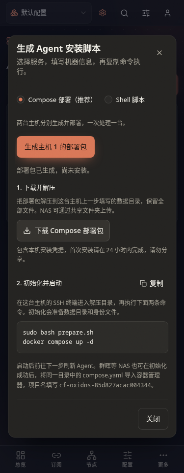

# Docker HA Compose 新安装验证（2026-10-27）

在测试服务器 192.168.0.32 使用当前分支 Dockerfile 实际构建 Linux/amd64 镜像，运行专用 Docker daemon、PID/mount/network namespace 与私有 bridge/veth；临时 ConfigFlow 后端开启全局注册密钥。未连接真实 NAS、正式 LAN 或 PVE，也未重新验证双宿主 HA 切换。

Host 和 Macvlan 两种真实 Compose 安装均通过：

- Host 将 ZIP 直接解压到数据目录，Macvlan 使用独立下载目录；`prepare.sh` 不登记设备，`docker compose up -d` 才完成真实注册与在线心跳。
- 宿主身份和持久 bootstrap 目录只读挂载；Agent 返回 HA environment ready。安装包不含管理员凭据或全局注册密钥。
- 仅将临时后端的安装会话 `expires` 设为 0，实际登记接口返回 401；普通 restart 和 force-recreate 均保持 Agent 身份，且无额外登记请求。
- 同设置重新生成并执行 prepare 后，运行中的容器能立即读取原子替换的安装设置；再次过期并重建仍正常。
- 注册后安装隔离 DNS fixture，实际 UDP 查询 `compose-lab.invalid` 在重启/重建前后均返回 `198.51.100.27`，不依赖公网 DNS。

[结果与镜像、源码 SHA256](oxidns-docker-compose-deploy-2026-10-27.json) · [实际清理结果](oxidns-docker-compose-deploy-cleanup-2026-10-27.json) · [可复用实验驱动](../../scripts/tests/oxidns_docker_compose_lab.py)

复现仅在 .32：先将驱动放到实验目录之外执行 `prepare-builder`；把对应源码的 `backend/`、`docker/` 与驱动复制到 `~/configflow-docker-compose-lab/source/`；依次运行 `build-image`、`prepare-runtime`、`test-host`、`test-macvlan`、`export-evidence`。取回公开报告后执行 `cleanup`，将其输出保存为清理记录。运行中的生成包、会话文件和凭据仅保存在私有实验目录，不应导出。

已实际停止全部临时服务并移除 namespace、veth、bridge、专用 cgroup、实验镜像缓存与含凭据的数据目录。默认 Docker/socket/containerd 仍 inactive，原宿主 TCP/UDP53 监听未变，15800/15810 预览均 HTTP 200。实验中曾因 `ip netns exec` 重挂 `/sys` 导致 daemon 看不到 cgroup2，已在其私有 mount namespace 补挂并采用专用 cgroup-parent；未改动宿主 DNS 或默认 Docker。

测试服务器上的最终定向回归为后端 226 项、前端安装向导 24 项通过，类型检查与生产构建通过。已更新测试预览 `http://192.168.0.32:15810/agents`（产品提交 `005e573e`）。实际浏览器在 1440px 浅色 Host 和 375px 深色 macvlan 下分别填写两台主机并下载 ZIP，共 4 个部署包；五个文件、网络参数、capabilities 和只读挂载校验通过。长命令未常显，切换 Shell 与旧容器迁移入口正常，无横向溢出、页面错误或新增 Agent。临时 ZIP 已删除。

